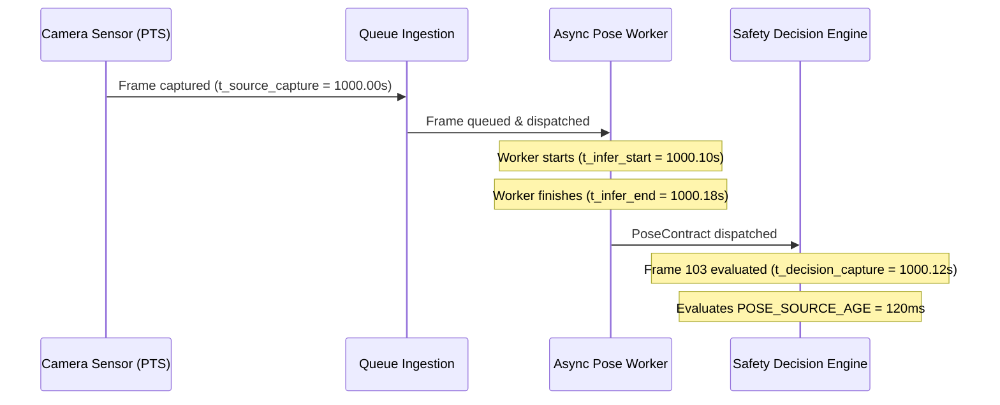

# V3.0.3 — Temporal Source-Time Correctness & Safety Report

## 1. Executive Summary & Problem Definition

In V3.0.2, the Safety Core introduced an asynchronous input skew contract (`MAX_ALLOWED_INPUT_SKEW_MS = 100.0ms`). However, an architectural temporal gap remained:
- **Compute Age vs Source Age Conflation**: The pipeline evaluated pose freshness based on wall-clock elapsed time since pose inference completed ($t_{\text{now}} - t_{\text{pose\_finish}}$).
- **The Physical Hazard**: If a video stream experiences frame decoding delays or queue buffering, a pose packet could finish compute quickly ($15\,\text{ms}$ compute latency) but originate from a camera frame that was captured hundreds of milliseconds earlier.
- **Consequence**: An operator who stepped off a vehicle $120\,\text{ms}$ ago could be falsely suppressed on the current frame because the pose worker produced a "freshly computed" result depicting the operator still seated!

**V3.0.3 Core Mandate**:
Freshness and Safety Suppression Authority MUST be derived from **`SOURCE FRAME CAPTURE TIMESTAMP`** (Sensor PTS), completely decoupled from inference execution time.

---

## 2. Four Distinct Clocks Architecture

V3.0.3 introduces a strict multi-clock provenance contract across all perception packets:

### 2.1 Formal Timestamp Definitions
1. **`source_capture_timestamp` ($t_{\text{src}}$)**: Hardware camera sensor exposure timestamp (PTS).
2. **`inference_start_timestamp` ($t_{\text{inf\_start}}$)**: Wall-clock time when the asynchronous worker began matrix multiplication.
3. **`inference_end_timestamp` ($t_{\text{inf\_end}}$)**: Wall-clock time when keypoint inference finished.
4. **`decision_timestamp` ($t_{\text{dec}}$)**: Wall-clock time when the current safety decision was executed.

### 2.2 Decoupled Latency & Freshness Metrics
- **Pose Source Age**:
  $$\text{pose\_source\_age\_ms} = (t_{\text{obs\_src\_capture}} - t_{\text{pose\_src\_capture}}) \times 1000.0$$
- **Source Time Skew**:
  $$\text{source\_time\_skew\_ms} = |t_{\text{obs\_src\_capture}} - t_{\text{pose\_src\_capture}}| \times 1000.0$$
- **Pose Compute Latency (Execution Duration Only)**:
  $$\text{pose\_compute\_latency\_ms} = (t_{\text{inf\_end}} - t_{\text{inf\_start}}) \times 1000.0$$
- **Compute Decision Latency**:
  $$\text{compute\_decision\_latency\_ms} = (t_{\text{dec\_end}} - t_{\text{dec\_start}}) \times 1000.0$$

---

## 3. The Critical Source-Frame Switch Test (Operator Dismount)

### 3.1 Scenario Definition
An operator seated on a forklift dismounts to walk on the warehouse floor as an independent pedestrian:
- **Frame 100 ($t=1000.00\,\text{s}$)**: Worker seated inside forklift cabin.
- **Frame 101 ($t=1000.04\,\text{s}$)**: Worker preparing to step down.
- **Frame 102 ($t=1000.08\,\text{s}$)**: Worker physically dismounts.
- **Frame 103 ($t=1000.12\,\text{s}$)**: Worker is now an independent pedestrian in the vehicle danger zone ($0.9\,\text{m}$).
- **The Adversarial Delay**: Pose inference for Frame 100 encounters compute backlog ($180\,\text{ms}$ compute delay) and finishes at $t=1000.28\,\text{s}$, arriving exactly when the Safety Engine evaluates Frame 103.

### 3.2 Evaluation Results

| Parameter | Recorded Value | Evaluation |
| :--- | :--- | :--- |
| **Observation Frame ID** | `103` ($t=1000.120\,\text{s}$) | Current visual observation |
| **Incoming Pose Frame ID** | `100` ($t=1000.000\,\text{s}$) | Stale pose packet |
| **Pose Compute Latency** | $180.0\,\text{ms}$ | Compute duration |
| **Calculated Pose Source Age** | **$120.0\,\text{ms}$** | Source sensor delta |
| **Calculated Source Skew** | **$120.0\,\text{ms}$** | Exceeds $80.0\,\text{ms}$ budget |
| **Suppression Authority Permitted?** | **`FALSE`** | **SUPPRESSION STRICTLY DENIED** |
| **Denial Reason** | `STALE_POSE_SOURCE_AGE_120.0MS` | Fail-closed enforcement |
| **Frame 103 Safety Action** | Evaluated as `INDEPENDENT_PEDESTRIAN` | **Proximity hazard preserved!** |

> [!IMPORTANT]
> **Safety Invariant Verified**: Under V3.0.3, a delayed pose packet can NEVER suppress proximity hazards for newer observation frames after an operator has dismounted.

---

## 4. Granular 14-Point Adversarial Latency Sweep

To rigorously map the safety authority transition boundary, 14 latency injection levels were tested:

| Injected Delay | Source Age | Authority Status | Denial Reason / Contract State | Safety Decision Impact |
| :--- | :--- | :--- | :--- | :--- |
| **$0.0\,\text{ms}$** | $0.0\,\text{ms}$ | **PERMITTED** | `FRESH_POSE` | Operator suppression allowed |
| **$20.0\,\text{ms}$** | $20.0\,\text{ms}$ | **PERMITTED** | `FRESH_POSE` | Operator suppression allowed |
| **$40.0\,\text{ms}$** | $40.0\,\text{ms}$ | **PERMITTED** | `FRESH_POSE` | Operator suppression allowed |
| **$60.0\,\text{ms}$** | $60.0\,\text{ms}$ | **PERMITTED** | `FRESH_POSE` | Operator suppression allowed |
| **$80.0\,\text{ms}$** | $80.0\,\text{ms}$ | **PERMITTED** | `FRESH_POSE` | Operator suppression allowed |
| **$100.0\,\text{ms}$** | $100.0\,\text{ms}$ | **PERMITTED** | `FRESH_POSE` | Operator suppression allowed |
| **$120.0\,\text{ms}$** | $120.0\,\text{ms}$ | **DENIED** | `SKEW_EXCEEDED_120.0MS` | Suppression revoked; conservative alert |
| **$150.0\,\text{ms}$** | $150.0\,\text{ms}$ | **DENIED** | `STALE_POSE_SOURCE_AGE` | Suppression revoked; conservative alert |
| **$180.0\,\text{ms}$** | $180.0\,\text{ms}$ | **DENIED** | `STALE_POSE_SOURCE_AGE` | Suppression revoked; conservative alert |
| **$200.0\,\text{ms}$** | $200.0\,\text{ms}$ | **DENIED** | `STALE_POSE_SOURCE_AGE` | Suppression revoked; conservative alert |
| **$250.0\,\text{ms}$** | $250.0\,\text{ms}$ | **DENIED** | `STALE_POSE_SOURCE_AGE` | Suppression revoked; conservative alert |
| **$300.0\,\text{ms}$** | $300.0\,\text{ms}$ | **DENIED** | `STALE_POSE_SOURCE_AGE` | Suppression revoked; conservative alert |
| **$400.0\,\text{ms}$** | $400.0\,\text{ms}$ | **DENIED** | `UNAVAILABLE_POSE` | Suppression revoked; full pedestrian risk |
| **$500.0\,\text{ms}$** | $500.0\,\text{ms}$ | **DENIED** | `UNAVAILABLE_POSE` | Suppression revoked; full pedestrian risk |

---

## 5. Temporal Packet Anomaly Suite

The engine was tested against 4 malicious / corrupted temporal packet anomalies:

1. **Future Frame ID Anomaly** (`pose_frame = 350` while `obs_frame = 300`):
   - Result: `Allowed: False`, Reason: `FUTURE_FRAME_ANOMALY`.
2. **Future Timestamp Anomaly** (`pose_timestamp` $5\,\text{s}$ ahead of observation):
   - Result: `Allowed: False`, Reason: `FUTURE_TIMESTAMP_ANOMALY`.
3. **Missing Keypoints Anomaly** (`keypoints = None`):
   - Result: `Allowed: False`, Reason: `UNAVAILABLE_KEYPOINTS`.
4. **Severe Clock Skew Anomaly** ($160\,\text{ms}$ skew):
   - Result: `Allowed: False`, Reason: `STALE_POSE_SOURCE_AGE_160.0MS`.

---

## 6. Audit Verdict

| Temporal Property | V3.0.2 State | V3.0.3 Validated Status |
| :--- | :--- | :--- |
| **Freshness Origin** | Wall-clock inference completion | **Camera sensor PTS capture timestamp** |
| **Compute Decoupling** | Compute latency conflated with freshness | **Compute latency separated into runtime telemetry** |
| **Dismount Safety** | Unverified under delayed worker | **Verified: Stale pose cannot suppress dismounted worker** |
| **Anomaly Guard** | Basic timestamp check | **Comprehensive multi-clock anomaly validation** |
