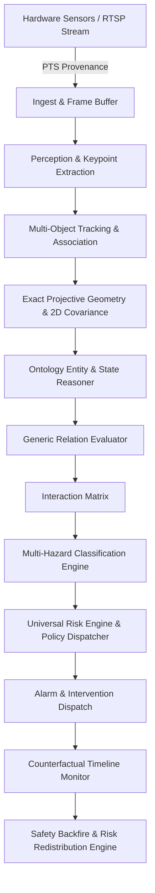

# V3.1 — System Architecture & Dataflow Specification

## 1. Architectural Overview

Safety Backfire AI V3.1 transforms the perception pipeline from a tightly coupled pairwise detector into a decoupled, layered safety intelligence architecture. The pipeline separates:
- **What is directly sensed** (pixels, keypoints, bounding boxes, hardware timestamps).
- **What is inferred geometrically** (3D warehouse floor positions, uncertainty covariances).
- **What is categorized ontologically** (entities, operational states, spatial zones).
- **What relationships exist** (clearance distances, approach velocities, structural dependencies).
- **What hazards emerge** (collisions, collapses, egress blocks, nip-point entrapments).
- **What safety decisions are commanded** (alarms, speed reductions, candidate reviews).
- **What unintended consequences occur post-intervention** (Safety Backfire).

---

## 2. Layer-by-Layer Architectural Decomposition

### Layer 1: Ingestion & Temporal Provenance Contract
- **Responsibility:** Ingests raw video frames while strictly binding hardware presentation timestamps (PTS) and wall-clock ingest timestamps.
- **Contract:** Creates an immutable `ProvenanceRecord` containing `sensor_id`, `source_frame_id`, `capture_timestamp`, and `ingest_timestamp`.
- **Latency Guard:** Drops frames if processing latency $\Delta t > 0.50\,\text{s}$, transitioning pipeline status to `ODDStatus.DEGRADED`.

### Layer 2: Perception & Feature Extraction
- **Responsibility:** Detects bounding boxes, segmentation masks, COCO keypoints (17 points), and environmental cues (liquid sheen, smoke).
- **Failure Mode Defense:** When classification confidence is low ($c < 0.60$), the module outputs `PersonSubtype.UNKNOWN_PERSON` rather than hallucinating specific operator or pedestrian classes (defends against **FAIL-31**).

### Layer 3: Tracking & Association Layer
- **Responsibility:** Multi-object tracker maintaining unique `track_id` sequences using appearance and spatial Hungarian association.
- **Independence:** Tracks are decoupled from persistent semantic `EntityID`. If a track dropout exceeds 60 frames ($2.0\,\text{s}$), the kinematic state is cleared, preventing phantom high-speed resurrection (defends against **FAIL-37**).

### Layer 4: 3D Projective Geometry & Uncertainty Propagation
- **Responsibility:** Transforms pixel coordinates $(u, v)$ to warehouse ground coordinates $(X_w, Y_w, 0)$ using exact projective ray-plane intersection and homography.
- **Elevation Compensation:** Integrates V3.0.5 `METHOD_E` closed-form projective elevation shift for forklift cabins ($Z = 1.40\,\text{m}$) and pedestrian heads ($Z = 1.70\,\text{m}$), eliminating perspective parallax.
- **Uncertainty Model:** Propagates image localization variance through the homography Jacobian:
  $$\mathbf{\Sigma}_{\text{world}} = \mathbf{J}_{\mathbf{H}} \, \mathbf{\Sigma}_{\text{pixel}} \, \mathbf{J}_{\mathbf{H}}^T$$
  Maintains coverage factor $k = 2.24$ with 2nd-order Jensen debiasing to guarantee $>95\%$ empirical coverage (defending against **FAIL-23** and **FAIL-28**).

### Layer 5: Ontology Entity & State Reasoner
- **Responsibility:** Maps low-level detections into typed `EntityBase` subclasses:
  - `PersonEntity`: Posture (`UPRIGHT`, `CROUCHED`, `FALLING`, `PRONE`), PPE status, cabin coupling.
  - `VehicleEntity`: Vehicle type, fork elevation, load presence, motion state.
  - `StorageStructureEntity`: Rack integrity, vertical tilt angle, structural loading state.
  - `LoadEntity`: Pallet load stability, overhang distance, tilt vector.
  - `MachineEntity`: Operational state (`RUNNING`, `MAINTENANCE`, `E_STOP`), exposed moving components.
  - `InfrastructureEntity`: Aisle boundaries, pedestrian crossings, dock doors, fire egress corridors.

### Layer 6: Generic Relation Evaluator
- **Responsibility:** Computes all active relations between entity pairs $(E_i, E_j)$:
  - Spatial clearance $d_{\text{min}}$ between 2D floor convex polygons.
  - Approach velocity $v_{\text{approach}} = -\frac{d}{dt} \|\mathbf{p}_i - \mathbf{p}_j\|$.
  - Kinematic Time-To-Collision (TTC) and Closest Point of Approach (CPA).
  - Topological zone containment (using ground contact footpoints, defending against **FAIL-32**).
  - Structural support relationships (e.g. `Pallet_01` supported by `Rack_04`).

### Layer 7: Interaction Matrix & Multi-Hazard Engine
- **Responsibility:** Filters valid $(E_i, E_j)$ pairs through the warehouse interaction matrix.
- **Hazard Classification:** Evaluates against the 20 controlled hazard types in `HazardTaxonomy`. Decouples static threats ($v \approx 0$) from kinematic threats (defending against **FAIL-34**).

### Layer 8: Universal Risk Engine & Multi-Policy Dispatcher
- **Responsibility:** Dispatches each candidate hazard to its specialized safety policy:
  - `CollisionPolicy`: Retains validated V3.0.5 2D Rice engine with FAIL-29 kinetic decoupling.
  - `StructuralCollapsePolicy`: Decoupled from TTC; triggered by rack deflection and proximity.
  - `ObstructionPolicy`: Protects emergency egress routes and aisles.
  - `MachineryPolicy`: Evaluates maintenance worker exposure to un-isolated machinery.
  - `ZoneIntrusionPolicy`: Flags unauthorized pedestrian or vehicle entry into restricted zones.
  - `EnvironmentalPolicy`: Evaluates liquid spills, low-friction zones, and dock edge drops.
  - `ManDownPolicy`: Detects fallen workers using multi-cue aspect ratio and torso angles.
- **Decoupled ID Model:** Emits structured decisions with independent IDs: `DEC_xxxxxx`, `EVT_xxxxxx`, `EP_xxxxx`, `PAIR_xx_yy`, `HZ_xxxxx`, `ALT_xxxxx`.

### Layer 9: Counterfactual Intervention & Safety Backfire Engine
- **Responsibility:** Evaluates intervention outcomes across pre- and post-intervention time windows.
- **Temporal Causal Barrier:** Enforces strict boundary verification to prevent late-arriving frames from contaminating baseline statistics (defending against **FAIL-33**).
- **Risk Redistribution Analysis:** Computes spatial migration of risk across warehouse zones and flags newly introduced hazards (defending against **FAIL-36**).

---

## 3. Data Integrity & Concurrency Architecture

1. **Lockless Decoupled Queues:** Thread communication between ingestion, inference, and reasoning utilizes bounded queues with non-blocking condition variables (defending against **FAIL-14** and **FAIL-21**).
2. **Deterministic Reproducibility:** Every pipeline execution given an identical stream of hardware timestamps, calibrations, and detections produces bitwise identical decision graphs.
3. **Fail-Closed Safety Guarantee:** If any module raises an uncaught exception, memory fault, or timeout, the pipeline falls closed to `ODDStatus.OUT_OF_DOMAIN` and issues a candidate review alert.
