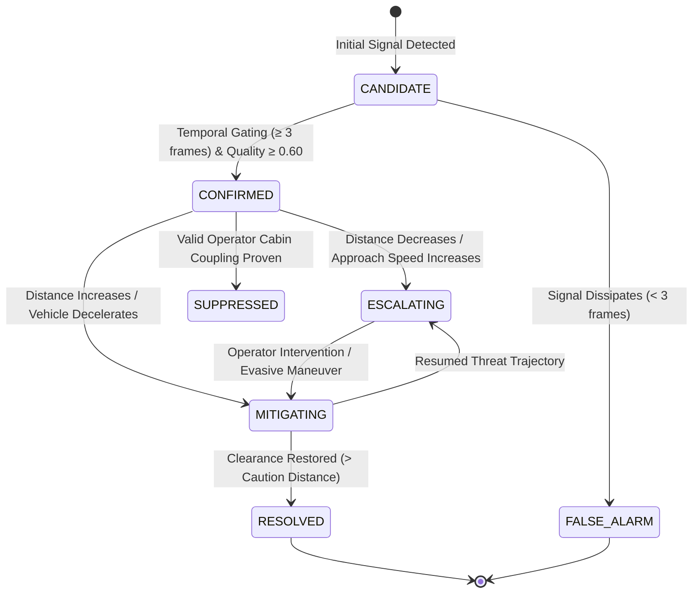

# V3.1 — Multi-Hazard Taxonomy & Lifecycle State Machine

## 1. Overview & Architectural Role

The **V3.1 Multi-Hazard Engine** classifies warehouse risk into 20 controlled, standardized hazard types. Prior versions treated all risks as either collision or man-down. V3.1 establishes a complete taxonomy of kinematic, structural, mechanical, environmental, and infrastructure hazards.

---

## 2. Complete 20-Hazard Taxonomy

```text
HazardType
├── Kinetic & Trajectory Hazards
│     ├── COLLISION_HAZARD (Converging moving entities on collision course)
│     ├── STRUCK_BY_HAZARD (Moving vehicle or payload striking worker)
│     ├── CRUSH_HAZARD (Worker caught between vehicle and fixed wall/rack)
│     ├── PINCH_POINT_HAZARD (Body part caught in articulated mechanical joints)
│     └── PROXIMITY_HAZARD (Static or slow encroachment within safety buffer)
├── Structural & Gravitational Hazards
│     ├── COLLAPSE_HAZARD (Structural failure of rack columns, uprights, or bays)
│     ├── FALLING_OBJECT_HAZARD (Dislodged pallet, carton, or elevated item)
│     └── UNSAFE_LOAD_HAZARD (Tilted, off-center, or unsecured elevated cargo)
├── Mechanical & Industrial Equipment Hazards
│     ├── MACHINERY_EXPOSURE_HAZARD (Unauthorized proximity to active machine)
│     └── ENTRAPMENT_HAZARD (Worker drawn into rotating rollers or conveyors)
├── Workplace Life Safety & Infrastructure Hazards
│     ├── BLOCKED_EGRESS_HAZARD (Obstruction of designated fire exit doors/routes)
│     ├── BLOCKED_AISLE_HAZARD (Impassable pallet or vehicle blocking main transit)
│     └── FIRE_ACCESS_HAZARD (Blocked fire extinguishers or emergency shutoffs)
├── Zone & Spatial Intrusion Hazards
│     ├── PEDESTRIAN_ZONE_INTRUSION (Pedestrian entering automated vehicle zone)
│     ├── VEHICLE_ZONE_INTRUSION (Forklift entering pedestrian-only walkway)
│     └── BLIND_CORNER_HAZARD (High-speed intersection approach with occluded view)
├── Environmental & Surface Hazards
│     ├── SPILL_SLIP_HAZARD (Liquid chemical, oil, or water on transit surface)
│     └── DOCK_EDGE_HAZARD (Unprotected drop-off at loading bay edge)
├── Human Physical Condition Hazards
│     └── FALL_HAZARD (Worker slip, trip, fall, or collapse / Man-Down)
└── Epistemic Fallback Hazard
      └── UNKNOWN_HAZARD (Anomaly detected but unclassified; Fail-Closed)
```

---

## 3. Hazard Lifecycle State Machine

Every detected hazard transitions through a deterministic, hysteretic finite state machine:



### Lifecycle Transition Criteria:
1. **`CANDIDATE`:** Single-frame detection or weak relational cue ($c_{\text{hazard}} \ge 0.40$).
2. **`CONFIRMED`:** Persistent evidence across $\ge 3$ consecutive frames with aggregate evidence quality $\ge 0.60$. Triggers alarm dispatch and policy escalation.
3. **`ESCALATING`:** Clearance distance decreasing ($v_{\text{approach}} > 0.5\,\text{m/s}$) or structural deflection angle increasing.
4. **`MITIGATING`:** Evasive braking detected; separation distance expanding.
5. **`RESOLVED`:** Separation distance exceeds caution threshold ($d > 3.0\,\text{m}$) for $\ge 30$ frames ($1.0\,\text{s}$).
6. **`SUPPRESSED`:** Confirmed operator cabin coupling. Suppresses self-collision alarms while maintaining outer vehicle-environment monitoring.

---

## 4. Static vs Kinetic Hazard Separation

A foundational advancement in V3.1 is the formal decoupling of **Kinetic Threats** from **Static Threats**:

$$\text{HazardCategory} = \begin{cases} \text{KINETIC\_TRAJECTORY} & \text{if } v_{\text{approach}} > 0.3\,\text{m/s} \text{ and } \text{TTC} < \infty \\ \text{STATIC\_PROXIMITY} & \text{if } v_{\text{approach}} \le 0.3\,\text{m/s} \text{ and } d \le d_{\text{danger}} \\ \text{STRUCTURAL\_THREAT} & \text{if } \text{Type} \in \{\text{COLLAPSE}, \text{FALLING\_OBJECT}, \text{UNSAFE\_LOAD}\} \\ \text{INFRASTRUCTURE\_OBSTRUCTION} & \text{if } \text{Type} \in \{\text{BLOCKED\_EGRESS}, \text{BLOCKED\_AISLE}\} \end{cases}$$

This mathematical distinction prevents stationary hazards (such as an unstable load ready to collapse or a blocked fire exit) from being falsely marked as `SAFE` simply because relative velocity is zero (**FAIL-34**).
