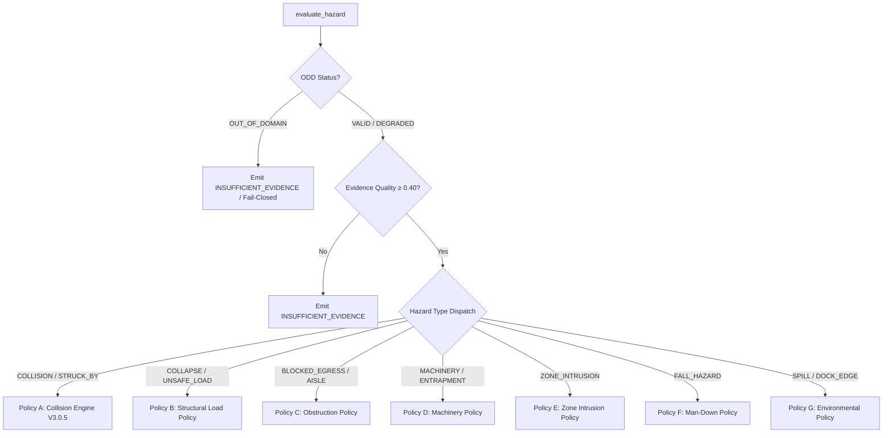

# V3.1 — Universal Risk Engine Specification & Policy Dispatch

## 1. Overview & Formal Mission

The **V3.1 Universal Risk Engine** serves as the central safety-decision authority for Safety Backfire AI. It evaluates classified hazards against formal statistical safety criteria, physical limits, and operational context to produce actionable risk decisions.

The engine guarantees two foundational principles:
1. **Preservation of Validated V3.0.5 Guarantees:** 100% preservation of the calibrated 2D Rice uncertainty distribution ($k = 2.24$), second-order Jensen debiasing, and FAIL-29 kinetic trajectory decoupling.
2. **Entity-Agnostic Extensibility:** Dispatching to specialized safety policies covering structural, mechanical, infrastructure, and environmental hazards.

---

## 2. Statistical Formulation & Uncertainty Gating

### 2.1 2D Rice Distribution & Coverage Factor ($k = 2.24$)
In warehouse floor coordinates $(X, Y)$, Euclidean separation distance $R = \sqrt{\Delta X^2 + \Delta Y^2}$ follows a Rice distribution when errors in $X$ and $Y$ are Gaussian with variance $\sigma^2$:
$$p(R \mid \nu, \sigma) = \frac{R}{\sigma^2} \exp\left( -\frac{R^2 + \nu^2}{2\sigma^2} \right) I_0\left( \frac{R\nu}{\sigma^2} \right)$$
where $\nu = \sqrt{\mu_X^2 + \mu_Y^2}$ is the true non-central separation and $I_0$ is the modified Bessel function of the first kind.

To guarantee $95\%$ statistical coverage under conservative industrial standards, V3.1 maintains the coverage factor derived in V3.0.4/V3.0.5:
$$k = 2.24 \implies P(R_{\text{true}} \le R_{\text{est}} + 2.24 \sigma_R) \ge 0.95$$

### 2.2 Second-Order Jensen Debiasing
Because the Euclidean distance function $g(X, Y) = \sqrt{X^2 + Y^2}$ is strictly convex, Jensen's inequality dictates that $\mathbb{E}[g(X, Y)] \ge g(\mathbb{E}[X], \mathbb{E}[Y])$. Uncorrected point estimates underestimate risk.
V3.1 applies the second-order Taylor correction:
$$\mathbb{E}[d] \approx d_0 + \frac{1}{2 d_0} \left( \sigma_X^2 \sin^2\theta + \sigma_Y^2 \cos^2\theta \right)$$
preventing false optimistic distance estimates near critical boundaries (**FAIL-23**).

---

## 3. Specialized Policy Dispatch Architecture

When `evaluate_hazard(hazard, ...)` is invoked, the engine applies global guards before dispatching to the appropriate domain policy:

### 3.1 Policy A: Kinetic Collision Engine (Preserving V3.0.5)
- **Inputs:** Corrected distance $d$, approach velocity $v_{\text{approach}}$, kinematic TTC, distance uncertainty $\sigma_d$.
- **FAIL-29 Trajectory Decoupling:** In the Caution Zone ($1.5\,\text{m} < d \le 3.0\,\text{m}$), if $v_{\text{approach}} > 0.3\,\text{m/s}$ and $\text{TTC} < 2.5\,\text{s}$, the system escalates directly to `CONFIRMED_DANGER`, preventing trajectory inversion defects.
- **Operator Cabin Suppression:** If pedestrian coordinates fall within the operating vehicle's bounding envelope and velocity vectors match, emits `SUPPRESSED_OPERATOR`.

### 3.2 Policy B: Structural Load Policy
- **TTC Independence:** Structural collapse risks operate with $v_{\text{rel}} \approx 0$ ($\text{TTC} = \infty$).
- **Rule:** If `StructuralState == DEFORMED` or `UNSTABLE`, and personnel distance $d \le 3.0\,\text{m}$, emits `CONFIRMED_DANGER` with `hazard_category = STRUCTURAL_THREAT` (**FAIL-34**).

### 3.3 Policy C: Infrastructure & Egress Obstruction Policy
- **Rule:** If an entity (pallet, vehicle) is stationary inside a designated `EMERGENCY_ROUTE` or `EMERGENCY_EXIT` for $\ge 3.0\,\text{s}$, emits `CONFIRMED_DANGER` with score $0.90$.

### 3.4 Policy D: Industrial Machinery Policy
- **Rule:** If an active machine (`OperationalState.OPERATIONAL`) has an un-isolated human worker within $d \le 1.0\,\text{m}$ without Lockout/Tagout verification, emits `CONFIRMED_DANGER`.

---

## 4. Decoupled ID Architecture

V3.1 permanently separates identity namespaces to avoid cross-talk, event fragmentation, and tracker ID collision (**Axiom 4**):

| Identifier | Format | Generator Responsibility | Scope & Lifecycle |
| :--- | :--- | :--- | :--- |
| `EntityID` | `ENT_xxxxxx` | Entity Reasoner | Durable persistent real-world entity |
| `PairID` | `PAIR_xxx_yyy` | Relation Engine | Active spatial-relational pair |
| `HazardID` | `HZ_xxxxxx` | Hazard Engine | Persistent physical hazard instance |
| `EventID` | `EVT_xxxxxx` | Risk Engine | Single-frame evaluation slice |
| `EpisodeID` | `EP_xxxxx` | Temporal Event Manager | Contiguous hazard event with hysteresis |
| `DecisionID`| `DEC_xxxxxx` | Risk Engine | Immutable risk evaluation record |
| `AlertID` | `ALT_xxxxx` | Dispatch Manager | Throttled user-facing alarm notification |
