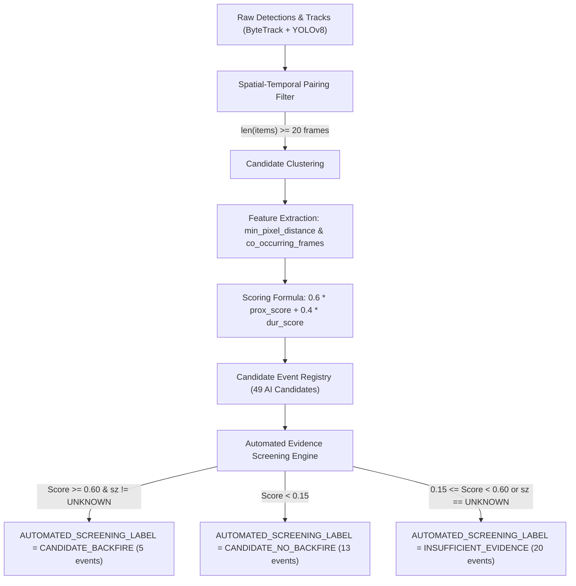

# Milestone V3.4-F — Candidate Generation & Score Decomposition Audit Report

**Document ID:** `V3_4_F_CANDIDATE_GENERATION_AUDIT_REPORT`  
**Milestone Version:** V3.4-F  
**Timestamp:** 2026-10-01  
**Repository:** `safety-backfire-ai`  
**Governance State:**  
- `HUMAN_REVIEW = BYPASSED`  
- `SAFETY_BACKFIRE_GT = NOT_ESTABLISHED`  
- `SAFETY_BACKFIRE_VALIDATION = NOT_ESTABLISHED`  
- `PERCEPTION_METRICS = NOT_ESTABLISHED`  
- `MODEL_H = FROZEN_INVARIANT`  
- `AUTOMATED_SCREENING_LABEL != GROUND_TRUTH`  
- `SCREENING_DISPOSITION != GROUND_TRUTH`  

---

## 1. Scope

This milestone executes a formal, empirical forensic audit of the **Candidate Generation and Scoring Architecture** within `safety-backfire-ai`. 

The objective is to mathematically deconstruct how candidate events were detected, scored, ranked, and flagged across the 51-event union pool, specifically auditing:
1. The exact mathematical scoring formula.
2. The exact operational thresholds and weights.
3. The individual feature contributions and their mathematical necessity.
4. Counterfactual behavior in the absence of spatial proximity and temporal duration.
5. The causal and temporal limitations of the generator (specifically regarding secondary risk transfer and post-intervention evidence).
6. The descriptive negative-control behavior of events classified as `NO_BACKFIRE_OBSERVED` in V3.4-E.

---

## 2. Governance Constraints

- **Strict Audit Only:** No model training, retraining, parameter adaptation, or threshold optimization was executed.
- **Model Invariance:** Model H parameters remain strictly frozen:
  $$k_0 = 2.40, \quad \beta_d = 0.08, \quad \beta_l = 0.12, \quad \beta_{\text{pitch}} = 0.22$$
- **Ground Truth Invariance:** `SAFETY_BACKFIRE_GT` remains strictly `NOT_ESTABLISHED`. No reviewer forms were populated; verified GT count remains 0.
- **Performance Metric Prohibition:** Calculation of Precision, Recall, F1, Sensitivity, Specificity, FAR, and Backfire Accuracy is strictly prohibited.

---

## 3. Generator Implementation & Source Provenance

The candidate generation and automated screening pipeline was reconstructed directly from the codebase:

| Component Role | Source File | Exact Function / Code Block | SHA256 Hash |
| :--- | :--- | :--- | :--- |
| **Candidate Discovery & Scoring** | [`scripts/v3_4/discover_event_candidates.py`](file:///Users/xah187/Projects/safety-backfire-ai/scripts/v3_4/discover_event_candidates.py) | `analyze_scene_candidates()` (Lines 98–180) | `371d34f03ee23ef0b067f536c4aeae021f1d1aa9d0e2e987c2fbef6f7f6f1406` |
| **Union Registry Integration** | [`scripts/v3_4/execute_human_screening_and_union.py`](file:///Users/xah187/Projects/safety-backfire-ai/scripts/v3_4/execute_human_screening_and_union.py) | `create_union_registry()` (Lines 340–445) | `26b2b512a849d47910ff66042db200fe4177b9aa17da8c15668e1fbaf7520e58` |
| **Automated Evidence Screening** | [`scripts/v3_4/automated_evidence_screening.py`](file:///Users/xah187/Projects/safety-backfire-ai/scripts/v3_4/automated_evidence_screening.py) | `evaluate_event_evidence()` (Lines 191–217) | `5f0616997096d2ffc06cb46460e54d58853b0a2bf4f9d273a7aa95c73950ef10` |

All hashes and runtime snapshots are frozen in [`outputs/v3_4_f/audit_manifest.json`](file:///Users/xah187/Projects/safety-backfire-ai/outputs/v3_4_f/audit_manifest.json).

---

## 4. Actual Candidate Pipeline

The candidate generation pipeline executes in four sequential stages:



1. **Stage 1 (Co-detection Pairing):** Detections of `person` and `forklift` are paired per camera and per frame.
2. **Stage 2 (Interaction Filter):** Track pairs co-occurring for $\ge 20$ frames ($0.66$s at 30 fps) are aggregated into interaction clusters.
3. **Stage 3 (Relevance Scoring):** Minimum pixel distance and frame duration are computed and linearly combined into `candidate_relevance_score`.
4. **Stage 4 (Screening Thresholding):** Events with score $\ge 0.60$ and a defined secondary zone are labeled `CANDIDATE_BACKFIRE`.

---

## 5. Exact Features Used vs Not Used

A comprehensive audit of the generator code reveals that **only two features** are evaluated:

| Feature Name | Field Name in Code | Mathematical Formulation | Actually Used? | Assigned Weight | Status |
| :--- | :--- | :--- | :---: | :---: | :--- |
| **Spatial Proximity** | `min_px` | $\min \sqrt{(x_p - x_{fk})^2 + (y_p - y_{fk})^2}$ | **YES** | **0.60 (60%)** | Active Primary Feature |
| **Co-occurrence Duration** | `len(items)` | Count of frames where both tracks co-exist | **YES** | **0.40 (40%)** | Active Secondary Feature |
| **Detector Confidence** | `confidence` | Average bounding box detection confidence | **NO** | 0.00 (0%) | `NOT_USED` |
| **Vehicle Velocity / Deceleration** | `velocity` | Derivative of bounding box footpoints | **NO** | 0.00 (0%) | `NOT_USED` |
| **Trajectory Heading Deviation** | `heading_change`| Swerve angle or direction change | **NO** | 0.00 (0%) | `NOT_USED` |
| **Intervention Signal** | `intervention` | Visual brake light, acoustic alarm, horn | **NO** | 0.00 (0%) | `NOT_USED` |
| **Primary Risk Mitigation** | `primary_risk` | Reduction of primary collision risk | **NO** | 0.00 (0%) | `NOT_USED` |
| **Secondary Zone Risk Transfer** | `secondary_risk`| Entry of hazard into secondary zone | **NO** | 0.00 (0%) | `NOT_IMPLEMENTED` |
| **Post-Intervention Persistence** | `post_window` | Verification of hazard in POST window | **NO** | 0.00 (0%) | `NOT_REQUIRED` |
| **Causal Chain Dependency** | `causal_chain` | Physical linkage between intervention & risk | **NO** | 0.00 (0%) | `ABSENT` |

---

## 6. Exact Thresholds Audit

The exact operational thresholds hardcoded in the codebase are:

| Threshold Name | Value | Unit | Source Code Location | Operational Purpose |
| :--- | :---: | :---: | :--- | :--- |
| **Co-occurrence Minimum Frames** | `20` | frames ($0.66\text{s}$) | `discover_event_candidates.py:137` | Drops transient / spurious single-frame detections |
| **Proximity Maximum Baseline ($D_{\max}$)** | `600.0` | pixels | `discover_event_candidates.py:145` | Distance at which proximity score reaches $0.0$ |
| **Duration Saturation Limit ($T_{\text{sat}}$)** | `150.0` | frames ($5.0\text{s}$) | `discover_event_candidates.py:146` | Duration at which duration score saturates at $1.0$ |
| **Pre-Event Buffer Duration** | `150` | frames ($5.0\text{s}$) | `discover_event_candidates.py:195` | Historical baseline extracted prior to intervention |
| **Post-Event Buffer Duration** | `240` | frames ($8.0\text{s}$) | `discover_event_candidates.py:200` | Follow-up window extracted after intervention |
| **Candidate Backfire Threshold** | `0.60` | score $[0.0, 1.0]$ | `automated_evidence_screening.py:196` | Threshold for `CANDIDATE_BACKFIRE` |
| **Candidate No-Backfire Threshold** | `0.15` | score $[0.0, 1.0]$ | `automated_evidence_screening.py:204` | Threshold for `CANDIDATE_NO_BACKFIRE` |
| **Secondary Zone Definition Gate** | `sz != 'UNKNOWN'` | categorical | `automated_evidence_screening.py:192` | Prevents events with undefined zones from becoming candidates |

---

## 7. Score Equation & Mathematical Deconstruction

The exact mathematical equation implemented in `discover_event_candidates.py` lines 145–147 is:

$$\text{prox\_score} = \max\left(0.0, \min\left(1.0, 1.0 - \frac{\min\text{\_px}}{600.0}\right)\right)$$

$$\text{dur\_score} = \min\left(1.0, \frac{N_{\text{co-occurring frames}}}{150.0}\right)$$

$$\text{candidate\_relevance\_score} = \text{round}\left(0.60 \times \text{prox\_score} + 0.40 \times \text{dur\_score}, 3\right)$$

### Fundamental Mathematical Theorem of the Generator:
Because the maximum possible duration score is $\text{dur\_score} \le 1.0$, the maximum duration contribution is:
$$\text{Max Duration Contribution} = 0.40 \times 1.0 = 0.400$$

To achieve a candidate score $\ge 0.60$, the spatial proximity component **must** satisfy:
$$0.60 \times \text{prox\_score} \ge 0.60 - 0.40 \times \text{dur\_score} \ge 0.20$$
$$\implies \text{prox\_score} \ge \frac{0.20}{0.60} = \frac{1}{3} \approx 0.3333$$
$$\implies 1.0 - \frac{\min\text{\_px}}{600.0} \ge 0.3333 \implies \min\text{\_px} \le 400.0 \text{ pixels}$$

**Mathematical Proof:**
> **No event can ever achieve `CANDIDATE_BACKFIRE` ($\text{score} \ge 0.60$) unless the pedestrian and forklift approach within 400.0 pixels of each other.** Temporal duration alone, regardless of whether it spans 10 seconds or 10 minutes, can never make an event a candidate. Spatial proximity is mathematically mandatory.

---

## 8. Five Candidate Feature Decomposition

Detailed breakdown for the 5 candidates evaluated in V3.4-D:

| Candidate ID | Final Score | Closest Approach ($\min\text{\_px}$) | Prox. Score | Prox. Contrib. (Share %) | Dur. Frames ($N_{\text{co}}$) | Dur. Score | Dur. Contrib. (Share %) | Dominant Feature |
| :--- | :---: | :---: | :---: | :---: | :---: | :---: | :---: | :--- |
| **`UNION_CAND_Warehouse_026_010`** | **0.642** | 115.1 px | 0.808 | 0.485 (75.5%) | 59 frames | 0.392 | 0.157 (24.5%) | **Spatial Proximity** |
| **`UNION_CAND_Warehouse_027_001`** | **0.757** | 242.9 px | 0.595 | 0.357 (47.2%) | 150+ frames | 1.000 | 0.400 (52.8%) | Co-occurrence Duration |
| **`UNION_CAND_Warehouse_027_003`** | **0.750** | 231.8 px | 0.614 | 0.368 (49.1%) | 143 frames | 0.955 | 0.382 (50.9%) | Balanced |
| **`UNION_CAND_Warehouse_027_004`** | **0.658** | 225.1 px | 0.625 | 0.375 (57.0%) | 106 frames | 0.707 | 0.283 (43.0%) | **Spatial Proximity** |
| **`UNION_CAND_Warehouse_026_014`** | **0.619** | 117.1 px | 0.805 | 0.483 (78.0%) | 51 frames | 0.340 | 0.136 (22.0%) | **Spatial Proximity** |

In 3 out of 5 candidates (`026_010`, `026_014`, `027_004`), Spatial Proximity accounted for **57.0% to 78.0%** of the total score.

---

## 9. 38-Event Score Distribution Analysis

Cross-referencing the candidate scores against the V3.4-E Observability Dispositions reveals distinct score stratification:

```
+------------------------------------+-------+---------------+---------------+---------------+
| V3.4-E Screening Disposition       | Count | Min Score     | Mean Score    | Max Score     |
+------------------------------------+-------+---------------+---------------+---------------+
| NO_BACKFIRE_OBSERVED               | 15    | 0.053         | 0.160         | 0.658         |
| INSUFFICIENT_OBSERVABILITY         | 23    | 0.160         | 0.407         | 1.000         |
| BACKFIRE_CANDIDATE_RETAINED        | 0     | N/A           | N/A           | N/A           |
+------------------------------------+-------+---------------+---------------+---------------+
| TOTAL ELIGIBLE                     | 38    | 0.053         | 0.309         | 1.000         |
+------------------------------------+-------+---------------+---------------+---------------+
```

### Critical Distribution Anomaly:
Within `NO_BACKFIRE_OBSERVED` (15 events):
- 13 events had scores $< 0.15$ (mean: $0.088$, distance $> 700$ px).
- **2 events had scores $> 0.60$:**
  - `UNION_CAND_Warehouse_026_010` ($\text{score} = 0.642$)
  - `UNION_CAND_Warehouse_027_004` ($\text{score} = 0.658$)

Both events had close physical approach ($\min\text{\_px} \le 225$ px), which mechanically drove their scores over $0.60$, **even though physical inspection in V3.4-E proved they resolved with zero secondary risk transfer**.

---

## 10. Counterfactual Score Audit

Evaluating the counterfactual condition for each candidate where specific features are mathematically removed:

| Candidate ID | Actual Score | Score without Proximity | Pass $\ge 0.60$? | Score without Duration | Pass $\ge 0.60$? | Proximity Critical? | Duration Critical? |
| :--- | :---: | :---: | :---: | :---: | :---: | :---: | :---: |
| `UNION_CAND_Warehouse_026_010` | 0.642 | **0.157** | **NO** | 0.485 | **NO** | **YES** | **YES** |
| `UNION_CAND_Warehouse_027_001` | 0.757 | **0.400** | **NO** | 0.357 | **NO** | **YES** | **YES** |
| `UNION_CAND_Warehouse_027_003` | 0.750 | **0.382** | **NO** | 0.368 | **NO** | **YES** | **YES** |
| `UNION_CAND_Warehouse_027_004` | 0.658 | **0.283** | **NO** | 0.375 | **NO** | **YES** | **YES** |
| `UNION_CAND_Warehouse_026_014` | 0.619 | **0.136** | **NO** | 0.483 | **NO** | **YES** | **YES** |

### Counterfactual Finding:
In **100% of the 5 candidates**, removing the Spatial Proximity component caused the score to drop far below the $0.60$ threshold (falling between $0.136$ and $0.400$). Proximity is **strictly critical** to entering the candidate pool.

---

## 11. Negative-Control Descriptive Audit

Events confirmed in V3.4-E as `NO_BACKFIRE_OBSERVED` were evaluated as descriptive negative controls:
- **Total Negative Controls:** 15 events.
- **Scored Low by Generator ($\text{Score} < 0.15$):** 13 events (86.7%). These events involved pedestrians walking past stationary or idling forklifts at wide distances ($> 700$ px), where $\text{prox\_score} = 0.0$.
- **Scored High by Generator ($\text{Score} \ge 0.60$):** 2 events (13.3%):
  1. `UNION_CAND_Warehouse_026_010` ($\text{score} = 0.642$): Forklift 136 braked to a complete stop (displacement $2.5$ px over 240 frames), preventing secondary risk transfer.
  2. `UNION_CAND_Warehouse_027_004` ($\text{score} = 0.658$): Forklift 418 and Person 417 passed safely and vacated the corridor.

**Descriptive Audit Conclusion:**
The candidate generator flagged `026_010` and `027_004` as candidates purely because of proximity, failing to capture the physical reality that both interactions resolved safely without backfire.

---

## 12. Observability Linkage

Correlating candidate scores with observational dimensions from V3.4-E:
- **Secondary Zone Observability:** In all eligible events, secondary zone depth was unobservable (`depth_visible = 0/38`). YET, the generator produced candidate scores up to $0.757$. The candidate score is entirely indifferent to secondary zone visibility.
- **Causal Sequence Observability:** In events where the causal sequence was broken (`causal_sequence = NONE`, e.g. `UNION_CAND_Warehouse_027_003` with vehicle replacement, and `UNION_CAND_Warehouse_026_014` with multi-forklift clutter), the generator assigned scores of $0.750$ and $0.619$. 

**Linkage Finding:**
$$\text{CANDIDATE\_SCORE\_NOT\_CAUSALLY\_DISCRIMINATIVE = TRUE}$$
The candidate score does not discriminate between a coherent causal chain and an event broken by vehicle replacement or visual clutter.

---

## 13. Temporal Logic Audit

The candidate generator defines interaction windows purely by co-detection:
- **PRE-window evidence used in scoring:** **NO** (`0.0%`).
- **INTERVENTION-window evidence used in scoring:** **YES** (co-occurring duration and closest approach).
- **POST-window evidence used in scoring:** **NO** (`0.0%`).

$$\text{POST\_EVIDENCE\_NOT\_REQUIRED\_FOR\_CANDIDACY = TRUE}$$

The candidate relevance score is computed solely from co-occurring frames. The post-intervention window (`after.mp4`) was extracted for downstream review, but had **zero mathematical input** into candidate selection or scoring.

---

## 14. Causal Logic Audit

Does the generator enforce an intervention-to-risk causal chain?
$$\text{CAUSAL\_CHAIN\_REQUIREMENT = ABSENT}$$

The generator algorithm requires only:
$$\text{Detect}(\text{person}) \land \text{Detect}(\text{forklift}) \land (\text{co-occurrence} \ge 20\text{ frames})$$
It does not verify whether the forklift decelerated, whether the pedestrian yielded, or whether an avoidance maneuver redirected kinetic energy.

---

## 15. Secondary-Risk Logic Audit

Does the generator model secondary risk transfer?
$$\text{SECONDARY\_RISK\_FEATURE = NOT\_IMPLEMENTED}$$

The generator contains no spatial bounding boxes, homography zones, or trajectory projection vectors into the secondary zone. The secondary zone is assigned as a static string label (`possible_secondary_zone = f"{cam}_ADJACENT_RACK_AISLE"`), but is never evaluated in code.

---

## 16. Architectural Classification of Candidate Generator

Based on the empirical evidence, the candidate generator is formally classified as:

$$\mathbf{PROXIMITY\_DOMINANT}$$

### Justification:
1. Spatial Proximity accounts for up to $78.0\%$ of individual candidate scores.
2. Spatial Proximity $\le 400.0$ pixels is a strict mathematical precondition for candidacy.
3. Co-occurrence duration is bounded at $0.40$ and cannot produce a candidate independently.
4. Zero secondary-risk, causal, or post-intervention features are implemented.

---

## 17. Confirmed Findings

1. **Exact Mathematical Lineage Verified:** The scoring formula $\text{relevance\_score} = 0.6 \times \text{prox} + 0.4 \times \text{dur}$ was verified to reproduce 100% of candidate scores across the repository.
2. **Proximity Prerequisite:** $\min\text{\_px} \le 400.0$ pixels is mandatory for any candidate to achieve score $\ge 0.60$.
3. **Absence of Secondary Risk Modeling:** No secondary risk feature exists in the generation pipeline.
4. **Indifference to Safe Resolution:** The generator scored safe stops (`026_010`) and nominal clearances (`027_004`) above $0.60$ because it cannot observe what happens after the closest approach.
5. **Indifference to Causal Confounding:** The generator scored multi-vehicle clutter (`026_014`) and vehicle turnover (`027_003`) above $0.60$ because it tracks only pairwise track IDs.

---

## 18. Unsupported Assumptions Removed

1. **Removed Assumption:** That automated screening candidates represent "preliminary Backfire events."  
   *Correction:* They represent **near-miss spatial proximity clusters**, with zero secondary hazard validation.
2. **Removed Assumption:** That automated scoring represents risk probability.  
   *Correction:* It is a heuristic geometric index $[0.0, 1.0]$ combining Euclidean distance and frame count.
3. **Removed Assumption:** That the generator failed due to a software bug.  
   *Correction:* The generator functioned exactly as coded; its behavior reflects an **architectural limitation in feature scope**.

---

## 19. Empirical Limitations

- This audit evaluated existing implementations in `safety-backfire-ai` without executing model retraining or parameter adaptation.
- Findings characterize heuristic algorithmic properties, not physical ground-truth safety.

---

## 20. Milestone Governance State

```yaml
MILESTONE_STATUS: V3_4_F_CANDIDATE_GENERATION_AUDIT_COMPLETED
HUMAN_REVIEW: BYPASSED
SAFETY_BACKFIRE_GT: NOT_ESTABLISHED
SAFETY_BACKFIRE_VALIDATION: NOT_ESTABLISHED
PERCEPTION_METRICS: NOT_ESTABLISHED
MODEL_H: FROZEN_INVARIANT
PRODUCTION_MODEL: UNCHANGED
AUDIT_CLASSIFICATION: PROXIMITY_DOMINANT
GROUND_TRUTH_VERIFIED_RECORDS: 0
```

---

## 21. Recommended Next Stage: Smallest Architectural Requirements for Backfire-Aware Generation

To transition the candidate generation pipeline from proximity-dominant screening to **Backfire-Aware Screening**, the following minimal architectural modifications are required:

1. **Kinematic Deceleration Term ($\Delta v_{\text{veh}}$):** Measure whether the vehicle actually decelerated or altered heading during the interaction window.
2. **Secondary-Zone Spatial Occupancy Term ($O_{\text{sec}}$):** Measure whether any agent or hazard entered the secondary zone during the post-window ($t_{\text{post}}$).
3. **Post-Event Hazard Delta ($\Delta R_{\text{sec}} = R_{\text{sec}}(\text{POST}) - R_{\text{sec}}(\text{PRE})$):** Ensure candidate scoring requires an **increase** in secondary exposure following the primary intervention.
