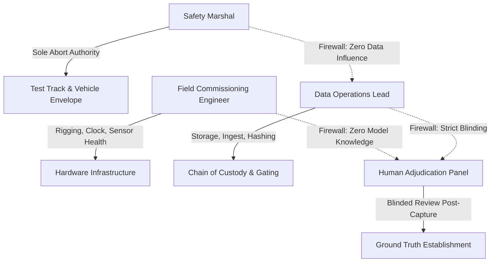

# FIELD PILOT EXECUTION STANDARD OPERATING PROCEDURE (SOP)
## Milestone V3.4-L — Field Execution Design

---

### 1. Document Overview & Mandatory Invariants
This document provides the step-by-step Standard Operating Procedure (SOP) for field engineering teams, safety marshals, and instrumentation technicians executing the physical pilot campaign designed in V3.4-L.

> [!CAUTION]
> **GOVERNANCE & ETHICS MANDATE:**
> 1. This document is a **FIELD EXECUTION DESIGN** specification. It **DOES NOT** authorize physical recording until all Pre-Capture Commissioning Gates are satisfied.
> 2. **ZERO HUMAN HAZARD RULE:** Under no circumstances shall any human being stand, walk, or enter the dynamic vehicle travel envelope, stopping buffer, or secondary diversion corridor during testing.
> 3. Production Model & Model H are **FROZEN INVARIANTS**. Model parameters ($k_0=2.40, \beta_d=0.08, \beta_l=0.12, \beta_{\text{pitch}}=0.22$) are never tuned or modified.

---

### 2. Operational Roles and Safety Separation of Duties

To prevent operational conflicts of interest and ensure unbiased scientific capture, roles are strictly segregated:



1. **Safety Marshal (SM):**
   - Independent safety authority with sole, uninhibited control of the primary remote wireless E-Stop.
   - Positioned in elevated, unoccluded vantage point outside the exclusion fence.
   - Does NOT participate in data analysis or candidate scoring.
2. **Field Commissioning Engineer (FCE):**
   - Responsible for sensor mounting torque, optical focus, PTP grandmaster synchronization, and CAN bus decoders.
   - Enforces Pre-Capture Commissioning Gates C1 through C6.
3. **Data Operations Lead (DOL):**
   - Oversees local NVMe storage arrays, live network throughput monitoring, write-blocker engagement, and SHA-256 cryptographic manifest generation.
   - Enforces Post-Capture Data Quality Gates D1 through D6.
4. **Human Adjudication Panel (HAP):**
   - Operates strictly downstream and offline. Receives sanitized, blinded review packages only after Gate D6 passes.

---

### 3. Chronological Daily Execution Sequence

The field campaign follows a mandatory, strictly linear 10-step daily sequence:

```mermaid
sequenceDiagram
    autonumber
    participant SM as Safety Marshal
    participant FCE as Field Engineer
    participant DOL as Data Lead
    participant SYS as DAQ System
    participant VEH as Test Vehicle

    Note over SM,VEH: PHASE 1: PRE-CAPTURE COMMISSIONING
    FCE->>SYS: Power on PTP Grandmaster & Network
    SYS-->>FCE: Verify PTP Lock (Clock Class 6, Satellites >= 8)
    FCE->>SYS: Align and lock Cameras A, B, C, D (Focus, Aperture, Torque)
    FCE->>VEH: Connect CAN Bus Tap; verify speed/brake telemetry streams
    FCE->>SYS: Place physical calibration target in secondary zone at 20m depth
    SYS-->>FCE: Confirm secondary_depth_visible = TRUE
    FCE->>DOL: Submit Commissioning Manifests (Gates C1-C6)
    DOL-->>FCE: State: INSTRUMENTATION_READY_FOR_CAPTURE

    Note over SM,VEH: PHASE 2: ACTIVE CAPTURE (CONTROLLED / NATURALISTIC)
    SM->>SM: Perform physical sweep of perimeter exclusion zone
    SM->>DOL: Arm Remote Wireless SIL-3 E-Stop; Authorize Run
    DOL->>SYS: Start Multi-Modal Ingest Recording Session
    VEH->>VEH: Execute Designated Run (Controlled L01-L09 or Naturalistic)
    SYS-->>DOL: Run Concluded Nominally (No Abort Tripped)
    DOL->>SYS: Close and lock event recording container

    Note over SM,VEH: PHASE 3: POST-CAPTURE QUALITY GATING
    DOL->>DOL: Verify Stream Completeness & Clock Monotonicity (Gates D1-D2)
    DOL->>DOL: Compute SHA-256 Hashes and Merkle Root (Gate D3-D4)
    DOL->>DOL: Verify Replayability & Blinding Sanitization (Gates D5-D6)
    DOL-->>DOL: State: DATASET_READY_FOR_REVIEW
```

---

### 4. Step-by-Step SOP Instructions

#### Step 4.1: Facility Safety Sweep & Perimeter Lock
1. Verify exclusion perimeter fence (1.8m height) is completely latched.
2. Confirm optical safety light curtains at vehicle entrance/exit are aligned.
3. Test physical hardwired E-Stop stations along corridor perimeter.
4. Test wireless Safety Marshal E-Stop pendant; verify vehicle traction cutoff within $\le 50\text{ ms}$.

#### Step 4.2: PTP Time Synchronization Lock (Gate C1)
1. Verify GNSS antenna has line-of-sight to sky; confirm $\ge 8$ satellites locked with DGPS/RTK fix.
2. Verify Grandmaster status: `clock_class = 6`, `current_state = LOCKED_AND_CALIBRATED`.
3. Check hardware slave nodes:
   - Cameras A, B, C, D: Measured offset mean $\le 100\,\mu\text{s}$, P99 $\le 500\,\mu\text{s}$ (component limit $\le 5.0\text{ ms}$).
   - CAN Gateway: Measured offset $\le 1.0\text{ ms}$ (component limit $\le 10.0\text{ ms}$).
   - Secondary LiDAR/Radar: Measured offset $\le 500\,\mu\text{s}$ (component limit $\le 5.0\text{ ms}$).
4. Verify composite system skew $\le 33.33\text{ ms}$.

#### Step 4.3: Optical Alignment & Rigid Mounting (Gate C2 & C5)
1. Check camera mounting brackets: torque wrench inspection at $9.5\text{ N}\cdot\text{m}$.
2. Inspect mechanical lens barrel: focus ring locked with set-screws; aperture locked at $f/2.8$ or $f/4.0$.
3. Image plane inspection: run checkerboard target across field; reprojection error must be $\le 1.5\text{ px}$.
4. Record camera manifest to `commissioning_manifest.json`.

#### Step 4.4: CAN Telemetry Validation (Gate C3)
1. Initialize vehicle CAN tap; verify non-intrusive high-impedance listen-only mode.
2. Execute low-speed shakedown ($1.0\text{ m/s}$); monitor live telemetry:
   - Speed: monotonic, continuous, units in $\text{m/s}$.
   - Brake pressure / state: continuous boolean/bar reading.
   - Yaw rate & steering angle: zero drift during straight roll.
3. Verify zero packet drops over 5-minute roll.

#### Step 4.5: Secondary Hazard Zone Verification (Gate C4)
1. Deploy certified reflective calibration mannequin at designated secondary depth limit ($20.0\text{ m}$ into cross-aisle).
2. Verify Camera C (and auxiliary LiDAR/UWB if equipped) achieves $\ge 65\text{ px/m}$ resolution on the mannequin.
3. Confirm absence of blind obstruction pockets along cross-aisle trajectory.
4. Toggle `secondary_depth_visible_state = TRUE_FIELD_PROVEN` in manifest.

#### Step 4.6: Executing Controlled Trials (Scenarios L01–L09)
1. Select target trial from [controlled_trial_matrix.json](file:///Users/xah187/Projects/safety-backfire-ai/outputs/v3_4_l/controlled_trial_matrix.json).
2. Position automated foam dummy or certified mannequin at specified corridor/aisle waypoint.
3. Brief vehicle test driver or set autonomous AGV mission profile.
4. Execute `RUN_BASELINE` first; verify nominal multi-modal recording.
5. Execute `RUN_INTERVENTION`; monitor vehicle speed, deceleration onset, swerve angle, and secondary approach.
6. Verify no abort condition tripped during execution.

#### Step 4.7: Naturalistic Capture Shift Monitoring
1. Stagger naturalistic shifts across morning, afternoon, and night lighting conditions.
2. Keep DAQ recording passively without alerting or interacting with warehouse material handlers.
3. Flag any incident involving sudden brake or diversion for immediate post-shift packaging.

#### Step 4.8: Post-Capture Data Ingest & Integrity Gating (Gates D1–D6)
1. Immediately mount recording volume in read-only write-blocked mode.
2. Execute automated data completeness script (`verify_event_package.py`).
3. Check for dropped frames, missing CAN packets, or timestamp non-monotonicity.
4. Compute SHA-256 hashes of all raw feeds; generate package Merkle root.
5. Compile sanitized review package (strictly excluding all AI scores, bounding boxes, or model risks).
6. Sign off chain-of-custody transfer log.

---

### 5. Immediate Action upon Abort Condition
If any condition in [abort_criteria.json](file:///Users/xah187/Projects/safety-backfire-ai/outputs/v3_4_l/abort_criteria.json) triggers:
1. **Safety Marshal:** Press E-Stop immediately.
2. **Vehicle Operator:** Confirm vehicle comes to complete mechanical stop.
3. **Data Lead:** Mark active event record as `ABORTED_<REASON>`. Do NOT delete raw data; archive it under `aborted_runs/` for audit.
4. **Resumption Protocol:** Testing cannot resume until Safety Marshal signs physical incident clearance and Field Engineer re-runs Gates C1–C6.
