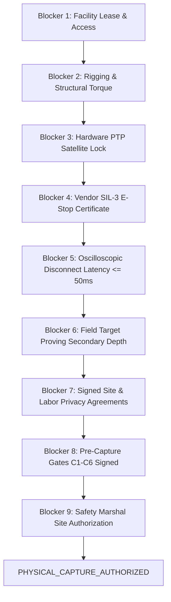

# V3.4-M — Physical Field Pilot Release Blockers
## Milestone V3.4-M: Pre-Deployment Consistency & Safety Audit

---

### Executive Declaration

```
========================================================================================
CURRENT MILESTONE STATUS:   CONSISTENCY_CLEARED_FOR_PHYSICAL_COMMISSIONING
PHYSICAL CAPTURE STATUS:    NOT_GRANTED_BY_V3_4_M (STRICTLY PROHIBITED)
DESIGN CONSISTENCY STATUS:  PASS (10/10 AUDITS CLEARED)
========================================================================================
```

Milestone **V3.4-M** successfully audits, reconciles, and clears all internal contradictions within the **engineering design specification**. However, clearing design consistency does **NOT** grant authorization for physical field recording.

Physical capture remains **BLOCKED** until every hardware, physical, legal, and operational prerequisite listed below is formally satisfied and verified on-site.

---

### Category A: Design Inconsistencies Audited & Cleared by V3.4-M

The following table documents the design contradictions that were resolved within V3.4-M, enabling the specification to achieve the status `CONSISTENCY_CLEARED_FOR_PHYSICAL_COMMISSIONING`:

| Audit Domain | Pre-V3.4-M Defect | V3.4-M Authoritative Resolution | Status |
| :--- | :--- | :--- | :--- |
| **Sync Budget Arithmetic** | 13.33 ms erratum vs 15.33 ms reserve | Fixed at exactly $18.00\text{ ms} + 15.33\text{ ms} = 33.33\text{ ms}$. | **CLEARED** |
| **Component vs Composite** | Fault limits conflated with nominal budget | Layer A (Trip Limits) separated from Layer D (Allocations). | **CLEARED** |
| **Pre-Window Baseline** | 1.5s diagram vs 3.0s text | Standardized to $T_{\text{pre}} \ge 3.0\text{ s}$ with dynamic velocity extension. | **CLEARED** |
| **$\tau$ Latency Semantics** | Conflated with sensor delay / wait time | Mathematically bounded to $\tau \triangleq t_{\text{sec\_onset}} - t_{\text{int\_start}} \le 2.0\text{ s}$. | **CLEARED** |
| **Camera Configuration** | Disparity between SOP and optional D | Min: A+C; Rec: A+B+C; Opt: D. | **CLEARED** |
| **Secondary Observability** | Gate C4 vs Scenario L07 conflict | Decoupled into Baseline Observability vs Induced Occlusion. | **CLEARED** |
| **Abort Taxonomy** | DAQ errors lumped with E-Stop | Bifurcated; DAQ failure strictly isolated from vehicle brakes. | **CLEARED** |
| **E-Stop Claims** | Presented as established system traits | Classified as Vendor Certification & Field Acceptance Test. | **CLEARED** |
| **Human Exposure** | Ambiguous "vehicle test driver" | Formalized Remote, Autonomous, and Protected Cab modes. | **CLEARED** |
| **Storage Architecture** | Writable ingest volume write-blocked | Staged: Fast Capture $\rightarrow$ Session Close $\rightarrow$ Hash $\rightarrow$ WORM. | **CLEARED** |
| **Provenance Claims** | Asserted "legal admissibility" | Replaced by tamper-evident cryptographic traceability. | **CLEARED** |
| **Privacy Claims** | Asserted "eliminates PII" | Purged; explicit Non-Anonymity declaration codified. | **CLEARED** |
| **Reviewer Count** | Fluctuated between 2 and 3 reviewers | Fixed at 2 Blinded Reviewers + 1 Lead Adjudicator. | **CLEARED** |
| **Test Verification Count**| 37 vs 58 check confusion | Verified exactly 58 checks (100% test pass rate). | **CLEARED** |

---

### Category B: Mandatory Physical & Operational Blockers (Must Be Cleared Before First Physical Recording)

Physical field recording cannot begin until the following nine physical blockers are formally cleared:



#### Blocker 1: Physical Facility Procurement & Layout Survey
- **Requirement:** Execution of commercial facility lease providing a continuous primary corridor $\ge 35.0\text{ m}$, cross-aisle depth $\ge 25.0\text{ m}$, floor flatness meeting DIN 18202 Table 3 Group 4, and surface friction $\mu \ge 0.55$.
- **Verification:** On-site certified Total Station and Laser Tracker survey report with ground plane RMS error $\le 3.0\text{ mm}$.
- **Responsible Party:** Facility Operations Lead & Geodetic Surveyor.

#### Blocker 2: Mechanical Rigging & Torque Wrench Inspection
- **Requirement:** Physical installation of rigid, vibration-damped extruded aluminum / steel camera mounting trusses with mechanical lock pins.
- **Verification:** Calibrated torque wrench inspection certifying all clamp bolts tightened to $9.5\text{ N}\cdot\text{m}$; lens focus and aperture barrel set-screws sealed with tamper-evident paint.
- **Responsible Party:** Mechanical Rigging Engineer.

#### Blocker 3: Hardware PTP Grandmaster Satellite Lock
- **Requirement:** Roof-mounted high-gain GNSS antenna connected to IEEE 1588-2019 Grandmaster clock.
- **Verification:** Continuous hardware lock with $\ge 8$ satellites, `clock_class = 6`, RTK/DGPS carrier fix, and 30-minute pre-trial burn-in showing zero step corrections and jitter $\le 250\,\mu\text{s}$.
- **Responsible Party:** Time Synchronization Engineer.

#### Blocker 4: Third-Party Vendor SIL-3 / Cat 4 E-Stop Certification
- **Requirement:** Dedicated industrial wireless emergency stop system.
- **Verification:** Inspection of vendor CE/TÜV notified body certificate proving compliance with IEC 61508 SIL-3 and ISO 13849-1 Category 4 / PLe.
- **Responsible Party:** Safety Systems Engineer.

#### Blocker 5: Empirical Oscilloscopic Verification of Traction Power Cutoff ($\le 50\text{ ms}$)
- **Requirement:** Physical disconnection latency of vehicle traction power upon pressing the wireless E-Stop.
- **Verification:** Oscilloscope trace capturing time delta from E-Stop switch contact opening to main contactor de-energization; latency must measure $\le 50.0\text{ ms}$.
- **Responsible Party:** Electrical Safety Specialist.

#### Blocker 6: Physical Deployment Proving Secondary Zone Observability
- **Requirement:** Physical placement of certified reflective calibration mannequin at $20.0\text{ m}$ depth in the secondary cross-aisle.
- **Verification:** Optical resolution audit confirming $\ge 65\text{ px/m}$ across target torso and zero critical blind pockets; manifest signed transitioning `secondary_depth_visible_state` to `TRUE_FIELD_PROVEN`.
- **Responsible Party:** Optical Perception Lead.

#### Blocker 7: Executed Site & Worker Privacy Agreements
- **Requirement:** Formal institutional authorization governing naturalistic capture.
- **Verification:** Executed bilateral data-governance agreement between Research Consortium, Facility Management, and Labor Safety Representatives acknowledging non-anonymous video capture and mandating 36-month retention.
- **Responsible Party:** Principal Investigator & Legal Counsel.

#### Blocker 8: Pre-Capture Commissioning Gates (C1 through C6) Signoff
- **Requirement:** Passing all six commissioning gates on physical hardware:
  - `Gate C1 (Clock)`: Multi-modal skew $\le 33.33\text{ ms}$; component limits respected.
  - `Gate C2 (Camera)`: All streams healthy, zero frame drops, $350 \pm 50\text{ lux}$.
  - `Gate C3 (CAN)`: Monotonic telemetry, zero packet gaps, valid SI units.
  - `Gate C4 (Secondary)`: Physical target proven at $20\text{ m}$.
  - `Gate C5 (Calibration)`: Intrinsic/extrinsic reprojection error $\le 1.5\text{ px}$.
  - `Gate C6 (Geometry)`: Ground plane and zone polygons surveyed.
- **Verification:** Digitally signed `commissioning_manifest.json` committing state to `INSTRUMENTATION_READY_FOR_CAPTURE`.
- **Responsible Party:** Field Engineering Team.

#### Blocker 9: Safety Marshal Site Clearance Manifest
- **Requirement:** Final physical walkthrough inspection immediately prior to capture session.
- **Verification:** Safety Marshal confirms exclusion perimeter latched, light curtains armed, test proxies calibrated, and signs physical clearance manifest.
- **Responsible Party:** Safety Marshal.

---

### Conclusion

Until all Category B Blockers are satisfied, the operational state remains:

$$\mathbf{INSTRUMENTATION\_DESIGN\_COMPLETE \quad \nrightarrow \quad PHYSICAL\_CAPTURE\_AUTHORIZED}$$

Physical capture is **STRICTLY PROHIBITED**.
