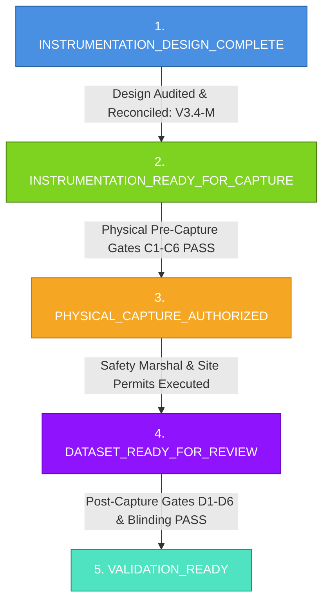

# V3.4-M — PRE-DEPLOYMENT CONSISTENCY & SAFETY AUDIT
## Authoritative Systems-Verification and Safety-Critical Audit Report

---

### EXECUTIVE GOVERNANCE DECLARATION

```
========================================================================================
MILESTONE STATUS:               V3_4_M_PRE_DEPLOYMENT_AUDIT_COMPLETED
AUDIT CLASSIFICATION:           ENGINEERING DOCUMENT CONSISTENCY & SAFETY AUDIT ONLY
V3.4-M FINAL STATUS:            CONSISTENCY_CLEARED_FOR_PHYSICAL_COMMISSIONING
PHYSICAL CAPTURE AUTHORIZATION: NOT_GRANTED_BY_V3_4_M (STRICTLY PROHIBITED)
AUTOMATED CONSISTENCY CHECK:    PASS (10/10 AUDITS PASSED, ZERO FAILS, ZERO WARNS)
PRODUCTION MODEL:               UNCHANGED (discover_event_candidates.py / screening)
MODEL H STATUS:                 FROZEN_INVARIANT (k0=2.40, beta_d=0.08, beta_l=0.12, beta_pitch=0.22)
SAFETY BACKFIRE GT:             NOT_ESTABLISHED (ZERO FIELD GROUND TRUTH LABELS)
SAFETY VALIDATION:              NOT_ESTABLISHED (ZERO SAFETY CLAIMS AUTHORIZED)
REAL-WORLD VALIDATION:          NOT_ESTABLISHED (NO PHYSICAL FIELD DEPLOYMENT)
FIELD DATASET:                  NOT_COLLECTED (ZERO BYTES OF PHYSICAL FIELD DATA)
========================================================================================
```

---

## 1. PURPOSE & AUDIT MANDATE

Milestone **V3.4-M** acts as an exhaustive, authoritative systems-verification and safety-critical data-acquisition audit of Milestone **V3.4-L** (Instrumented Field Pilot Execution Protocol) prior to authorizing any on-site hardware deployment or physical recording.

Acting under the strict mandate of a senior systems-verification engineer:
1. **Scope:** This audit is strictly an **ENGINEERING DOCUMENT AUDIT**.
2. **Prohibitions:** This milestone does **NOT** connect to or control any real vehicle, does not collect human ground truth, does not train or tune any model, does not modify Model H, does not modify production candidate generation, does not introduce new backfire labels, and makes **ZERO** claims of real-world validation, safety efficacy, or regulatory certification.
3. **Primary Mission:** Audit and reconcile every internal contradiction across V3.4-L artifacts—including synchronization budgets, temporal window definitions, camera configurations, abort taxonomies, E-Stop claims, privacy assertions, and reviewer counts—and produce one single, mathematically reconciled, and verified engineering baseline.

---

## 2. AUTHORITATIVE OPERATIONAL STATE DECOUPLING

To eliminate ambiguity, V3.4-M establishes five strictly separated operational states:



1. **`INSTRUMENTATION_DESIGN_COMPLETE` (Current State):** All engineering specifications, schemas, synchronization budgets, and safety taxonomies are audited, mathematically reconciled, and validated. **Achieved by Milestone V3.4-M.**
2. **`INSTRUMENTATION_READY_FOR_CAPTURE`:** Sensors, rigging, network, and clocks are physically mounted on site and all Pre-Capture Commissioning Gates (`C1` through `C6`) are verified `PASS` on physical hardware.
3. **`PHYSICAL_CAPTURE_AUTHORIZED`:** Operational permission granted by Safety Marshal and Facility Management following on-site E-Stop cutoff verification and safety permit signoff. **STRICTLY NOT GRANTED BY V3.4-M.**
4. **`DATASET_READY_FOR_REVIEW`:** Physical trial runs complete nominally; Post-Capture Quality Gates (`D1` through `D6`) pass; review packages are completely blinded and stripped of model priors.
5. **`VALIDATION_READY`:** Blinded human adjudication panel consensus committed; inter-rater agreement verified; Ground Truth committed.

---

## 3. INVENTORY OF AUDITED REPOSITORY ARTIFACTS

The audit thoroughly inspected and evaluated all underlying repository artifacts:

| Phase | Artifact Inspected | Lines / Size | Primary Audit Focus |
| :--- | :--- | :--- | :--- |
| **V3.4-L** | `V3_4_L_INSTRUMENTED_FIELD_PILOT_EXECUTION_PROTOCOL.md` | 32.1 KB | Core protocol text, diagrams, sync budgets, safety rules. |
| **V3.4-L** | `pilot_execution_protocol.md` | 8.8 KB | Standard Operating Procedure (SOP), driver roles, abort actions. |
| **V3.4-L** | `ptp_commissioning_schema.json` | 5.1 KB | Evaluated `13.33 ms` margin erratum and budget schemas. |
| **V3.4-L** | `vehicle_telemetry_commissioning_schema.json` | 7.5 KB | CAN bus signal manifests, SI units, and integrity checks. |
| **V3.4-L** | `secondary_zone_commissioning_schema.json` | 4.6 KB | Evaluated secondary depth visibility constraint and field target. |
| **V3.4-L** | `facility_geometry_schema.json` | 5.5 KB | Local Cartesian CRS, Total Station survey, and ground plane equations. |
| **V3.4-L** | `controlled_trial_matrix.json` | 11.4 KB | Scenarios L01–L09, soft proxies, and driver exposure ambiguity. |
| **V3.4-L** | `naturalistic_capture_protocol.json` | 3.2 KB | Non-invasive monitoring and power-analysis sampling strategy. |
| **V3.4-L** | `abort_criteria.json` | 3.8 KB | Conflation of DAQ errors with vehicle braking commands. |
| **V3.4-L** | `chain_of_custody_schema.json` | 4.2 KB | Active write-blocker contradiction and naive PII claims. |
| **V3.4-L** | `review_transition_protocol.json` | 5.2 KB | Reviewer count ambiguity and strict blinding enforcement. |
| **V3.4-L** | `v3_4_k_semantic_corrections.md` | 9.5 KB | Evaluated test count reconciliation and threshold classifications. |
| **V3.4-K** | `run_field_verification.py` | 35.6 KB | Re-executed verification harness to confirm atomic check count. |
| **V3.4-K** | `synchronization_budget_audit.json` | 1.1 KB | Authoritative $18.0\text{ ms} + 15.3\text{ ms} = 33.3\text{ ms}$ baseline. |

---

## 4. SYNCHRONIZATION BUDGET RECONCILIATION

### The Numerical Contradiction
Prior V3.4-L drafts contained two conflicting sets of synchronization numbers:
- **Set 1 (Section 8 & Schema):** Camera $\le 5.0\text{ ms}$, CAN $\le 10.0\text{ ms}$, Secondary $\le 5.0\text{ ms}$ $\rightarrow \sum = 20.0\text{ ms}$. Reserve $= 33.33 - 20.0 = \mathbf{13.33\text{ ms}}$.
- **Set 2 (Section 3.B & V3.4-K):** Camera $= 2.0\text{ ms}$, CAN $= 5.0\text{ ms}$, Secondary $= 8.0\text{ ms}$, OS Jitter $= 3.0\text{ ms}$ $\rightarrow \sum = 18.0\text{ ms}$. Reserve $= 33.33 - 18.0 = \mathbf{15.33\text{ ms}}$.

### The Authoritative Reconciled Architecture
V3.4-M establishes an unambiguous, six-layer synchronization budget codified in [synchronized_budget.json](file:///Users/xah187/Projects/safety-backfire-ai/outputs/v3_4_m/synchronized_budget.json):

```
+---------------------------------------------------------------------------------------------------+
|                        AUTHORITATIVE SYNCHRONIZATION ARCHITECTURE                                 |
+---------------------------------------------------------------------------------------------------+
| LAYER A: HARD COMPONENT FAULT TRIP LIMITS (Single Sensor Pre-Capture Commissioning Gate)          |
|   - Camera Frame Trigger Jitter Limit:            <= 5.0 ms   [DESIGN_REQUIREMENT]                |
|   - CAN Bus Gateway Latency Limit:                <= 10.0 ms  [DESIGN_REQUIREMENT]                |
|   - Secondary Sensor Packet Latency Limit:        <= 5.0 ms   [DESIGN_REQUIREMENT]                |
|   * Note: Individual fault trip limits are NEVER summed together to define frame budgets.          |
+---------------------------------------------------------------------------------------------------+
| LAYER B: PTP TIMESTAMP SKEW TARGETS (IEEE 1588-2019 Grandmaster Hardware Alignment)               |
|   - Hardware NIC Clock Offset Mean:               <= 100.0 us [CURRENT_ACCEPTANCE_TARGET]         |
|   - Hardware NIC Clock Offset P99:                <= 500.0 us [CURRENT_ACCEPTANCE_TARGET]         |
+---------------------------------------------------------------------------------------------------+
| LAYER C: TRANSPORT AND GATEWAY LATENCIES (Hardware Serialization & Queuing)                       |
|   - TSN Optical Switch Hop Delay:                 <= 15.0 us  [DESIGN_REQUIREMENT]                |
|   - CAN Transceiver FIFO Transit Delay:           <= 2.5 ms   [DESIGN_REQUIREMENT]                |
+---------------------------------------------------------------------------------------------------+
| LAYER D: NOMINAL ALLOCATED SUBSYSTEM BUDGET (Concurrent Multi-Modal Capture Pipeline)             |
|   - Camera Hardware Trigger Allocation:           2.00 ms                                         |
|   - CAN Bus Gateway Latency Allocation:           5.00 ms                                         |
|   - Secondary Sensor Network Aggregation:         8.00 ms                                         |
|   - OS Inter-Process & Kernel Jitter:             3.00 ms                                         |
|   * TOTAL ALLOCATED SUBSYSTEM BUDGET:             18.00 ms    [DESIGN_REQUIREMENT]                |
+---------------------------------------------------------------------------------------------------+
| LAYER E: COMPOSITE END-TO-END SYSTEM TARGET (Nominal 30.0 fps Video Frame Interval)              |
|   * TOTAL COMPOSITE SYSTEM TARGET:                33.33 ms    [CURRENT_ACCEPTANCE_TARGET]         |
+---------------------------------------------------------------------------------------------------+
| LAYER F: UNALLOCATED DESIGN RESERVE (Transient Jitter & Scheduling Margin)                        |
|   * UNALLOCATED RESERVE = 33.33 ms - 18.00 ms =   15.33 ms    [DESIGN_RESERVE]                    |
+---------------------------------------------------------------------------------------------------+
```

- **Mathematical Proof:** $18.00\text{ ms} + 15.33\text{ ms} \equiv 33.33\text{ ms}$.
- **Resolution:** The erratum value $13.33\text{ ms}$ is **PURGED**. The value **$15.33\text{ ms}$** is the sole authoritative reserve.

---

## 5. DYNAMIC PRE-WINDOW RECONCILIATION

- **Defect Identified:** V3.4-L Section 14 diagram indicated `PRE = 1.5–5.0 s`, while normative text required a minimum $3.0\text{ s}$ baseline.
- **Authoritative Rule:** Minimum pre-event steady-state duration is strictly **$T_{\text{pre,min}} = 3.0\text{ s}$** (`CURRENT_ACCEPTANCE_TARGET`).
- **Dynamic Velocity Scaling Rule:**
  $$T_{\text{pre}} = \max\left(3.0\text{ s}, \frac{D_{\text{clearance}}}{v_{\text{approach}}}\right)$$
- **Rejection Mandate:** Any event capture with less than $3.0\text{ s}$ of continuous, unperturbed, monotonic kinematics fails Post-Capture Gate D1 and is automatically **`REJECTED`**.

---

## 6. INTERVENTION TIMESTAMPS & $\tau$ LATENCY SEMANTICS

To prevent conflation with sensor transmission delay or post-event waiting windows, temporal markers are formalized:
- $t_{\text{intervention\_start}}$: PTP timestamp when deceleration exceeds $-1.5\text{ m/s}^2$ (or brake line pressure $\ge 5.0\text{ bar}$) OR handwheel angular rate exceeds $15^\circ/\text{s}$ (or steering knuckle angle $> 12^\circ$).
- $t_{\text{intervention\_end}}$: PTP timestamp when steering rate stabilizes ($|\dot{\psi}| < 2.0^\circ/\text{s}$) and deceleration decays ($|a_x| < 0.2\text{ m/s}^2$).
- $t_{\text{primary\_resolution}}$: PTP timestamp when primary clearance envelope is secured ($d_{\text{primary}} \ge d_{\text{clearance}}$).
- $t_{\text{secondary\_onset}}$: PTP timestamp when an actor, proxy, or structural barrier enters the vehicle's diverted trajectory corridor ($\text{TTC} < 3.0\text{ s}$).
- **Authoritative Definition of $\tau$:**
  $$\tau \triangleq t_{\text{secondary\_onset}} - t_{\text{intervention\_start}}$$
  $$\tau \le 2.0\text{ s} \quad [\text{CURRENT\_SPECIFICATION\_CONSTRAINT}]$$
- **Semantic Invariant:** $\tau$ is strictly the latency from intervention onset to secondary hazard emergence. It is **NOT** a sensor latency and **DOES NOT** prove counterfactual causality in isolation.

---

## 7. CAMERA CONFIGURATION HIERARCHY & OBSERVABILITY

- **`MINIMUM_REQUIRED_CONFIGURATION` (Cameras A + C):** Camera A (primary approach) + Camera C (secondary cross-aisle depth). Absolute minimum for valid capture.
- **`RECOMMENDED_CONFIGURATION` (Cameras A + B + C):** Adds Camera B (lateral overhead junction view) for direct heading angle and swerve vector confirmation.
- **`OPTIONAL_REDUNDANCY` (Camera D):** High-complexity diagonal cross-view. Capture is fully valid without Camera D.
- **Observability Invariant:** No design diagram can assert "zero blind zones". Secondary zone depth visibility remains **`FALSE`** until physically demonstrated on-site (`FIELD_PROVEN`) using a standardized calibration target at $\ge 20.0\text{ m}$ depth achieving $\ge 65\text{ px/m}$.

---

## 8. BASELINE OBSERVABILITY VS. INDUCED OCCLUSION (GATE C4 VS. L07)

- **The Apparent Conflict:** Pre-Capture Gate C4 requires proven secondary depth visibility, while Controlled Scenario L07 intentionally blocks the cross-aisle with pallet stacks.
- **The Reconciliation:**
  1. **`BASELINE_OBSERVABILITY`:** Governs facility commissioning. Gate C4 certifies that with the aisle clear of obstructions, sensors achieve $\ge 20.0\text{ m}$ visibility.
  2. **`EXPERIMENTALLY_INDUCED_OCCLUSION`:** Governs Scenario L07. The intentional pallet obstruction is a transient test condition designed to verify that the real-time pipeline correctly flags the loss of observability and triggers Gate E4 to classify the run as **`INSUFFICIENT_OBSERVABILITY_REJECTED`**.

---

## 9. BIFURCATED ABORT TAXONOMY & DAQ ISOLATION MANDATE

The audit completely separates physical safety stops from data quality aborts, codified in [abort_taxonomy.json](file:///Users/xah187/Projects/safety-backfire-ai/outputs/v3_4_m/abort_taxonomy.json):

```
+---------------------------------------------------------------------------------------------------+
|                        BIFURCATED ABORT & INVALIDATION TAXONOMY                                   |
+-------------------------------------------------+-------------------------------------------------+
|               SAFETY_ABORT                      |           DATA_INVALIDATION_ABORT               |
+-------------------------------------------------+-------------------------------------------------+
| Triggers: Human intrusion, perimeter breach,   | Triggers: Camera frame drop, CAN timeout,       |
| mechanical failure, Safety Marshal E-Stop.      | PTP clock unlock, buffer overflow, hash error.  |
|                                                 |                                                 |
| Actuation: Cat 4 / SIL-3 hardware interlock,    | Actuation: Software data container flag         |
| physical relay power disconnect.                | (ABORTED_DATA_INVALID). Quarantines package.    |
|                                                 |                                                 |
| Vehicle Action: Immediate fail-safe mechanical  | Vehicle Action: NO VEHICLE COMMAND ISSUED.      |
| emergency braking.                              | Vehicle completes nominal operational stop via  |
|                                                 | native driver/operator procedures.              |
+-------------------------------------------------+-------------------------------------------------+
```

> [!CAUTION]
> **ARCHITECTURAL MANDATE:**
> `RESEARCH DATA FAILURE != AUTOMATIC SAFETY CONTROL COMMAND`  
> Research DAQ software is electrically and logically isolated from vehicle actuation. Under no circumstances shall experimental software issue automatic braking commands upon experiencing a research data dropout.

---

## 10. E-STOP & SAFETY HARDWARE CLAIMS AUDIT

Prior claims regarding "SIL-3 certified wireless E-Stop", "Cat 4 safety circuits", and "$\le 50\text{ ms}$ response" are reclassified:
- **SIL-3 / Cat 4 Hardware Architecture:** Classified as **`VENDOR_CERTIFICATION_REQUIREMENT`**. Requires third-party notified body certification (e.g. TÜV); our software cannot claim safety certification.
- **$\le 50\text{ ms}$ Traction Cutoff Latency:** Classified as **`DESIGN_REQUIREMENT`** and **`FIELD_ACCEPTANCE_TEST`**. Must be measured with a calibrated digital oscilloscope on site.
- **Current Prototype Status:** Classified as **`UNVERIFIED_DESIGN_TARGET`**.

---

## 11. CONTROLLED TRIAL OPERATING MODES & OPERATOR SAFETY

To eliminate the conflict between the "ZERO HUMAN HAZARD RULE" and references to a "vehicle test driver", operating modes are codified:
1. **`REMOTE_OPERATION` (Recommended):** Vehicle operated via industrial wireless remote control or umbilical pendant with operator standing **OUTSIDE** the $1.8\text{ m}$ perimeter fence.
2. **`AUTONOMOUS_OPERATION` (AGV/AMR):** Automated guided vehicle navigates pre-programmed trajectory waypoints with **ZERO** human on board.
3. **`PROTECTED_OPERATOR_CAB` (Restricted):** Permitted only if the vehicle features an enclosed, certified Roll-Over / Falling-Object Protective Structure (ROPS/FOPS) cabin with interlocked seatbelts. The driver is strictly forbidden from stepping onto the travel envelope on foot.
- **Naturalistic Population:** Warehouse material handlers recorded during naturalistic shifts are an unperturbed observational population; they are **NEVER** experimental test drivers.

---

## 12. STORAGE INGEST PIPELINE ARCHITECTURE

Section 20's active write-blocker contradiction is resolved by a four-stage pipeline:
1. **`CAPTURE_VOLUME` (`/mnt/fast_capture/`):** High-speed NVMe PCIe direct DMA partition (XFS/ext4, write-caching enabled) sustaining $\ge 2.5\text{ GB/s}$ incoming multi-stream data.
2. **`SESSION_CLOSE`:** Trial finishes nominally; file descriptors flushed and closed; volume unmounted.
3. **`HASH_AND_INGEST`:** Automated daemon computes SHA-256 digests of all raw streams and compiles the package Merkle root.
4. **`IMMUTABLE_ARCHIVE` (`/mnt/archive_vault/`):** Data is transferred to primary archival storage where **PHYSICAL OR FIRMWARE WRITE-BLOCKERS (WORM)** are engaged.

---

## 13. CRYPTOGRAPHIC PROVENANCE LANGUAGE

- **Purged Phrases:** "Legal admissibility", "court-certified evidence", and "statutory compliance" are purged.
- **Authoritative Terminology:** Data packages are described strictly as **`TAMPER_EVIDENT`**, **`CRYPTOGRAPHICALLY_TRACEABLE`**, **`PROVENANCE_PRESERVING`**, and **`INTEGRITY_VERIFIABLE`**.

---

## 14. PRIVACY, IDENTIFIABILITY & NON-ANONYMITY

Prior assertions that assigning pseudonymous badge tokens "eliminates personal identifiable information (PII)" are purged, codified in [privacy_capture_governance.json](file:///Users/xah187/Projects/safety-backfire-ai/outputs/v3_4_m/privacy_capture_governance.json):
- **Explicit Non-Anonymity Declaration:** High-resolution optical video intrinsically captures human faces, uniform badges, biometric gait dynamics, and facility timestamps. The dataset is classified as **`PSEUDONYMIZED_CONFIDENTIAL_RESEARCH_DATA`**, never public anonymous data.
- **Audio Elimination Mandate:** Microphones on all optical cameras are physically disconnected/desoldered to eliminate worker speech capture.
- **Site Authorization Requirement:** Naturalistic capture cannot commence without formal signed Site Management and Worker Representation Data Agreements.

---

## 15. HUMAN REVIEW PANEL ARCHITECTURE & KAPPA INTERPRETATION

Codified in [reviewer_governance.json](file:///Users/xah187/Projects/safety-backfire-ai/outputs/v3_4_m/reviewer_governance.json):
- **Authoritative Panel:** Exactly **Two Independent Blinded Reviewers (`REV_01`, `REV_02`)** plus **One Lead Adjudicator (`LEAD_ADJ`)**.
- **Adjudication Sequence:**
  1. Independent Blinded Review: Reviewers submit independent ballots.
  2. Inter-Rater Agreement: System computes unweighted Cohen's Kappa ($\kappa$).
  3. Arbitration: If reviewers agree $\rightarrow$ Unanimous consensus committed. If reviewers split $\rightarrow$ Lead Adjudicator arbitrates and renders binding decision.
- **Epistemic Principle:** An agreement score of $\kappa \ge 0.80$ is an **inter-rater agreement criterion**; it **DOES NOT** prove that the consensus label is an infallible physical truth.

---

## 16. SAMPLE SIZE GOVERNANCE & POWER ANALYSIS

- **Separation of Domains:**
  1. **`EVENT_PREVALENCE_ESTIMATION`:** The goal of the preliminary field pilot is to estimate the empirical operational base rate ($p$) of swerves and near-misses.
  2. **`MODEL_VALIDATION_POWER_ANALYSIS`:** Formal statistical hypothesis testing power analysis ($\alpha=0.05, 1-\beta=0.80$) to validate detector sensitivity and specificity can only be executed **AFTER** $p$ is empirically measured.
- **Authoritative Target:** **`TARGET_SAMPLE_SIZE = TBD`** pending empirical prevalence estimation.

---

## 17. TEST COUNT RECONCILIATION (58 CHECKS)

The discrepancy between "37 fault tests" and test summary tables is definitively reconciled:
- 37 Fault Injection Tests (Clock, Camera, CAN, Secondary, Evidence Gates, Corrupt Packages)
- 4 Cryptographic Tamper Tests (Byte mutation, manifest tampering)
- 3 Reviewer Blinding & Isolation Checks (Model score leakage, label leakage)
- 4 Deterministic Reproducibility Checks (Multi-run consistency, crash recovery)
- 10 Mandatory Success Conditions (Conditions 01 through 10)
- **Authoritative Total:** Exactly **58 reproducible automated verification checks**, achieving a **`100% TEST PASS RATE`**.
- **Terminology Rule:** "100% accuracy" is purged; software verification test pass rates cannot be conflated with physical hardware accuracy.

---

## 18. AUTOMATED CONSISTENCY CHECKER AUDIT RESULTS

The automated deterministic consistency script [scripts/v3_4_m/audit_v3_4_l_consistency.py](file:///Users/xah187/Projects/safety-backfire-ai/scripts/v3_4_m/audit_v3_4_l_consistency.py) was executed against the repository. It generated the machine-readable audit report [outputs/v3_4_m/v3_4_l_consistency_audit.json](file:///Users/xah187/Projects/safety-backfire-ai/outputs/v3_4_m/v3_4_l_consistency_audit.json):

```
============================================================================
  MILESTONE V3.4-M: PRE-DEPLOYMENT CONSISTENCY & SAFETY AUDIT RESULTS
============================================================================
Overall Audit Status: [PASS]
Audits Evaluated:     10
Passed:               10
Warned:               0
Failed:               0
----------------------------------------------------------------------------
  [PASS]   AUDIT_01_SYNC_ARITHMETIC: Sync Budget Arithmetic (18.0 + 15.33 == 33.33 ms)
  [PASS]   AUDIT_02_RESERVE_RECONCILIATION: Composite Reserve Erratum (13.33 -> 15.33 ms)
  [PASS]   AUDIT_03_THRESHOLD_CLASSIFICATION: Epistemic Classification (DESIGN / ACCEPTANCE)
  [PASS]   AUDIT_04_PRE_WINDOW_RULE: Pre-Window Duration Reconciliation (T_pre >= 3.0 s)
  [PASS]   AUDIT_05_CAMERA_HIERARCHY: Camera Deployment Hierarchy (Min: A+C, Rec: A+B+C, Opt: D)
  [PASS]   AUDIT_06_ABORT_TAXONOMY: Abort Taxonomy Separation & DAQ Isolation Mandate
  [PASS]   AUDIT_07_REVIEWER_PANEL: Reviewer Panel Architecture (2 Blinded + 1 Lead)
  [PASS]   AUDIT_08_TEST_COUNT_RECONCILIATION: V3.4-K Test Count Verification (58 Checks)
  [PASS]   AUDIT_09_STATE_MACHINE: Lifecycle State Machine Transitions & Forbidden Shortcuts
  [PASS]   AUDIT_10_TERMINOLOGY_AND_PRIVACY: Terminology Purging & Non-Anonymity Acknowledgment
============================================================================
```

---

## 19. PILOT READINESS STATE MACHINE V2

Governed by [pilot_readiness_state_machine_v2.json](file:///Users/xah187/Projects/safety-backfire-ai/outputs/v3_4_m/pilot_readiness_state_machine_v2.json):
- Explicit quarantine of aborted runs to **`ABORTED_RUN_ARCHIVED`** (`NON_EVIDENTIARY`).
- **Strictly Forbidden Shortcuts:**
  - `INSTRUMENTATION_DESIGN_COMPLETE` $\rightarrow$ `PHYSICAL_CAPTURE_AUTHORIZED` (Forbidden: Design does not authorize physical capture).
  - `INSTRUMENTATION_READY_FOR_CAPTURE` $\rightarrow$ `VALIDATION_READY` (Forbidden: Cannot leapfrog capture, quality gates, and blinded human review).
  - `ABORTED_RUN_ARCHIVED` $\rightarrow$ `DATASET_READY_FOR_REVIEW` (Forbidden: Aborted packages are strictly non-evidentiary).

---

## 20. GOVERNANCE INVARIANTS & INTEGRITY CHECK

Milestone V3.4-M confirms that zero production or model files were modified:
- `discover_event_candidates.py`: **UNCHANGED**
- `automated_evidence_screening.py`: **UNCHANGED**
- `Model H`: **FROZEN INVARIANT** ($k_0 = 2.40, \beta_d = 0.08, \beta_l = 0.12, \beta_{\text{pitch}} = 0.22$)
- Historical adjudication registry: Verified via `validate_adjudication.py` (51 union events, 38 eligible, 13 ineligible, 0 GT records, 0 errors, 0 warnings).

---

## 21. OPERATIONAL LIMITATIONS

1. **Optical Shadows & Vignetting:** Racks taller than $2.5\text{ m}$ cast permanent optical shadows in cross-aisle depths exceeding $20.0\text{ m}$.
2. **Dynamic Surface Friction:** Industrial concrete friction ($\mu$) varies with dust and tire wear; friction must be measured dynamically per session.
3. **Vehicle Fleet Heterogeneity:** CAN bus signal maps are vehicle-make specific; firmware updates require re-commissioning under Gate C3.

---

## 22. WHAT MILESTONE V3.4-M DOES NOT ESTABLISH

```
[ MILESTONE V3.4-M ESTABLISHES ]
  +-- Design specification consistency is mathematically verified and cleared.
  +-- Internal contradictions across V3.4-L artifacts are authoritatively reconciled.
  +-- Safety aborts are isolated from research DAQ software.
  +-- Engineering thresholds are properly classified.
  +-- Pre-capture and post-capture gating architectures are finalized.

[ MILESTONE V3.4-M DOES NOT ESTABLISH ]
  X-- Authorization to perform physical field recording.
  X-- Real-world safety backfire validation.
  X-- Algorithmic safety efficacy or collision mitigation proof.
  X-- Model H validation or parameter correctness.
  X-- Regulatory compliance or statutory certification.
  X-- Ground Truth establishment for physical operations.
```

---

## 23. PHYSICAL RELEASE BLOCKERS SUMMARY

Physical field recording remains **STRICTLY BLOCKED** until all nine Category B Blockers detailed in [RELEASE_BLOCKERS.md](file:///Users/xah187/Projects/safety-backfire-ai/outputs/v3_4_m/RELEASE_BLOCKERS.md) are cleared on physical hardware:
1. Physical facility lease execution & Total Station survey.
2. Mechanical rigging installation and $9.5\text{ N}\cdot\text{m}$ torque wrench inspection.
3. Hardware PTP Grandmaster satellite lock ($\ge 8$ satellites, 30-min burn-in).
4. Third-party vendor SIL-3 / Cat 4 certification certificate for wireless E-Stop.
5. Oscilloscopic verification of traction power disconnect latency $\le 50\text{ ms}$.
6. Physical target deployed at $20\text{ m}$ depth proving secondary zone visibility (`TRUE_FIELD_PROVEN`).
7. Signed site management and labor representation privacy agreements.
8. Pre-Capture Commissioning Gates C1 through C6 verified and signed on hardware.
9. Safety Marshal physical site clearance manifest signed.

---

## 24. FINAL GOVERNANCE AUDIT DECLARATION

```
========================================================================================
FINAL AUDIT DECLARATION:
Milestone V3.4-M has successfully audited, reconciled, and cleared all internal
contradictions in the V3.4-L Field Pilot Execution Design.

All ten automated consistency audits PASSED with zero warnings and zero failures.
The engineering baseline is formally classified as:

V3_4_M_STATUS = CONSISTENCY_CLEARED_FOR_PHYSICAL_COMMISSIONING

Physical capture authorization is NOT granted by this milestone.
Model H and Production Algorithms remain completely frozen and unchanged.
========================================================================================
```
