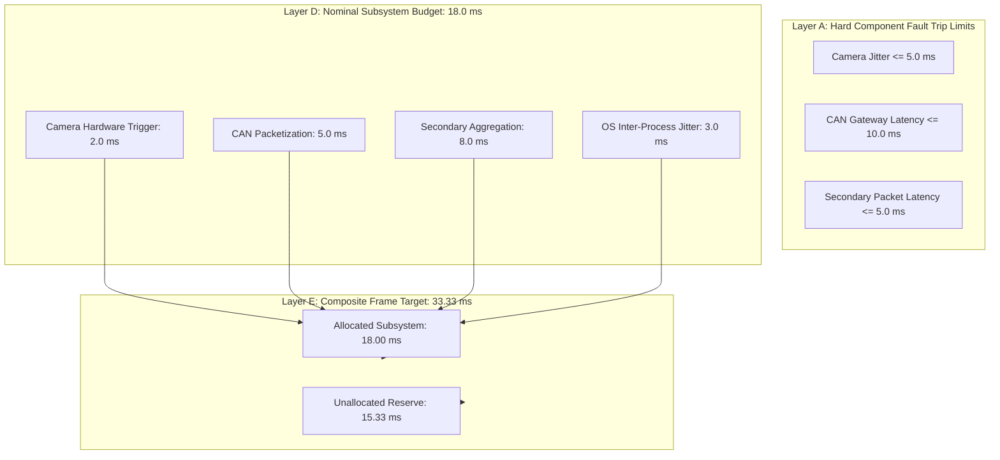

# V3.4-M — Authoritative Pre-Deployment Semantic Corrections & Reconciliations
## Milestone V3.4-M: Pre-Deployment Consistency & Safety Audit

---

### Executive Summary & Purpose

Milestone **V3.4-L** established the foundational field execution design and standard operating procedures. However, an exhaustive pre-deployment consistency audit conducted in **V3.4-M** identified fourteen internal semantic, numerical, architectural, and operational contradictions across the V3.4-L specification drafts. 

This document serves as the **sole authoritative semantic baseline**. It formally supersedes all conflicting statements, diagrams, or schemas in prior milestones without mutating historical records.

---

### 1. Multi-Modal Synchronization Budget Architecture

#### Contradiction in Prior Drafts
- In V3.4-L Section 8 and `ptp_commissioning_schema.json`: Component limits were stated as Camera $\le 5.0\text{ ms}$, CAN $\le 10.0\text{ ms}$, Secondary $\le 5.0\text{ ms}$, yielding a sum of $20.0\text{ ms}$. This sum was subtracted from $33.33\text{ ms}$, incorrectly reporting an unallocated margin of **$13.33\text{ ms}$**.
- In V3.4-L Section 3.B, `v3_4_k_semantic_corrections.md`, and `synchronization_budget_audit.json`: Nominal allocations were defined as Camera $= 2.0\text{ ms}$, CAN $= 5.0\text{ ms}$, Secondary $= 8.0\text{ ms}$, OS Jitter $= 3.0\text{ ms}$, summing to **$18.0\text{ ms}$**, yielding an unallocated reserve of **$15.33\text{ ms}$**.

#### Authoritative Reconciliation
The budget is structured into distinct, non-conflated architectural layers:



- **Layer A — Hard Component Acceptance Limits (`DESIGN_REQUIREMENT`):** Upper bounds on single-sensor bench test jitter. Exceeding any individual limit fails Gate C1/C2/C3 immediately. These limits are fault-trip thresholds and are **NEVER** summed together to define the composite frame budget.
- **Layer D — Nominal Allocated Subsystem Budget (`DESIGN_REQUIREMENT`):**
  $$\text{Allocated Subsystem Budget} = 2.0\text{ ms} + 5.0\text{ ms} + 8.0\text{ ms} + 3.0\text{ ms} = \mathbf{18.00\text{ ms}}$$
- **Layer E — Composite System Frame Target (`CURRENT_ACCEPTANCE_TARGET`):**
  $$\text{Composite Max Skew} = 1.0\text{ frame at } 30.0\text{ fps} = \mathbf{33.33\text{ ms}}$$
- **Layer F — Unallocated Design Reserve (`DESIGN_RESERVE`):**
  $$\text{Unallocated Reserve} = 33.33\text{ ms} - 18.00\text{ ms} = \mathbf{15.33\text{ ms}}$$
- **Errata Purge:** The value $13.33\text{ ms}$ was an arithmetic artifact of subtracting Layer A fault trip limits ($20.0\text{ ms}$) instead of Layer D allocations ($18.0\text{ ms}$). The value $13.33\text{ ms}$ is formally purged; **$15.33\text{ ms}$** is the sole authoritative reserve.

---

### 2. Dynamic Pre-Window Baseline Duration

#### Contradiction in Prior Drafts
- Section 14 Diagram in V3.4-L indicated `PRE WINDOW (1.5s - 5.0s)`.
- `event_capture_manifest_schema.json` permitted `pre_duration_seconds: minimum: 1.5`.
- Section 3.C in `v3_4_k_semantic_corrections.md` and `review_transition_protocol.json` mandated a minimum $3.0\text{ s}$ baseline.

#### Authoritative Reconciliation
- **Normative Rule:** The minimum pre-event steady-state baseline is strictly **$T_{\text{pre,min}} = 3.0\text{ s}$** (`CURRENT_ACCEPTANCE_TARGET`).
- **Mathematical Dynamic Extension Logic:**
  $$T_{\text{pre}} = \max\left(3.0\text{ s}, \frac{D_{\text{approach}}}{v_{\text{approach}}}\right)$$
  For nominal test approach velocities ($v \le 4.0\text{ m/s}$) over corridor distance $D \ge 15.0\text{ m}$, $T_{\text{pre}} = 3.75\text{ s} \ge 3.0\text{ s}$.
- **Rejection Condition:** Any event recording exhibiting less than $3.0\text{ s}$ of continuous, unperturbed, monotonic kinematics prior to intervention onset fails Post-Capture Gate D1 and is automatically **`REJECTED`** for insufficient pre-event baseline.

---

### 3. Intervention Kinematics and $\tau$ Latency Semantics

#### Contradiction in Prior Drafts
The term $\tau$ was informally used across prior drafts interchangeably as generic sensor transmission latency, post-event waiting delay, and causal attribution duration.

#### Authoritative Reconciliation
The physical timestamps and parameter $\tau$ are defined mathematically:

```
[--- PRE BASELINE (>= 3.0s) ---] [--- INTERVENTION (0.5s - 3.0s) ---] [--- POST OBSERVATION (2.0s - 10.0s) ---]
|                                |                                   |                                        |
t_pre_start                      t_intervention_start                t_intervention_end                       t_post_end
                                 \                                  /
                                  \-- tau <= 2.0s -----------------/
                                      Secondary Hazard Onset (t_secondary_onset)
```

1. **$t_{\text{intervention\_start}}$:** The exact PTP timestamp when vehicle deceleration exceeds $-1.5\text{ m/s}^2$ (or brake line pressure $\ge 5.0\text{ bar}$) OR handwheel angular rate exceeds $15^\circ/\text{s}$ (or steering knuckle angle $> 12^\circ$).
2. **$t_{\text{intervention\_end}}$:** The PTP timestamp when evasive vehicle steering returns to steady heading ($|\dot{\psi}| < 2.0^\circ/\text{s}$) or longitudinal acceleration stabilizes ($|a_x| < 0.2\text{ m/s}^2$).
3. **$t_{\text{primary\_resolution}}$:** The PTP timestamp when primary obstacle clearance envelope is secured ($d_{\text{primary}} \ge d_{\text{clearance}}$).
4. **$t_{\text{secondary\_onset}}$:** The PTP timestamp when an actor, proxy, or structural barrier enters the vehicle's diverted trajectory corridor (or Time-to-Collision $\text{TTC} < 3.0\text{ s}$).
5. **Mathematical Definition of $\tau$:**
   $$\tau \triangleq t_{\text{secondary\_onset}} - t_{\text{intervention\_start}}$$
   $$\tau \le 2.0\text{ s} \quad [\text{CURRENT\_SPECIFICATION\_CONSTRAINT}]$$
- **Semantic Constraint:** $\tau$ is strictly the elapsed physical duration between intervention initiation and secondary hazard emergence. It is **NOT** a sensor latency, **NOT** an empirical constant of nature, and **DOES NOT** prove counterfactual causality in isolation.

---

### 4. Camera Configuration Hierarchy & Observability

#### Contradiction in Prior Drafts
V3.4-L designated Camera D as optional redundancy, yet operational SOP procedures wrote check routines as if Cameras A, B, C, and D were always deployed. Furthermore, architectural drawings claimed "zero blind zones" prior to physical mounting.

#### Authoritative Reconciliation
- **`MINIMUM_REQUIRED_CONFIGURATION` (Cameras A + C):** Covers primary corridor approach (A) and secondary cross-aisle depth (C). Mandatory baseline for valid data acquisition.
- **`RECOMMENDED_CONFIGURATION` (Cameras A + B + C):** Adds Camera B (lateral overhead junction view) for direct heading angle and swerve vector confirmation.
- **`OPTIONAL_REDUNDANCY` (Camera D):** High-complexity diagonal cross-view. Provides occlusion bridging across junction seams. Capture is valid without Camera D.
- **Observability Status:** No design diagram can assert "zero blind zones". The parameter `secondary_depth_visible_state` remains **`FALSE`** until physically verified in the field (`FIELD_PROVEN`) using a standardized target at $\ge 20.0\text{ m}$ depth achieving $\ge 65\text{ px/m}$.

---

### 5. Baseline Observability vs. Experimentally Induced Occlusion (Gate C4 vs. Scenario L07)

#### Apparent Contradiction
Pre-Capture Gate C4 mandates that secondary depth visibility must be proven (`secondary_depth_visible = TRUE`) for a facility to be commissioned. Controlled Trial Scenario L07 intentionally places pallet stacks in the secondary aisle to create an occluded blind zone, appearing to violate Gate C4.

#### Authoritative Reconciliation
Two distinct concepts are codified:
1. **`BASELINE_OBSERVABILITY`:** The nominal facility geometry under clear operating conditions. Gate C4 certifies that the fixed sensors have an unobstructed line-of-sight down the cross-aisle when the corridor is physically clear.
2. **`EXPERIMENTALLY_INDUCED_OCCLUSION`:** In Scenario L07, an intentional, temporary physical obstruction is placed in the secondary zone during a specific test run. Gate C4 has already passed for the facility; Scenario L07 tests whether the real-time pipeline correctly detects the loss of observability during that specific run and triggers Gate E4 to classify the run as **`INSUFFICIENT_OBSERVABILITY_REJECTED`**.

---

### 6. Bifurcated Abort Taxonomy & Research Software Isolation

#### Contradiction in Prior Drafts
Prior text conflated emergency safety stops with data quality aborts, implying that research DAQ software could command vehicle traction or braking upon experiencing a dropped camera frame.

#### Authoritative Reconciliation
A strict bifurcation is established:

```
+---------------------------------------------------------------------------------------------------+
|                                  ABORT TAXONOMY BIFURCATION                                       |
+-------------------------------------------------+-------------------------------------------------+
|               SAFETY_ABORT                      |           DATA_INVALIDATION_ABORT               |
+-------------------------------------------------+-------------------------------------------------+
| Triggers: Human intrusion, perimeter breach,   | Triggers: Camera frame drop, CAN timeout,       |
| mechanical failure, Safety Marshal E-Stop.      | PTP clock unlock, buffer overflow, hash error.  |
|                                                 |                                                 |
| Actuation: Cat 4 / SIL-3 hardware interlock,    | Actuation: Software data container flag         |
| physical relay power disconnect.                | (ABORTED_DATA_INVALID). Isolates package.       |
|                                                 |                                                 |
| Vehicle Action: Immediate fail-safe mechanical  | Vehicle Action: NO VEHICLE COMMAND ISSUED.      |
| emergency braking.                              | Vehicle brought to controlled operational stop  |
|                                                 | via native driver/operator procedures.          |
+-------------------------------------------------+-------------------------------------------------+
```

> [!CAUTION]
> **ARCHITECTURAL BOUNDARY:**
> `RESEARCH DATA FAILURE != AUTOMATIC SAFETY CONTROL COMMAND`  
> Research DAQ software is electrically and logically isolated from vehicle actuation. It has **ZERO** authority to trigger vehicle braking or steering.

---

### 7. Safety Certification & E-Stop Claims Classification

#### Contradiction in Prior Drafts
V3.4-L asserted system properties such as "SIL-3 certified wireless E-Stop", "Cat 4 safety circuit", and "$\le 50\text{ ms}$ response" as established facts of the experimental prototype before physical procurement.

#### Authoritative Reconciliation
All safety hardware metrics are strictly classified:
- **SIL-3 / Cat 4 Hardware Architecture:** Classified as **`VENDOR_CERTIFICATION_REQUIREMENT`**. The commercial remote pendant must carry third-party notified body certification (e.g. TÜV Rheinland); our research project does not certify safety hardware.
- **$\le 50\text{ ms}$ Traction Cutoff Latency:** Classified as **`DESIGN_REQUIREMENT`** and **`FIELD_ACCEPTANCE_TEST`**. It must be physically measured with a calibrated digital storage oscilloscope on site before capture authorization.
- **Current Status:** Classified as **`UNVERIFIED_DESIGN_TARGET`**.

---

### 8. Controlled Trial Operating Modes & Operator Protection

#### Contradiction in Prior Drafts
V3.4-L declared a strict "ZERO HUMAN HAZARD RULE", but simultaneously referred to a "vehicle test driver" inside the corridor during controlled trials.

#### Authoritative Reconciliation
The operating modes for controlled trials (L01–L09) are explicitly defined:
1. **`REMOTE_OPERATION` (Recommended):** Vehicle is operated via industrial wireless remote control or umbilical pendant with the operator standing **OUTSIDE** the $1.8\text{ m}$ perimeter exclusion barrier.
2. **`AUTONOMOUS_OPERATION` (AGV/AMR):** Automated guided vehicle navigates pre-programmed trajectory waypoints with **ZERO** human on board.
3. **`PROTECTED_OPERATOR_CAB` (Permitted under restriction):** If a human operator is required on board, the vehicle **MUST** feature a certified Roll-Over / Falling-Object Protective Structure (ROPS/FOPS) fully enclosed cabin, interlocked seatbelt, and the operator is strictly forbidden from stepping onto the travel envelope on foot.
- **Naturalistic Population Separation:** Warehouse material handlers recorded during naturalistic operations are an unperturbed observational population; they are **NEVER** experimental test drivers.

---

### 9. Storage Ingest Pipeline vs. Physical Write-Blockers

#### Contradiction in Prior Drafts
Section 20 claimed that "raw ingest volumes operate with physical hardware write-blockers enabled", which is physically impossible because an active DAQ recorder must write incoming high-bandwidth data to disk.

#### Authoritative Reconciliation
The storage lifecycle is separated into four distinct stages:
1. **`CAPTURE_VOLUME` (`/mnt/fast_capture/`):** High-speed NVMe PCIe direct DMA partition formatted as XFS/ext4 with write-caching enabled to sustain $\ge 2.5\text{ GB/s}$ incoming multi-stream data.
2. **`SESSION_CLOSE`:** Trial finishes nominally; file descriptors flushed and closed; volume unmounted.
3. **`HASH_AND_INGEST`:** Automated daemon computes SHA-256 digests of all raw streams and compiles the package Merkle root.
4. **`IMMUTABLE_ARCHIVE` (`/mnt/archive_vault/`):** Data is transferred to primary archival storage where **PHYSICAL OR FIRMWARE WRITE-BLOCKERS (WORM)** are engaged to prevent subsequent tampering.

---

### 10. Cryptographic Provenance Language

#### Contradiction in Prior Drafts
Prior text asserted that SHA-256 and Merkle trees established "legal admissibility" of experimental data packages.

#### Authoritative Reconciliation
- **Purged Terminology:** "Legal admissibility", "court-certified evidence", and "statutory compliance" are strictly purged. Legal admissibility is an external jurisdictional determination, not a software property.
- **Authoritative Terminology:** Data packages are described as **`TAMPER_EVIDENT`**, **`CRYPTOGRAPHICALLY_TRACEABLE`**, **`PROVENANCE_PRESERVING`**, and **`INTEGRITY_VERIFIABLE`**.

---

### 11. Privacy, Identifiability & Non-Anonymity

#### Contradiction in Prior Drafts
Section 25 and `chain_of_custody_schema.json` claimed that assigning pseudonymous operator badge tokens "eliminates personal identifiable information (PII)".

#### Authoritative Reconciliation
- **Explicit Non-Anonymity Declaration:** High-resolution optical video of warehouse aisles intrinsically captures human faces, uniform badges, biometric walking gait, and shift timestamps. Pseudonymizing badge IDs does **NOT** anonymize the dataset.
- **Classification:** The dataset is formally classified as **`PSEUDONYMIZED_CONFIDENTIAL_RESEARCH_DATA`**, never public anonymous data.
- **Audio Elimination Mandate:** Microphones on all cameras are physically disconnected/desoldered to eliminate ambient worker speech capture.
- **Authorization Requirement:** Naturalistic capture cannot occur without formal signed Site Management and Worker Representation Data Agreements.

---

### 12. Human Review Panel Architecture & Kappa Interpretation

#### Contradiction in Prior Drafts
Prior drafts fluctuated between mentioning "three reviewers" and "two reviewers plus a lead adjudicator".

#### Authoritative Reconciliation
- **Authoritative Composition:** Exactly **Two Independent Blinded Reviewers (`REV_01`, `REV_02`)** plus **One Lead Adjudicator (`LEAD_ADJ`)**.
- **Sequence:**
  1. Reviewer 1 and Reviewer 2 independently review sanitized packages and submit ballots.
  2. The system computes unweighted Cohen's Kappa ($\kappa$) on the independent pair.
  3. If Reviewer 1 and Reviewer 2 agree $\rightarrow$ Unanimous consensus committed.
  4. If Reviewer 1 and Reviewer 2 disagree $\rightarrow$ Lead Adjudicator arbitrates and renders binding decision.
- **Epistemic Principle:** An agreement score of $\kappa \ge 0.80$ is an **inter-rater agreement criterion**; it **DOES NOT** prove that the consensus label is an infallible physical truth.

---

### 13. Sample Size Governance & Power Analysis

#### Contradiction in Prior Drafts
V3.4-L presented the formula $n = Z^2 p (1-p) / E^2$ as if it were a completed power analysis for model validation.

#### Authoritative Reconciliation
- **Separation of Domains:**
  1. **`EVENT_PREVALENCE_ESTIMATION`:** The goal of the preliminary field pilot is to estimate the empirical operational base rate ($p$) of swerves and near-misses.
  2. **`MODEL_VALIDATION_POWER_ANALYSIS`:** Formal statistical hypothesis testing power analysis ($\alpha=0.05, 1-\beta=0.80$) to validate detector sensitivity and specificity can only be executed **AFTER** $p$ is empirically measured.
- **Current Target:** **`TARGET_SAMPLE_SIZE = TBD`** pending empirical prevalence estimation.

---

### 14. Test Count Reconciliation (58 Automated Verification Checks)

#### Contradiction in Prior Drafts
Prior text referenced "37 fault tests", while test tables listed 58 checks.

#### Authoritative Reconciliation
Exhaustive verification of `scripts/v3_4_k/run_field_verification.py` confirms:
- **37 Fault Injection Tests** (Step 3)
- **4 Cryptographic Tamper Tests** (Step 4)
- **3 Reviewer Blinding & Isolation Checks** (Step 5)
- **4 Deterministic Reproducibility Checks** (Step 6)
- **10 Mandatory Success Conditions** (Step 7)
- **Authoritative Total:** Exactly **58 reproducible automated verification checks**, achieving a **`100% TEST PASS RATE`**.
- **Terminology Rule:** "100% accuracy" is purged; software verification test pass rates cannot be conflated with physical hardware accuracy.
