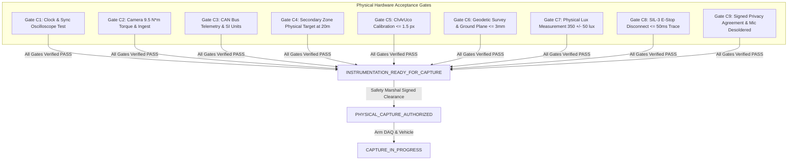

# V3.4-N — Physical Commissioning Acceptance Release Blockers
## Milestone V3.4-N: Physical Commissioning Acceptance & Instrumentation Readiness Audit

---

### Executive Milestone Status Declaration

```
========================================================================================
CURRENT MILESTONE STATUS:       READY_FOR_PHYSICAL_COMMISSIONING
PHYSICAL CAPTURE AUTHORIZATION: NOT_GRANTED_BY_V3_4_N (STRICTLY PROHIBITED)
DESIGN STATUS:                  INSTRUMENTATION_DESIGN_COMPLETE
COMMISSIONING GATES C1-C9:      UNVERIFIED_PENDING_PHYSICAL_COMMISSIONING
PHYSICAL DATA RECORDED:         ZERO BYTES (STRICT LAB/AUDIT PHASE ONLY)
========================================================================================
```

Milestone **V3.4-N** represents the final pre-field-capture engineering gate. It converts the reconciled V3.4-M baseline into an executable physical commissioning package. 

Setting `V3_4_N_STATUS = READY_FOR_PHYSICAL_COMMISSIONING` declares that the **engineering specifications, sensor schemas, measurement matrices, and gating criteria are 100% complete, mathematically consistent, and ready for deployment to the physical site**.

> [!CAUTION]
> **CRITICAL BOUNDARY:** `READY_FOR_PHYSICAL_COMMISSIONING` **DOES NOT** authorize physical vehicle capture or naturalistic recording. Physical capture is strictly prohibited until every on-site physical blocker below is measured, verified, and signed.

---

### Physical Release Blockers (Pre-requisites for `PHYSICAL_CAPTURE_AUTHORIZED`)

Physical field recording is blocked until all nine Commissioning Acceptance Gates (`C1` through `C9`) transition from `UNVERIFIED_PENDING_PHYSICAL_COMMISSIONING` to `GATE_PASS`:



#### Detailed Blocker Ledger:

| Blocker ID | Gate Required | Physical Test Description | Measuring Instrument | Acceptance Threshold | Current Status |
| :--- | :--- | :--- | :--- | :--- | :--- |
| **BLK_01_SYNC** | `Gate C1_CLOCK` | Measure actual camera strobe, CAN gateway, and secondary sensor timestamp offsets under multi-modal impact rig. | Keysight DSOX1204G Oscilloscope + Vector VN1640A | Composite skew $\le 33.33\text{ ms}$; Camera $\le 5.0\text{ ms}$; CAN $\le 10.0\text{ ms}$. | `UNVERIFIED` |
| **BLK_02_RIGGING**| `Gate C2_CAMERA` | Torque wrench audit of all optical camera truss clamps; 30-min frame loss soak test. | Norbar Calibrated Torque Wrench + Wireshark Monitor | All clamps tightened to $9.5\text{ N}\cdot\text{m}$; zero dropped frames over 30 min. | `UNVERIFIED` |
| **BLK_03_TELEMETRY**| `Gate C3_CAN` | Non-intrusive CAN bus tap validation; verify 50 Hz streaming of speed, brake state, accel, and steering. | Vector CANoe with high-impedance CAN tap | Zero packet gaps $> 20.0\text{ ms}$; SI units confirmed; derivation verified. | `UNVERIFIED` |
| **BLK_04_SECONDARY**| `Gate C4_SEC_OBS` | Deploy certified reflective mannequin at $20.0\text{ m}$ depth in cross-aisle; verify optical tracking. | Leica DISTO D2 Laser Measure + OpenCV Target Resolution | Verified depth $\ge 20.0\text{ m}$; resolution $\ge 65.0\text{ px/m}$; zero blind pockets. | `UNVERIFIED` |
| **BLK_05_OPTICAL_CAL**| `Gate C5_CALIB` | Multi-camera intrinsic/extrinsic photogrammetric calibration using 12x9 ChArUco diamond board. | Calib.io Certified Precision ChArUco Target | RMS reprojection error $\le 1.50\text{ px}$ across all cameras. | `UNVERIFIED` |
| **BLK_06_GEOMETRY**| `Gate C6_GEOM` | Geodetic Total Station survey establishing facility origin, corridor boundaries, and floor ground plane. | Leica TS16 Total Station (1\" angle accuracy) | Ground plane residual $\text{RMS} \le 3.0\text{ mm}$; facility monument locked. | `UNVERIFIED` |
| **BLK_07_ILLUMINANCE**| `Gate C7_LUX` | Direct physical illuminance audit across 5 corridor points using calibrated lux meter. | Testo 540 Digital Lux Meter (NIST traceable) | Mean corridor illuminance within $350 \pm 50\text{ lux}$; flicker index $\le 0.05$. | `UNVERIFIED` |
| **BLK_08_ESTOP** | `Gate C8_ESTOP` | Empirical oscilloscope trace measuring vehicle traction power cutoff upon wireless E-Stop press. | Keysight DSOX1204G connected to main contactor | Traction cutoff latency $\le 50.0\text{ ms}$; vendor SIL-3 / Cat 4 certificate on file. | `UNVERIFIED` |
| **BLK_09_PRIVACY** | `Gate C9_PRIVACY` | Physical inspection of camera microphones; formal execution of bilateral Data Agreement. | Visual inspection + Legal document registry | Microphones physically disconnected/desoldered; agreement signed by site & labor. | `UNVERIFIED` |

---

### Conclusion & Operational Boundary

The lifecycle transition rule is absolute:

$$\mathbf{READY\_FOR\_PHYSICAL\_COMMISSIONING \quad \nrightarrow \quad PHYSICAL\_CAPTURE\_AUTHORIZED}$$

Only the physical clearance of Blockers `BLK_01` through `BLK_09` on physical hardware at the facility can advance the system to `INSTRUMENTATION_READY_FOR_CAPTURE`, and only the final Safety Marshal site signoff can grant `PHYSICAL_CAPTURE_AUTHORIZED`.
