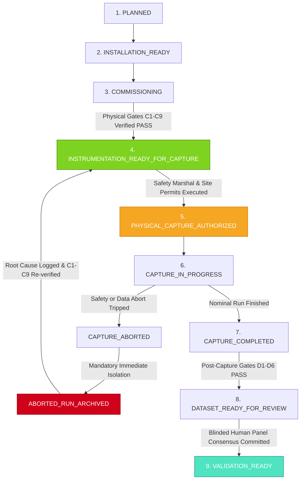
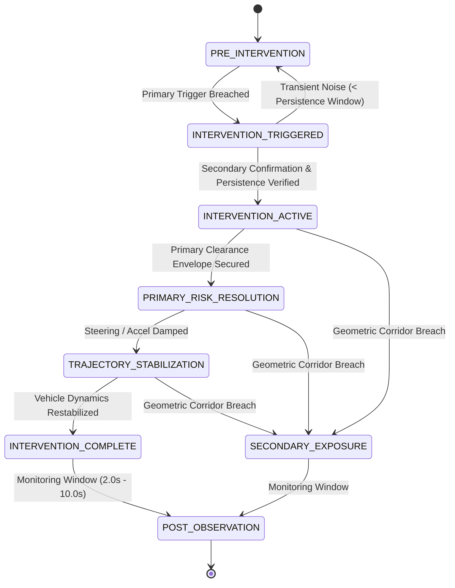

# V3.4-N — PHYSICAL COMMISSIONING ACCEPTANCE & INSTRUMENTATION READINESS AUDIT
## Final Pre-Field-Capture Engineering Specification, Commissioning Gate Matrix, and Safety Acceptance Protocol

---

### EXECUTIVE GOVERNANCE & STATUS DECLARATION

```
========================================================================================
MILESTONE STATUS:               V3_4_N_PHYSICAL_COMMISSIONING_ACCEPTANCE_COMPLETED
AUDIT CLASSIFICATION:           FINAL PRE-FIELD-CAPTURE COMMISSIONING ACCEPTANCE GATE
V3.4-N FINAL STATUS:            READY_FOR_PHYSICAL_COMMISSIONING
PHYSICAL CAPTURE AUTHORIZATION: NOT_GRANTED_BY_V3_4_N (STRICTLY PROHIBITED)
DESIGN READINESS STATE:         INSTRUMENTATION_DESIGN_COMPLETE
COMMISSIONING GATES C1-C9:      UNVERIFIED_PENDING_PHYSICAL_COMMISSIONING
AUTOMATED CONSISTENCY CHECK:    PASS (10/10 AUDITS PASSED, ZERO FAILS, ZERO WARNS)
PRODUCTION MODEL:               UNCHANGED (discover_event_candidates.py / screening)
MODEL H STATUS:                 FROZEN_INVARIANT (k0=2.40, beta_d=0.08, beta_l=0.12, beta_pitch=0.22)
SAFETY BACKFIRE GT:             NOT_ESTABLISHED (ZERO FIELD GROUND TRUTH LABELS)
SAFETY VALIDATION:              NOT_ESTABLISHED (ZERO SAFETY CLAIMS AUTHORIZED)
REAL-WORLD VALIDATION:          NOT_ESTABLISHED (NO PHYSICAL FIELD DEPLOYMENT)
FIELD DATASET:                  NOT_COLLECTED (ZERO BYTES OF PHYSICAL FIELD DATA)
========================================================================================
```

---

## 1. AUTHORITATIVE PURPOSE & AUDIT MANDATE

Milestone **V3.4-N** serves as the final pre-field-capture systems-engineering acceptance gate for the Safety Backfire AI project.

Acting under the strict mandate of a senior systems-verification engineer:
1. **Authoritative Objective:** Convert the audited V3.4-M design baseline into a physically executable commissioning package.
2. **Elimination of Semantic Ambiguity:** Establish rigid, non-overlapping boundaries between **Design Specification**, **Physical Installation**, **Hardware Commissioning**, **Operational Capture Authorization**, **Active Capture**, **Dataset Review**, and **Validation**.
3. **Strict Non-Execution Invariants:**
   - V3.4-N does **NOT** perform physical recording.
   - V3.4-N does **NOT** connect research software to vehicle throttle, steering, or braking actuators.
   - V3.4-N does **NOT** modify production models, tune thresholds, or create Ground Truth labels.
   - Model H remains an immutable frozen invariant:
     $$k_0 = 2.40, \quad \beta_d = 0.08, \quad \beta_l = 0.12, \quad \beta_{\text{pitch}} = 0.22$$

---

## 2. CRITICAL LIFECYCLE STATE MACHINE CORRECTION

The operational lifecycle is defined by a strictly guarded 9-state linear progression with an isolated abort branch, codified in [pilot_readiness_state_machine_v3.json](file:///Users/xah187/Projects/safety-backfire-ai/outputs/v3_4_n/pilot_readiness_state_machine_v3.json):



### State Boundary Definitions
- **`INSTRUMENTATION_DESIGN_COMPLETE`:** Strictly describes the current documentation and specification milestone state (V3.4-M/V3.4-N). It **DOES NOT** imply hardware readiness.
- **`INSTRUMENTATION_READY_FOR_CAPTURE`:** Requires physical hardware installation and passing all nine Pre-Capture Commissioning Gates (`C1` through `C9`) on physical hardware.
- **`PHYSICAL_CAPTURE_AUTHORIZED`:** Requires on-site Safety Marshal signoff, E-Stop oscilloscope test, and executed site/labor agreements.
- **`DATASET_READY_FOR_REVIEW`:** Requires passing all Post-Capture Data Quality Gates (`D1` through `D6`) with complete blinding sanitization.
- **`VALIDATION_READY`:** Requires completed double-blind human panel adjudication and committed Ground Truth.

### Strictly Forbidden Shortcuts
1. `INSTRUMENTATION_DESIGN_COMPLETE -> INSTRUMENTATION_READY_FOR_CAPTURE` (Forbidden: Design completeness cannot certify physical hardware).
2. `INSTRUMENTATION_DESIGN_COMPLETE -> PHYSICAL_CAPTURE_AUTHORIZED` (Forbidden: Design completeness does not grant authorization to operate vehicles).
3. `CAPTURE_COMPLETED -> VALIDATION_READY` (Forbidden: Raw captures cannot establish validation without quality gates and blinded human GT review).
4. `ABORTED_RUN_ARCHIVED -> DATASET_READY_FOR_REVIEW` (Forbidden: Aborted packages are non-evidentiary and permanently quarantined).

---

## 3. SYNCHRONIZATION COMMISSIONING ARCHITECTURE & DIRECT MEASUREMENT

The numerical architecture established in V3.4-M is preserved:
- Nominal Subsystem Allocation:
  $$\text{Camera } (2.0\text{ ms}) + \text{CAN } (5.0\text{ ms}) + \text{Secondary } (8.0\text{ ms}) + \text{OS } (3.0\text{ ms}) = \mathbf{18.00\text{ ms}}$$
- Composite System Frame Target:
  $$\text{One video frame at } 30.0\text{ fps} = \mathbf{33.33\text{ ms}}$$
- Unallocated Design Reserve:
  $$33.33\text{ ms} - 18.00\text{ ms} = \mathbf{15.33\text{ ms}}$$

### Crucial Epistemic Principle
The identity $18.00 + 15.33 = 33.33\text{ ms}$ is an **engineering budget allocation**. It is **NOT** empirical proof that the physical multi-modal system naturally achieves $\le 33.33\text{ ms}$ skew.

### Mandatory Direct Physical Measurement Matrix
Physical commissioning requires direct empirical measurement codified in [synchronization_commissioning_matrix.json](file:///Users/xah187/Projects/safety-backfire-ai/outputs/v3_4_n/synchronization_commissioning_matrix.json):

| Metric ID | Direct Physical Measurement | Measuring Instrument | Acceptance Threshold | Failure Action |
| :--- | :--- | :--- | :--- | :--- |
| **`SYNC_MEAS_01`** | `actual_camera_offset_ms` | Keysight DSOX1204G Oscilloscope (PTP 1PPS vs Strobe Pin) | P99 $\le 5.0\text{ ms}$ (Nominal $\le 2.0\text{ ms}$) | Inspect PTP slave NIC; replace opto-coupler |
| **`SYNC_MEAS_02`** | `actual_can_timestamp_offset_ms` | Vector VN1640A CANoe Hardware Logger (CAN EOF vs UDP emit) | P99 $\le 10.0\text{ ms}$ (Nominal $\le 5.0\text{ ms}$) | Optimize CAN transceiver FIFO buffer size |
| **`SYNC_MEAS_03`** | `actual_secondary_timestamp_offset_ms` | Fiberblaze Silicom PTP Capture NIC (Switch Mirror Ingress) | P99 $\le 5.0\text{ ms}$ (Nominal $\le 8.0\text{ ms}$) | Check TSN VLAN priority tag (IEEE 802.1Qbv) |
| **`SYNC_MEAS_04`** | `actual_composite_skew_ms` | Optical-Accelerometer Strobe-Impactor Calibration Rig | Max Skew $\le 33.33\text{ ms}$ | Re-tune master PTP clock servos |

---

## 4. PHYSICAL ILLUMINANCE INSTRUMENTATION (CLOSING `MISSING_ILLUMINATION_LUX`)

The historical project blocker `MISSING_ILLUMINATION_LUX` is formally closed at the instrumentation-design level:
1. **Dedicated Sensor in BOM:** A standalone digital photometer/lux meter (Testo 540 / GOSSEN MAVOLUX 5032B, NIST traceable, uncertainty $\le 3.0\%$) is added to the mandatory bill of materials.
2. **Prohibition:** Physical illuminance **MUST NEVER** be derived from video pixel values or auto-exposure metadata.
3. **Decoupled Commissioning Gates:**
   - `Gate C2_CAMERA`: Optical focus, mount rigidity ($9.5\text{ N}\cdot\text{m}$), and zero frame drops.
   - `Gate C7_ILLUMINANCE`: Direct physical photometer audit across a 5-point spatial grid.
4. **Target Classification:** The target $350 \pm 50\text{ lux}$ with flicker index $\le 0.05$ is classified as **`CURRENT_ACCEPTANCE_TARGET`**.

---

## 5. VEHICLE TELEMETRY SIGNAL MANIFEST V2

Every CAN signal is classified into one of four rigid operational categories in [signal_manifest_v2.json](file:///Users/xah187/Projects/safety-backfire-ai/outputs/v3_4_n/signal_manifest_v2.json):

```
+---------------------------------------------------------------------------------------------------+
|                        TELEMETRY SIGNAL CLASSIFICATION MATRIX                                     |
+-----------------------------+------------------------------------+--------------------------------+
| Signal Name                 | Category                           | Engineering Units & Validation |
+-----------------------------+------------------------------------+--------------------------------+
| vehicle_speed               | MANDATORY_RAW_SIGNAL               | m/s (50 Hz, monotonic)         |
| brake_state                 | MANDATORY_RAW_SIGNAL               | boolean (50 Hz, latency < 50ms)|
| longitudinal_acceleration   | MANDATORY_RAW_SIGNAL               | m/s^2 (50 Hz, Butterworth 10Hz)|
| steering_angle              | MANDATORY_RAW_SIGNAL               | deg (50 Hz, zero-centered)     |
| yaw_rate                    | MANDATORY_RAW_SIGNAL               | deg/s (50 Hz, drift < 0.5 d/s) |
| throttle_position           | MANDATORY_RAW_SIGNAL               | percent (50 Hz, 0-100%)        |
| steering_rate               | DERIVED_SIGNAL                     | deg/s (Central difference +    |
|                             |                                    | 2nd-order Butterworth filter)  |
| wheel_speed                 | OPTIONAL_SIGNAL                    | rad/s (individual wheel ticks) |
| brake_pressure_bar          | UNAVAILABLE_SIGNAL                 | Hydraulic pressure transducer  |
|                             |                                    | ABSENT on stock forklift CAN.  |
+-----------------------------+------------------------------------+--------------------------------+
```

> [!IMPORTANT]
> **FALLBACK POLICY:** All intervention detection algorithms are strictly prohibited from requiring `brake_pressure_bar`. Detection logic must rely exclusively on `brake_state` (boolean) and `longitudinal_acceleration` ($\text{m/s}^2$).

---

## 6. DETERMINISTIC INTERVENTION STATE MACHINE

Prior loose OR-based threshold crossings are replaced with a deterministic, persistence-filtered 8-state machine codified in [intervention_state_machine.json](file:///Users/xah187/Projects/safety-backfire-ai/outputs/v3_4_n/intervention_state_machine.json):



### Persistence and Confirmation Criteria
1. **Longitudinal Braking Intervention:**
   - Primary Trigger: $a_x \le -1.5\text{ m/s}^2$ (filtered via 2nd-order Butterworth, $f_c = 10.0\text{ Hz}$).
   - Secondary Confirmation: `brake_state == TRUE`.
   - Minimum Persistence Window: $\ge 100\text{ ms}$.
2. **Lateral Swerving Intervention:**
   - Primary Trigger: $|\dot{\psi}| \ge 12.0^\circ/\text{s}$ (filtered via 2nd-order Butterworth, $f_c = 10.0\text{ Hz}$).
   - Secondary Confirmation: $|\dot{\theta}_{\text{steer}}| \ge 15.0^\circ/\text{s}$.
   - Minimum Persistence Window: $\ge 120\text{ ms}$.
- **Spurious Spike Protection:** Any signal breach lasting $< 100\text{ ms}$ without secondary confirmation resets to `PRE_INTERVENTION` and is tagged `SPURIOUS_TRANSIENT_REJECTED`.

---

## 7. SECONDARY EXPOSURE VS. TIME-TO-COLLISION (TTC)

- **Primary Geometric Exposure:** `SECONDARY_EXPOSURE` is defined primarily by **geometry**: an entity enters the projected $2.0\text{ m}$ dynamic travel corridor of the vehicle following swerve diversion.
- **TTC as Auxiliary Rate Descriptor:** Time-To-Collision ($\text{TTC} = R / \dot{R}$) is recorded as an auxiliary descriptor. When optical tracking or velocity derivatives are noisy, TTC must be marked `UNKNOWN_INSUFFICIENT_TRACKING`.
- **Entity Type Separation:** Moving human proxies and static structural barriers are separated into distinct fields:
  - `secondary_object_type`: `PEDESTRIAN_PROXY_MOVING`, `PEDESTRIAN_PROXY_STATIC`, `STRUCTURAL_RACK_BARRIER`, `MATERIAL_HANDLING_CART`.

---

## 8. TAU HORIZON GOVERNANCE

- **Mathematical Definition:**
  $$\tau \triangleq t_{\text{secondary\_onset}} - t_{\text{intervention\_confirmed}}$$
- **Specification Horizon Classification:**
  - $\tau \le 2.0\text{ s} \implies$ **`INSIDE_CURRENT_ANALYTIC_HORIZON`**
  - $\tau > 2.0\text{ s} \implies$ **`OUTSIDE_CURRENT_ANALYTIC_HORIZON`**
- **Strict Prohibitions:**
  1. Never classify $\tau > 2.0\text{ s}$ as `NO_BACKFIRE`.
  2. Never classify $\tau \le 2.0\text{ s}$ as `BACKFIRE`.
  3. Tau is temporal eligibility only; it does not establish causality.

---

## 9. CAMERA CONFIGURATION HIERARCHY

- **`MINIMUM_REQUIRED_CONFIGURATION` (Cameras A + C):** Approach frontal view (A) + cross-aisle depth (C). Mandatory baseline.
- **`RECOMMENDED_CONFIGURATION` (Cameras A + B + C):** Adds lateral overhead view (B) for heading vector confirmation.
- **`OPTIONAL_REDUNDANCY` (Camera D):** Diagonal cross-view. Capture is fully valid without Camera D.
- Every run manifest records the deployed configuration. An absent Camera D **DOES NOT** invalidate an A+B+C run.
- "Zero blind zones" claims are purged; secondary depth visibility remains **`FALSE`** until physically verified on-site (`FIELD_PROVEN`).

---

## 10. BASELINE OBSERVABILITY VS. INDUCED OCCLUSION

- **`BASELINE_OBSERVABILITY` (Gate C4):** Certifies that the permanent facility infrastructure provides $\ge 20.0\text{ m}$ unobstructed visibility down the cross-aisle under nominal conditions.
- **`EXPERIMENTALLY_INDUCED_OCCLUSION` (Scenario L07):** A temporary test run where pallet stacks intentionally block the aisle to test whether the software pipeline correctly rejects the package under Gate E4. L07 **DOES NOT** invalidate the facility's prior C4 baseline.

---

## 11. BIFURCATED ABORT TAXONOMY & ZERO DAQ ACTUATION AUTHORITY

Codified in [safety_abort_v2.json](file:///Users/xah187/Projects/safety-backfire-ai/outputs/v3_4_n/safety_abort_v2.json):

```
+---------------------------------------------------------------------------------------------------+
|                        BIFURCATED ABORT & INVALIDATION TAXONOMY                                   |
+-------------------------------------------------+-------------------------------------------------+
|               SAFETY_ABORT                      |           DATA_INVALIDATION_ABORT               |
+-------------------------------------------------+-------------------------------------------------+
| Triggers: Human intrusion, perimeter breach,   | Triggers: Camera frame drop, CAN timeout,       |
| mechanical failure, Safety Marshal E-Stop.      | PTP clock unlock, buffer overflow, hash error.  |
|                                                 |                                                 |
| Actuation: Cat 4 / SIL-3 hardware interlock,    | Actuation: Software data container flag         |
| physical relay power disconnect.                | (ABORTED_DATA_INVALID). Quarantines package.    |
|                                                 |                                                 |
| Vehicle Action: Immediate fail-safe mechanical  | Vehicle Action: ZERO ACTUATION AUTHORITY.       |
| emergency braking.                              | Vehicle completes nominal operational stop via  |
|                                                 | native driver/operator procedures.              |
+-------------------------------------------------+-------------------------------------------------+
```

> [!CAUTION]
> **CRITICAL BOUNDARY:** Experimental research software has **ZERO VEHICLE ACTUATION AUTHORITY**. Under no circumstances shall experimental software issue automatic braking commands upon experiencing a research data dropout.

---

## 12. E-STOP PHYSICAL ACCEPTANCE SPECIFICATION

All safety hardware metrics are strictly classified:
- **Cat 4 / SIL-3 Architecture:** Classified as **`VENDOR_CERTIFICATION_REQUIREMENT`** (vendor CE/TÜV certificate must be on file).
- **$\le 50\text{ ms}$ Traction Cutoff Latency:** Classified as **`DESIGN_REQUIREMENT`** and **`FIELD_ACCEPTANCE_TEST`**.
- **Current Status:** **`UNVERIFIED_PENDING_MEASUREMENT`**. Requires on-site dual-channel oscilloscope trace recording E-Stop switch break vs main contactor auxiliary feedback opening.

---

## 13. STORAGE INGEST PIPELINE ARCHITECTURE

The active write-blocker contradiction is permanently resolved via four staged volumes:
1. **`CAPTURE_VOLUME` (`/mnt/fast_capture/`):** High-speed NVMe PCIe direct DMA partition (XFS/ext4, write-caching enabled) sustaining $\ge 2.5\text{ GB/s}$ incoming data.
2. **`SESSION_CLOSE`:** Trial finishes nominally; file descriptors flushed and closed; volume unmounted.
3. **`HASHING`:** Automated daemon computes SHA-256 digests and compiles the package Merkle root.
4. **`IMMUTABLE_ARCHIVE` (`/mnt/archive_vault/`):** Data transferred to primary archival storage where **PHYSICAL OR FIRMWARE WRITE-BLOCKERS (WORM)** are engaged.
- "Legal admissibility" claims are purged in favor of **`TAMPER_EVIDENT`**, **`CRYPTOGRAPHICALLY_TRACEABLE`**, and **`PROVENANCE_PRESERVING`**.

---

## 14. PRIVACY GOVERNANCE V2 & PHYSICAL AUDIO ELIMINATION

Codified in [privacy_capture_governance_v2.json](file:///Users/xah187/Projects/safety-backfire-ai/outputs/v3_4_n/privacy_capture_governance_v2.json):
- **Classification:** **`PSEUDONYMIZED_CONFIDENTIAL_RESEARCH_DATA`** (strictly non-anonymous).
- **Physical Audio Elimination:** Microphones on all optical cameras are physically disconnected, desoldered, or jumper-disabled to prevent worker speech capture.
- **Retention:** 36-month retention is classified as **`PROJECT_RETENTION_POLICY`**.
- **Ten Formal Governance Policies:** Operator Identifiers, Video Identifiability, Audio Elimination, Access Control (RBAC), Retention, Export Rules, Deletion/Opt-Out, Site Authorization, Worker Notice Signage, and Data Minimization.

---

## 15. HUMAN REVIEW PANEL ARCHITECTURE & KAPPA

Codified in `reviewer_governance.json`:
- Exactly **Two Independent Blinded Reviewers (`REV_01`, `REV_02`)** + **One Lead Adjudicator (`LEAD_ADJ`)**.
- Unweighted Cohen's Kappa ($\kappa$) is computed from independent ballots prior to arbitration.
- **Epistemic Principle:** An agreement score of $\kappa \ge 0.80$ is an **inter-rater agreement criterion**; it **DOES NOT** prove that the consensus label is an infallible physical truth.

---

## 16. FORENSIC TEST COUNT AUDIT (58 CHECKS)

Codified in [test_count_audit.json](file:///Users/xah187/Projects/safety-backfire-ai/outputs/v3_4_n/test_count_audit.json):
- **48 Atomic Test Cases:**
  - 37 Fault Injection Tests (Time, Camera, CAN, Secondary, Calibration, Geometry)
  - 4 Cryptographic Tamper Tests (Video, CAN, Manifest, Calibration)
  - 3 Reviewer Blinding & Isolation Checks (Absence of scores, Model H freeze, leak test)
  - 4 Deterministic Reproducibility Checks (Hash consistency, crash recovery, rollback, schema)
- **10 Meta-Verification Success Conditions:** Aggregate assertions inspecting test suite outcomes.
- **Authoritative Total:** Exactly **58 reproducible automated verification checks** (100% TEST PASS RATE). "100% accuracy" is purged.

---

## 17. PHYSICAL COMMISSIONING ACCEPTANCE MATRIX (GATES C1–C9)

Codified in [physical_commissioning_acceptance_matrix.json](file:///Users/xah187/Projects/safety-backfire-ai/outputs/v3_4_n/physical_commissioning_acceptance_matrix.json):

```
+---------------------------------------------------------------------------------------------------+
|                        PHYSICAL COMMISSIONING ACCEPTANCE MATRIX                                   |
+---------+-------------------------------+------------------------------+--------------------------+
| Gate ID | Gate Name                     | Acceptance Threshold         | Initial Status           |
+---------+-------------------------------+------------------------------+--------------------------+
| C1      | PTP Clock Synchronization     | Composite Skew <= 33.33 ms   | UNVERIFIED_PENDING_TEST  |
| C2      | Camera Mount Rigidity         | Torque = 9.5 N*m, 0 drops    | UNVERIFIED_PENDING_TEST  |
| C3      | CAN Telemetry Integrity       | Gaps <= 20ms, SI units valid | UNVERIFIED_PENDING_TEST  |
| C4      | Secondary Zone Observability  | Target at 20m, >= 65 px/m    | UNVERIFIED_PENDING_TEST  |
| C5      | Photogrammetric Calibration   | Reprojection RMS <= 1.50 px  | UNVERIFIED_PENDING_TEST  |
| C6      | Geodetic Survey Geometry      | Ground Plane RMS <= 3.0 mm   | UNVERIFIED_PENDING_TEST  |
| C7      | Physical Illuminance          | 350 +/- 50 lux, flicker <.05 | UNVERIFIED_PENDING_TEST  |
| C8      | Safety E-Stop Disconnect      | Cutoff Latency <= 50.0 ms    | UNVERIFIED_PENDING_TEST  |
| C9      | Privacy & Site Authorization  | Agreement signed, Mic cut    | UNVERIFIED_PENDING_TEST  |
+---------+-------------------------------+------------------------------+--------------------------+
```

---

## 18. AUTOMATED CONSISTENCY CHECKER RESULTS

The deterministic verification script [scripts/v3_4_n/run_v3_4_n_consistency_audit.py](file:///Users/xah187/Projects/safety-backfire-ai/scripts/v3_4_n/run_v3_4_n_consistency_audit.py) was executed. It produced [outputs/v3_4_n/v3_4_n_consistency_audit.json](file:///Users/xah187/Projects/safety-backfire-ai/outputs/v3_4_n/v3_4_n_consistency_audit.json):

```
============================================================================
  MILESTONE V3.4-N: PHYSICAL COMMISSIONING ACCEPTANCE AUDIT RESULTS
============================================================================
Overall Audit Status: [PASS]
Audits Evaluated:     10
Passed:               10
Warned:               0
Failed:               0
----------------------------------------------------------------------------
  [PASS]   AUDIT_01_STATE_MACHINE: State Machine V3 Lifecycle & Forbidden Shortcuts
  [PASS]   AUDIT_02_SYNC_MATRIX: Synchronization Commissioning Matrix & Measurements
  [PASS]   AUDIT_03_ILLUMINANCE: Physical Illuminance Instrumentation (Gate C7 Closed)
  [PASS]   AUDIT_04_SIGNAL_MANIFEST: Telemetry Signal Manifest & Derivations
  [PASS]   AUDIT_05_INTERVENTION_SM: Deterministic State Machine & Geometric Exposure
  [PASS]   AUDIT_06_SAFETY_ESTOP: Safety Abort Separation & E-Stop Acceptance
  [PASS]   AUDIT_07_PRIVACY: Privacy Governance V2 & Audio Elimination
  [PASS]   AUDIT_08_TEST_COUNT: Test Count Forensic Audit (48 Atomic + 10 Meta = 58)
  [PASS]   AUDIT_09_ACCEPTANCE_MATRIX: Physical Commissioning Matrix (Gates C1 - C9)
  [PASS]   AUDIT_10_RELEASE_GOVERNANCE: Release Blockers & Authoritative Status
============================================================================
```

---

## 19. WHAT MILESTONE V3.4-N DOES NOT ESTABLISH

```
[ MILESTONE V3.4-N ESTABLISHES ]
  +-- Final pre-field-capture commissioning acceptance package.
  +-- Direct measurement protocols for synchronization, illuminance, and E-Stop.
  +-- Deterministic 8-state intervention and geometric exposure machine.
  +-- Complete classification of telemetry signals and explicit derivation rules.
  +-- Physical commissioning gates C1 through C9 defined and initialized.

[ MILESTONE V3.4-N DOES NOT ESTABLISH ]
  X-- Authorization to perform physical field recording.
  X-- Real-world safety backfire validation.
  X-- Algorithmic safety efficacy or collision mitigation proof.
  X-- Model H validation or parameter correctness.
  X-- Regulatory compliance or statutory certification.
  X-- Ground Truth establishment for physical operations.
```

---

## 20. PHYSICAL RELEASE BLOCKERS SUMMARY

Physical field recording remains **STRICTLY BLOCKED** until all nine Category B Blockers detailed in [RELEASE_BLOCKERS.md](file:///Users/xah187/Projects/safety-backfire-ai/outputs/v3_4_n/RELEASE_BLOCKERS.md) are cleared on physical hardware on site:
1. `BLK_01_SYNC`: Oscilloscope measurement of composite skew $\le 33.33\text{ ms}$.
2. `BLK_02_RIGGING`: $9.5\text{ N}\cdot\text{m}$ torque wrench inspection and 30-min frame loss test.
3. `BLK_03_TELEMETRY`: Non-intrusive CAN bus tap validation at 50 Hz.
4. `BLK_04_SECONDARY`: Physical target deployed at $20\text{ m}$ depth achieving $\ge 65\text{ px/m}$.
5. `BLK_05_OPTICAL_CAL`: ChArUco diamond board reprojection error $\le 1.50\text{ px}$.
6. `BLK_06_GEOMETRY`: Total Station survey confirming ground plane residual $\le 3.0\text{ mm}$.
7. `BLK_07_ILLUMINANCE`: Physical photometer measurement confirming $350 \pm 50\text{ lux}$.
8. `BLK_08_ESTOP`: Oscilloscope trace measuring traction power cutoff latency $\le 50.0\text{ ms}$.
9. `BLK_09_PRIVACY`: Hardware microphone disconnection audit and signed site/labor agreements.

---

## 21. FINAL GOVERNANCE AUDIT DECLARATION

```
========================================================================================
FINAL AUDIT DECLARATION:
Milestone V3.4-N has successfully audited V3.4-M and established the authoritative,
physically executable commissioning acceptance package.

All ten automated consistency audits PASSED with zero warnings and zero failures.
The engineering baseline is formally classified as:

V3_4_N_STATUS = READY_FOR_PHYSICAL_COMMISSIONING

Physical capture authorization is NOT granted by this milestone.
Model H and Production Algorithms remain completely frozen and unchanged.
========================================================================================
```
