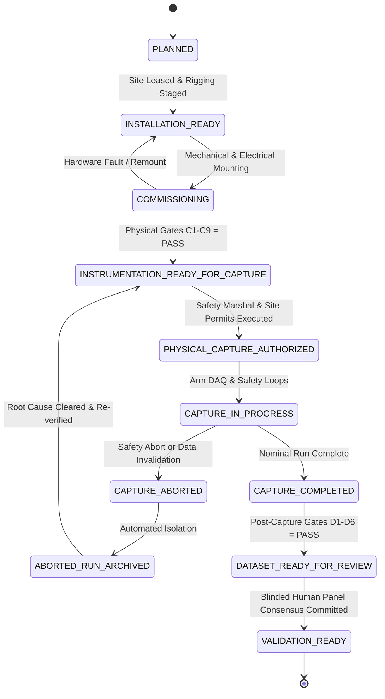

# V3.4-N — Authoritative Physical Commissioning Semantic Corrections
## Milestone V3.4-N: Physical Commissioning Acceptance & Instrumentation Readiness Audit

---

### Executive Purpose

Milestone **V3.4-N** serves as the final pre-field-capture engineering gate. While Milestone V3.4-M reconciled design contradictions, V3.4-N eliminates the remaining operational and semantic ambiguities between **Design**, **Installation**, **Commissioning**, **Capture Authorization**, **Active Capture**, **Dataset Review**, and **Validation**.

This document defines the authoritative semantic rules governing physical commissioning.

---

### 1. Authoritative Lifecycle State Machine & Transition Rules

#### Semantic Clarification
The lifecycle state machine is strictly linear with a quarantined abort branch:

$$\mathbf{PLANNED \longrightarrow INSTALLATION\_READY \longrightarrow COMMISSIONING \longrightarrow INSTRUMENTATION\_READY\_FOR\_CAPTURE}$$
$$\mathbf{\longrightarrow PHYSICAL\_CAPTURE\_AUTHORIZED \longrightarrow CAPTURE\_IN\_PROGRESS \longrightarrow CAPTURE\_COMPLETED}$$
$$\mathbf{\longrightarrow DATASET\_READY\_FOR\_REVIEW \longrightarrow VALIDATION\_READY}$$

Abort Branch:
$$\mathbf{CAPTURE\_IN\_PROGRESS \longrightarrow CAPTURE\_ABORTED \longrightarrow ABORTED\_RUN\_ARCHIVED}$$



- **`INSTRUMENTATION_DESIGN_COMPLETE`:** Strictly represents the V3.4-M/V3.4-N documentation and specification state. It **DOES NOT** imply hardware commissioning.
- **Strictly Forbidden Shortcuts:**
  1. `INSTRUMENTATION_DESIGN_COMPLETE -> INSTRUMENTATION_READY_FOR_CAPTURE` (Forbidden: Requires physical installation and passing Gates C1-C9 on physical hardware).
  2. `INSTRUMENTATION_DESIGN_COMPLETE -> PHYSICAL_CAPTURE_AUTHORIZED` (Forbidden: Design completeness does not grant authorization to operate vehicles).
  3. `CAPTURE_COMPLETED -> VALIDATION_READY` (Forbidden: Raw field captures cannot establish validation without Post-Capture Gates D1-D6 and blinded human Ground Truth adjudication).
  4. `ABORTED_RUN_ARCHIVED -> DATASET_READY_FOR_REVIEW` (Forbidden: Aborted packages are strictly non-evidentiary).

---

### 2. Synchronization Semantics & Direct Measurement Mandate

#### The Budget Identity vs. Physical Reality
- **Engineering Budget Identity:**
  $$\text{Allocated Subsystem Budget (18.00 ms)} + \text{Unallocated Reserve (15.33 ms)} = \mathbf{33.33\text{ ms (Frame Target)}}$$
- **Crucial Semantic Rule:** The arithmetic $18.0 + 15.33 = 33.33\text{ ms}$ is a design partition. It is **NOT** physical evidence that the hardware ensemble naturally produces $\le 33.33\text{ ms}$ skew.
- **Direct Measurement Requirement:**
  The on-site commissioning procedure must directly measure:
  1. `actual_camera_offset_ms` (via oscilloscope strobe trace)
  2. `actual_can_timestamp_offset_ms` (via CANoe hardware timestamping)
  3. `actual_secondary_timestamp_offset_ms` (via switch packet arrival)
  4. `actual_composite_skew_ms` (via physical optical-accelerometer impact rig)
- Composite skew **CANNOT** be inferred by summing component numbers; it must be empirically measured under live multi-modal load.

---

### 3. Physical Illuminance Instrumentation (Closing `MISSING_ILLUMINATION_LUX`)

- **Root Cause Closed:** In prior milestones, illuminance was flagged as a blocker because physical lux was not directly measured.
- **Hardware Addition to BOM:** A calibrated, standalone digital lux meter (e.g. Testo 540 / GOSSEN MAVOLUX 5032B, NIST/DAkkS traceable, uncertainty $\le 3.0\%$) is added to the mandatory commissioning bill of materials.
- **Prohibition:** Physical lux **MUST NEVER** be estimated from ordinary video pixel intensities or camera auto-exposure curves.
- **Separation of Gates:**
  - `Gate C2 (Camera Quality)`: Focus, mount rigidity ($9.5\text{ N}\cdot\text{m}$), and zero frame drops.
  - `Gate C7 (Physical Illuminance)`: Spatial photometer grid measuring mean corridor illuminance.
- **Classification:** The target $350 \pm 50\text{ lux}$ is classified as **`CURRENT_ACCEPTANCE_TARGET`**.

---

### 4. Telemetry Signal Manifest & Explicit Derivation Rules

Signals are classified into four rigid categories in [signal_manifest_v2.json](file:///Users/xah187/Projects/safety-backfire-ai/outputs/v3_4_n/signal_manifest_v2.json):
1. **`MANDATORY_RAW_SIGNAL`:** `vehicle_speed` (m/s), `brake_state` (boolean), `longitudinal_acceleration` (m/s²), `steering_angle` (deg), `yaw_rate` (deg/s), `throttle_position` (%).
2. **`DERIVED_SIGNAL`:** `steering_rate` (deg/s), calculated as the filtered central difference derivative:
   $$\dot{\theta}[t] = \frac{\theta[t+1] - \theta[t-1]}{2 \cdot \Delta t}$$
   passed through a 2nd-order digital Butterworth low-pass filter ($f_c = 10.0\text{ Hz}, f_s = 50.0\text{ Hz}$).
3. **`OPTIONAL_SIGNAL`:** `wheel_speed` (rad/s), used for wheel slip estimation if available.
4. **`UNAVAILABLE_SIGNAL`:** `brake_pressure_bar`. Standard industrial forklifts do not provide analog line pressure on stock CAN buses. All intervention logic is strictly prohibited from requiring `brake_pressure_bar` and must rely exclusively on `brake_state` and `longitudinal_acceleration`.

---

### 5. Deterministic Intervention State Machine & Persistence

Prior loose OR-based conditions are replaced by a deterministic 8-state machine:

```
PRE_INTERVENTION 
    --(Primary Trigger + Confirmation >= Persistence)--> INTERVENTION_TRIGGERED 
    --(Confirmed Dynamics)--> INTERVENTION_ACTIVE 
    --(Clearance Secured)--> PRIMARY_RISK_RESOLUTION 
    --(Damping Settled)--> TRAJECTORY_STABILIZATION 
    --(Dynamics Concluded)--> INTERVENTION_COMPLETE
    *(Geometric Crossing)* --> SECONDARY_EXPOSURE
    *(Monitoring Window)* --> POST_OBSERVATION
```

- **Persistence Filter Mandates:**
  - Braking: $a_x \le -1.5\text{ m/s}^2$ + `brake_state == TRUE` sustained for $\ge 100\text{ ms}$.
  - Swerving: $|\dot{\psi}| \ge 12.0^\circ/\text{s}$ + $|\dot{\theta}_{\text{steer}}| \ge 15.0^\circ/\text{s}$ sustained for $\ge 120\text{ ms}$.
- A single-sample threshold spike is **NEVER** an intervention.

---

### 6. Secondary Exposure vs. Time-To-Collision (TTC)

- **Primary Geometric Definition:** `SECONDARY_EXPOSURE` is defined primarily by **geometry**: an entity enters the projected $2.0\text{ m}$ dynamic travel corridor of the vehicle following swerve diversion.
- **TTC as Auxiliary Descriptor:** Time-To-Collision is an auxiliary rate descriptor, not the definition of exposure. When range-rate evidence is insufficient or noisy, TTC must be recorded as `UNKNOWN_INSUFFICIENT_TRACKING`.
- **Entity Type Separation:** Moving human proxies and static structural rack barriers are separated into `secondary_object_type`:
  - `PEDESTRIAN_PROXY_MOVING`
  - `PEDESTRIAN_PROXY_STATIC`
  - `STRUCTURAL_RACK_BARRIER`
  - `MATERIAL_HANDLING_CART`

---

### 7. Tau Temporal Horizon Governance

- **Formula:** $\tau \triangleq t_{\text{secondary\_onset}} - t_{\text{intervention\_confirmed}}$.
- **Horizon Boundary:**
  - $\tau \le 2.0\text{ s} \implies$ **`INSIDE_CURRENT_ANALYTIC_HORIZON`**
  - $\tau > 2.0\text{ s} \implies$ **`OUTSIDE_CURRENT_ANALYTIC_HORIZON`**
- **Strict Prohibitions:**
  1. Never classify $\tau > 2.0\text{ s}$ as `NO_BACKFIRE`.
  2. Never classify $\tau \le 2.0\text{ s}$ as `BACKFIRE`.
  3. Tau is temporal eligibility only; it does not establish causality.

---

### 8. Camera Hierarchy & Field-Proven Observability

- **`MINIMUM_REQUIRED_CONFIGURATION`:** Cameras A + C.
- **`RECOMMENDED_CONFIGURATION`:** Cameras A + B + C.
- **`OPTIONAL_REDUNDANCY`:** Camera D.
- Every run manifest must record the deployed configuration. An absent Camera D **DOES NOT** invalidate an A+B+C capture.
- "Zero blind zones" claims from CAD models are purged; secondary depth visibility is strictly **`FALSE`** until physically verified on-site (`FIELD_PROVEN`).

---

### 9. Baseline Observability vs. Induced Occlusion

- **`BASELINE_OBSERVABILITY` (Gate C4):** Certifies that the permanent facility infrastructure provides $\ge 20.0\text{ m}$ unobstructed line-of-sight down the cross-aisle.
- **`EXPERIMENTALLY_INDUCED_OCCLUSION` (Scenario L07):** A temporary test run where pallet stacks intentionally block the aisle to test whether the software pipeline correctly rejects the package under Gate E4. L07 **DOES NOT** invalidate the facility's prior C4 certification.

---

### 10. Safety Abort vs. Data Invalidation Abort (Zero Actuation Authority)

- **`SAFETY_ABORT`:** Certified Cat 4 / SIL-3 hardware loop cuts vehicle traction power upon physical E-Stop depression or perimeter fence breach.
- **`DATA_INVALIDATION_ABORT`:** Research DAQ daemon tags active package as `ABORTED_DATA_INVALID` upon dropped frames or CAN timeout.
- **Authoritative Rule:** Research DAQ software has **ZERO VEHICLE ACTUATION AUTHORITY**. A data capture failure terminates logging; it **DOES NOT** command vehicle braking.

---

### 11. Safety Claims Classification

All safety metrics are strictly classified:
- SIL-3 / Cat 4: **`VENDOR_CERTIFICATION_REQUIREMENT`** (requires notified body certificate on file).
- $\le 50\text{ ms}$ Cutoff: **`DESIGN_REQUIREMENT`** and **`FIELD_ACCEPTANCE_TEST`** (requires oscilloscope trace).
- Current Prototype Status: **`UNVERIFIED_PENDING_MEASUREMENT`** (never report design targets as measured results).

---

### 12. Storage Stages & Cryptographic Provenance

- **Four Staged Volumes:**
  1. `CAPTURE_VOLUME` (`/mnt/fast_capture/`): Writable NVMe direct DMA buffer.
  2. `SESSION_CLOSE`: File descriptors flushed and unmounted.
  3. `HASHING`: SHA-256 Merkle root computation.
  4. `IMMUTABLE_ARCHIVE` (`/mnt/archive_vault/`): Write-blockers / WORM engaged.
- "Legal admissibility" claims are purged in favor of **`TAMPER_EVIDENT`**, **`CRYPTOGRAPHICALLY_TRACEABLE`**, and **`PROVENANCE_PRESERVING`**.

---

### 13. Privacy Governance & Audio Elimination

- **Classification:** **`PSEUDONYMIZED_CONFIDENTIAL_RESEARCH_DATA`** (strictly non-anonymous).
- **Physical Audio Elimination:** Microphones on all cameras are physically disconnected/desoldered to eliminate worker speech capture.
- **Retention:** 36-month retention is classified as **`PROJECT_RETENTION_POLICY`**.

---

### 14. Human Review Panel Architecture

- Exactly **Two Independent Blinded Reviewers (`REV_01`, `REV_02`)** + **One Lead Adjudicator (`LEAD_ADJ`)**.
- Cohen's Kappa ($\kappa$) is computed from independent ballots prior to arbitration. $\kappa \ge 0.80$ is an **inter-rater agreement criterion**, not proof of physical truth.

---

### 15. Forensic Test Count Audit (58 Checks Verified)

Forensic audit of `scripts/v3_4_k/run_field_verification.py` confirms:
- **48 Atomic Test Cases:** 37 fault injection + 4 tamper + 3 blinding + 4 reproducibility.
- **10 Meta-Verification Checks:** Conditions 01 through 10.
- **Total Automated Checks:** Exactly **58 automated verification checks** (100% TEST PASS RATE). "100% accuracy" is purged.
