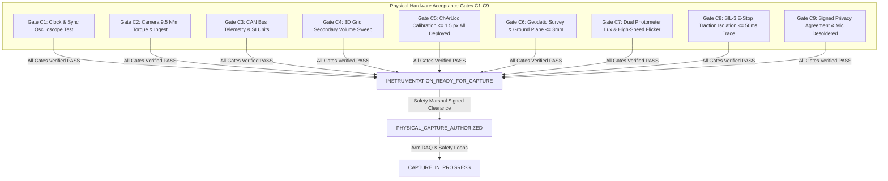

# V3.4-N-CORR-01 — Final Physical Commissioning Release Blockers
## Milestone V3.4-N-CORR-01: Final Commissioning Gate Corrections

---

### Executive Milestone Status Declaration

```
========================================================================================
MILESTONE STATUS:               READY_FOR_PHYSICAL_COMMISSIONING
PHYSICAL CAPTURE AUTHORIZATION: NOT_GRANTED (STRICTLY PROHIBITED)
DESIGN READINESS STATE:         INSTRUMENTATION_DESIGN_COMPLETE
COMMISSIONING GATES C1-C9:      UNVERIFIED_PENDING_PHYSICAL_COMMISSIONING
PHYSICAL FIELD RECORDING:       ZERO BYTES (STRICT PRE-DEPLOYMENT GATE ONLY)
========================================================================================
```

Milestone **V3.4-N-CORR-01** successfully eliminates the final four internal measurement and acceptance ambiguities in Milestone V3.4-N:
1. Secondary sensor synchronization threshold hierarchy reconciled ($5.0\text{ ms} \le 8.0\text{ ms} \le 8.0\text{ ms}$).
2. Gate C7 illuminance bifurcated into static lux meter vs high-frequency optical photodiode.
3. Gate C4 secondary observability transformed from a single point into a 36-point 3D spatial grid.
4. Gate C8 E-Stop latency endpoint explicitly defined as motor current isolation ($t_{\text{traction\_safe\_state}}$).

The designation `READY_FOR_PHYSICAL_COMMISSIONING` declares that the **engineering documentation, measurement protocols, schemas, and acceptance matrices are 100% complete, mathematically reconciled, and ready to be physically executed on site**.

> [!CAUTION]
> **CRITICAL BOUNDARY:** `READY_FOR_PHYSICAL_COMMISSIONING` **DOES NOT** authorize physical vehicle capture or naturalistic recording. Physical capture is strictly prohibited until every on-site physical blocker below is measured, verified, and signed.

---

### Mandatory Physical Release Blockers (Pre-requisites for `PHYSICAL_CAPTURE_AUTHORIZED`)

Physical field recording is strictly blocked until all nine Commissioning Acceptance Gates (`C1` through `C9`) achieve `GATE_PASS`:



#### Detailed Blocker Ledger:

| Blocker ID | Gate Required | Corrected Physical Acceptance Test | Measuring Instrument | Acceptance Threshold | Current Status |
| :--- | :--- | :--- | :--- | :--- | :--- |
| **BLK_01_SYNC** | `Gate C1_CLOCK` | Measure actual camera strobe, CAN gateway, and secondary sensor timestamp offsets under multi-modal impact rig. | Keysight DSOX1204G Oscilloscope + Vector VN1640A | Composite skew $\le 33.33\text{ ms}$; Camera $\le 5.0\text{ ms}$; CAN $\le 10.0\text{ ms}$; Sec $\le 8.0\text{ ms}$. | `UNVERIFIED` |
| **BLK_02_RIGGING**| `Gate C2_CAMERA` | Torque wrench audit of all optical camera truss clamps; 30-min frame loss soak test across deployed cameras. | Norbar Calibrated Torque Wrench + Wireshark Monitor | All clamps tightened to $9.5\text{ N}\cdot\text{m}$; zero dropped frames over 30 min. | `UNVERIFIED` |
| **BLK_03_TELEMETRY**| `Gate C3_CAN` | Non-intrusive CAN bus tap validation; verify 50 Hz streaming of speed, brake state, accel, and steering. | Vector CANoe with high-impedance CAN tap | Zero packet gaps $> 20.0\text{ ms}$; SI units confirmed; steering rate derivation verified. | `UNVERIFIED` |
| **BLK_04_SECONDARY**| `Gate C4_SEC_OBS` | 3D spatial grid sweep (36 points, $0\text{m}$ to $20\text{m}$ depth) using SPMT-01 mannequin target. | Leica DISTO D2 Laser Measure + OpenCV Target Resolution | Verified depth $\ge 20.0\text{ m}$; resolution $\ge 65.0\text{ px/m}$; $\text{CRITICAL\_OBSTRUCTION\_AREA} = 0.0\text{ m}^2$. | `UNVERIFIED` |
| **BLK_05_OPTICAL_CAL**| `Gate C5_CALIB` | Photogrammetric calibration using 12x9 ChArUco diamond board across **all deployed cameras** (D = NOT_APPLICABLE if absent). | Calib.io Certified Precision ChArUco Target | RMS reprojection error $\le 1.50\text{ px}$ across all deployed cameras. | `UNVERIFIED` |
| **BLK_06_GEOMETRY**| `Gate C6_GEOM` | Geodetic Total Station survey establishing facility origin, corridor boundaries, and floor ground plane. | Leica TS16 Total Station (1\" angle accuracy) | Ground plane residual $\text{RMS} \le 3.0\text{ mm}$; facility monument locked. | `UNVERIFIED` |
| **BLK_07_ILLUMINANCE**| `Gate C7_LUX` | Path 1: Calibrated lux meter ($350 \pm 50\text{ lux}$). Path 2: High-speed photodiode oscilloscope trace (flicker index $\le 0.05$). | Testo 540 Lux Meter + Thorlabs PDA36A2 / Keysight DSO | $300\text{ lux} \le \text{mean} \le 400\text{ lux}$ AND flicker index $\le 0.05$ (Freq $\ge 1000\text{ Hz}$). | `UNVERIFIED` |
| **BLK_08_ESTOP** | `Gate C8_ESTOP` | Empirical oscilloscope trace measuring $t_{\text{traction\_safe\_state}} - t_{\text{estop\_command}}$ to motor current cutoff. | Keysight DSOX1204G connected to motor current & E-Stop | Traction cutoff latency $\le 50.0\text{ ms}$; vendor SIL-3 / Cat 4 certificate on file. | `UNVERIFIED` |
| **BLK_09_PRIVACY** | `Gate C9_PRIVACY` | Physical inspection of camera microphones; formal execution of bilateral Data Agreement. | Visual inspection + Legal document registry | Microphones physically disconnected/desoldered; agreement signed by site & labor. | `UNVERIFIED` |

---

### Conclusion & Operational Boundary

The lifecycle transition rule is absolute:

$$\mathbf{READY\_FOR\_PHYSICAL\_COMMISSIONING \quad \nrightarrow \quad PHYSICAL\_CAPTURE\_AUTHORIZED}$$

Only the physical clearance of Blockers `BLK_01` through `BLK_09` on physical hardware at the facility can advance the system to `INSTRUMENTATION_READY_FOR_CAPTURE`, and only the final Safety Marshal site signoff can grant `PHYSICAL_CAPTURE_AUTHORIZED`.
