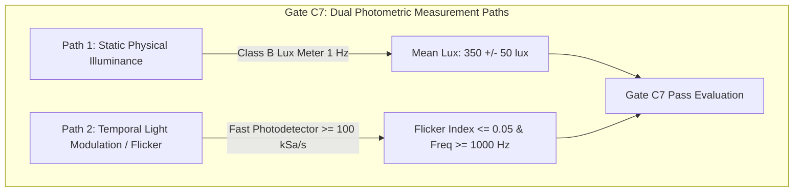

# V3.4-N-CORR-01 — Measurement Semantics & Physical Instrumentation Architecture
## Milestone V3.4-N-CORR-01: Final Commissioning Gate Corrections

---

### Executive Purpose

This document provides the definitive physical measurement procedures, probe locations, instrument specifications, and acceptance mathematics for the four critical physical commissioning domains corrected in **Milestone V3.4-N-CORR-01**:
1. Multi-Modal Synchronization Threshold Hierarchy
2. Physical Illuminance vs. Temporal Light Modulation (Flicker)
3. Volume-Based Secondary Zone Observability Proof
4. E-Stop Physical Traction Power Disconnect Endpoint

---

## 1. MULTI-MODAL SYNCHRONIZATION MEASUREMENT SEMANTICS

### The Semantic Inversion Resolved
In prior drafts, the Secondary Sensor subsystem had a nominal allocation of $8.0\text{ ms}$ but an acceptance limit of $5.0\text{ ms}$, creating an inverted hierarchy where nominal performance would violate acceptance. 

V3.4-N-CORR-01 establishes a strictly monotonic hierarchy across all four multi-modal channels:

$$\mathbf{nominal\_target \le acceptance\_limit \le hard\_rejection\_limit}$$

```
+------------------------------------------------------------------------------------------------------------------------+
|                                    SYNCHRONIZATION MEASUREMENT HIERARCHY                                              |
+---------------------+-------------------+-------------------+------------------------+-------------------+-------------+
| Subsystem Channel   | Nominal Target    | Acceptance Limit  | Hard Rejection Limit   | Allocation Budget | Measured    |
+---------------------+-------------------+-------------------+------------------------+-------------------+-------------+
| Camera Trigger      | 2.0 ms            | 2.0 ms            | 5.0 ms                 | 2.00 ms           | PENDING     |
| CAN Telemetry       | 5.0 ms            | 5.0 ms            | 10.0 ms                | 5.00 ms           | PENDING     |
| Secondary Sensor    | 5.0 ms            | 8.0 ms            | 8.0 ms                 | 8.00 ms           | PENDING     |
| Host OS Process     | 1.0 ms            | 3.0 ms            | 5.0 ms                 | 3.00 ms           | PENDING     |
+---------------------+-------------------+-------------------+------------------------+-------------------+-------------+
| TOTAL SUBSYSTEM     | 13.0 ms (Nominal) | 18.0 ms (Budget)  | -                      | 18.00 ms          | PENDING     |
| UNALLOCATED RESERVE | -                 | -                 | -                      | 15.33 ms          | PENDING     |
| COMPOSITE SYSTEM    | -                 | 33.33 ms (Target) | 33.33 ms (Frame Max)   | 33.33 ms (Budget) | PENDING     |
+---------------------+-------------------+-------------------+------------------------+-------------------+-------------+
```

### Physical Measurement Methods & Instruments
1. **Camera Strobe Offset (`actual_camera_offset_ms`):**
   - Probe: Channel 1 on PTP Grandmaster 1PPS hardware pulse; Channel 2 on opto-isolated camera flash trigger pin.
   - Instrument: Keysight DSOX1204G (200MHz, 2GSa/s, NIST traceable).
   - Rule: $P99 \le 2.0\text{ ms}$ (Nominal PASS); $2.0 < P99 \le 5.0\text{ ms}$ (Reserve Consumed); $> 5.0\text{ ms}$ (FAIL Gate C1/C2).
2. **CAN Timestamp Offset (`actual_can_timestamp_offset_ms`):**
   - Probe: Non-intrusive high-impedance CAN bus tap comparing CAN message EOF bit timestamp vs UDP output packet timestamp.
   - Instrument: Vector VN1640A Network Interface with PTP hardware slave synchronization.
   - Rule: $P99 \le 5.0\text{ ms}$ (Nominal PASS); $5.0 < P99 \le 10.0\text{ ms}$ (Reserve Consumed); $> 10.0\text{ ms}$ (FAIL Gate C1/C3).
3. **Secondary Sensor Packet Latency (`actual_secondary_timestamp_offset_ms`):**
   - Probe: Switch ingress mirror port packet capture using hardware-timestamped NIC.
   - Instrument: Fiberblaze Silicom PTP Capture Card.
   - Rule: $P99 \le 8.0\text{ ms}$ (Nominal PASS); $> 8.0\text{ ms}$ (FAIL Gate C1/C4).
4. **Composite Multi-Modal Skew (`actual_composite_skew_ms`):**
   - Method: Physical Co-Calibration Impactor Strobe Rig (CC-ISR-01) firing an LED strobe concurrently with a mechanical solenoid impactor on the vehicle chassis IMU.
   - Rule: $\text{Max Observed Skew} \le 33.33\text{ ms}$.

---

## 2. PHOTOMETRIC & TEMPORAL LIGHT MODULATION (FLICKER) SEMANTICS

### Instrument Capability Separation
A standard digital lux meter (sampling at 1–2 Hz) is physically incapable of detecting temporal light modulation or rolling shutter banding produced by high-frequency LED drivers ($\ge 1000\text{ Hz}$). Gate C7 is formally bifurcated into two independent measurement paths:



### Detailed Path Specifications
- **Path 1 (Static Illuminance):**
  - Instrument: Class B DIN 5032-7 Precision Lux Meter (Testo 540 / GOSSEN MAVOLUX 5032B).
  - Spatial Grid: 5 corridor points (Entry, Mid-Approach, Junction, Cross-Aisle Mouth, Cross-Aisle 20m).
  - Acceptance Rule: $300.0\text{ lux} \le \text{Mean Illuminance} \le 400.0\text{ lux}$ (`CURRENT_ACCEPTANCE_TARGET`).
- **Path 2 (High-Frequency Temporal Flicker):**
  - Instrument: High-speed photodiode detector with transimpedance amplifier (Thorlabs PDA36A2, DC-1.5MHz, $V(\lambda)$ photopic matched) connected to Keysight DSOX1204G oscilloscope sampling at $\ge 100\text{ kSa/s}$.
  - Metric 1: Modulation Frequency $f_{\text{mod}} \ge 1000.0\text{ Hz}$ (conforming to IEEE 1789-2015 zero-effect boundary).
  - Metric 2: Flicker Index $\le 0.05$:
    $$\text{Flicker Index} = \frac{\text{Area above mean light output}}{\text{Total area of light output waveform}}$$
  - **Current Status:** `C7_FLICKER_STATUS = UNVERIFIED_INSTRUMENTATION_REQUIREMENT`. Gate C7 cannot achieve `GATE_PASS` until Path 2 hardware is deployed and measured on site.

---

## 3. VOLUME-BASED SECONDARY ZONE OBSERVABILITY PROOF

### Inadequacy of Point Targets
A single calibration mannequin placed at $20.0\text{ m}$ verifies optical line-of-sight along a single line, but fails to prove observability across the vehicle's dynamic diversion envelope. Gate C4 mandates a **3D Spatial Volumetric Sweep**.

```
   [INTERSECTION JUNCTION]                                   [CROSS-AISLE DEPTH: 20m]
   X = 30.0m                                                 X = 50.0m
   +--------------------------------------------------------------------------------+
   | (L, 5m)                 (L, 10m)               (L, 15m)               (L, 20m) |  Y = +1.2m (Left Rail)
   |                                                                                |
   | (C, 5m)                 (C, 10m)               (C, 15m)               (C, 20m) |  Y =  0.0m (Centerline)
   |                                                                                |
   | (R, 5m)                 (R, 10m)               (R, 15m)               (R, 20m) |  Y = -1.2m (Right Rail)
   +--------------------------------------------------------------------------------+
     |                          |                      |                      |
   Z = 0.8m (Low)             Z = 1.4m (Mid)         Z = 1.8m (Head)        Total: 36 Voxel Points
```

### Volumetric Specification
1. **Geometric Coordinate Polygon:**
   - Vertices: $[30.0, 0.0, 0.0]$, $[30.0, 3.5, 0.0]$, $[50.0, 3.5, 0.0]$, $[50.0, 0.0, 0.0]$ in local facility Cartesian coordinates.
   - Depth Extent: Continuous $20.0\text{ m}$ penetration into cross-aisle (`DESIGN_REQUIREMENT`).
   - Width Clearance: $3.5\text{ m}$.
   - Vertical Envelope: $0.0\text{ m}$ to $2.2\text{ m}$.
2. **Measurement Grid:**
   - 4 Depth Planes ($5\text{ m}, 10\text{ m}, 15\text{ m}, 20\text{ m}$) $\times$ 3 Lateral Offsets (Left Rail $-1.2\text{ m}$, Center $0.0\text{ m}$, Right Rail $+1.2\text{ m}$) $\times$ 3 Target Heights ($0.8\text{ m}, 1.4\text{ m}, 1.8\text{ m}$) = **36 Discrete Grid Points**.
3. **Optical Resolution Acceptance Target:**
   - At $20.0\text{ m}$ depth: Resolution $\ge \mathbf{65.0\text{ px/m}}$ across target torso (`CURRENT_ACCEPTANCE_TARGET`), ensuring $\ge 30\text{ pixels}$ across a $0.45\text{ m}$ pedestrian torso.
4. **Measurable Obstruction Metric:**
   - Metric: $\mathbf{CRITICAL\_OBSTRUCTION\_AREA = 0.0\text{ m}^2}$.
   - Rule: Zero unobserved floor area $> 0.25\text{ m}^2$ permitted within the vehicle diversion envelope up to $20.0\text{ m}$ depth.

---

## 4. E-STOP PHYSICAL TRACTION POWER ENDPOINT

### The Safety Isolation Gap
Auxiliary microswitches on industrial contactors frequently open milliseconds before main contact tips separate, and motor drive inverters contain bulk DC capacitors that sustain torque after contactor drop. Equating contactor auxiliary feedback with traction isolation is physically invalid.

### The Four Physical Signal Transitions
Gate C8 defines the exact physical signal transition sequence:

```
[E-Stop Actuation]                 [Safety Relay Drop]               [Contactor Auxiliary Drop]          [TRACTION POWER ISOLATED]
t_estop_command                    t_safety_output                   t_contactor_change                  t_traction_safe_state
(NC Contact Breaks)                (Cat 4 Output Drops)              (Microswitch Opens)                 (I_motor < 0.5A & Brake Engaged)
|                                  |                                 |                                   |
+------ delta_t_relay <= 15ms ---->+                                 |                                   |
+----------------- delta_t_contactor_aux <= 35ms ------------------->+                                   |
+--------------------------------- AUTHORITATIVE ACCEPTANCE ENDPOINT <= 50.0 ms ------------------------>+
```

1. **$t_{\text{estop\_command}}$ ($t_0$):** Physical break of the normally-closed (NC) dual-channel E-Stop push-button or wireless safety relay contacts ($24\text{V} \rightarrow 0\text{V}$).
2. **$t_{\text{safety\_output}}$ ($t_1$):** Safety controller internal logic response ($24\text{V} \rightarrow 0\text{V}$).
3. **$t_{\text{contactor\_change}}$ ($t_2$):** Opening of the main contactor auxiliary feedback microswitch. Classified as an **auxiliary diagnostic precursor** (acceptance target $\le 35.0\text{ ms}$).
4. **$t_{\text{traction\_safe\_state}}$ ($t_3$ — AUTHORITATIVE SAFETY ENDPOINT):** The exact instant when traction motor line current drops below $0.5\text{ A}$ (verified via Hall-effect current clamp) AND mechanical spring-applied fail-safe brake solenoid coil de-energizes.

### Acceptance Rule
$$\Delta t_{\text{traction\_isolation}} = t_{\text{traction\_safe\_state}} - t_{\text{estop\_command}} \le \mathbf{50.0\text{ ms}}$$
- Classification: **`CURRENT_DESIGN_REQUIREMENT`** and **`FIELD_ACCEPTANCE_TEST`**.
- Status: **`UNVERIFIED_PENDING_FIELD_MEASUREMENT`** until empirical oscilloscope trace is recorded on site.
