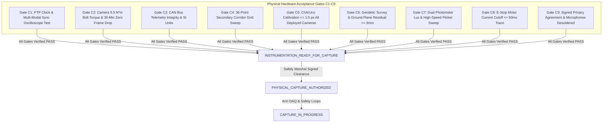

# V3.4-N-CORR-02 — Final Physical Commissioning Release Blockers
## Milestone V3.4-N-CORR-02: Safety, Measurement & Standards Applicability Closure

---

### Executive Milestone Status Declaration

```text
========================================================================================
MILESTONE STATUS:               READY_FOR_PHYSICAL_COMMISSIONING
PHYSICAL CAPTURE AUTHORIZATION: NOT_GRANTED (STRICTLY PROHIBITED)
DESIGN READINESS STATE:         INSTRUMENTATION_DESIGN_COMPLETE
STANDARDS APPLICABILITY:        CLASSIFIED (ISO 13849 / ISO 3691-4 FRAMEWORK)
COMMISSIONING GATES C1-C9:      UNVERIFIED_PENDING_PHYSICAL_COMMISSIONING
PHYSICAL FIELD RECORDING:       ZERO BYTES (STRICT PRE-DEPLOYMENT GATE ONLY)
========================================================================================
```

Milestone **V3.4-N-CORR-02** closes the final semantic, measurement-definition, and standards-applicability ambiguities identified in Milestone V3.4-N-CORR-01:
1. **Camera Synchronization Reserve Semantics:** Formally defined `SYNC_NOMINAL_PASS` ($P_{99} \le 2.0\text{ ms}$), `SYNC_RESERVE_CONSUMED` / `PASS_WITH_DEGRADED_MARGIN` ($2.0\text{ ms} < P_{99} \le 5.0\text{ ms}$), and `SYNC_FAIL` ($P_{99} > 5.0\text{ ms}$). Established mandatory independent channel evaluation across all deployed modalities—composite skew below $33.33\text{ ms}$ cannot mask a channel component failure.
2. **Secondary Observability Geometric Semantics:** Replaced ungrounded voxel terminology with `OBSERVABILITY_SAMPLE_POINTS` (36 discrete test coordinates). Audited the lateral rail span ($2.4\text{ m}$) against the corridor width ($3.5\text{ m}$). Replaced continuous zero-blind-pocket claims with bounded sampled-observability criteria ($100\%$ pass on 36 points) and classified continuous corridor coverage as `UNVERIFIED_BOUNDED_INTERPOLATION`.
3. **Flicker Measurement Instrumentation:** Established high-speed optoelectronic requirements ($\ge 1.0\text{ MSa/s}$ sampling rate, $50\text{ kHz}$ analog bandwidth, 4th-order anti-alias filter, $\ge 2.0\text{ s}$ duration) providing $\ge 20\times$ oversampling margin over Nyquist. Clarified that $f_{\text{mod}} \ge 1000\text{ Hz}$ alone does not guarantee absence of CMOS rolling-shutter banding.
4. **E-Stop Physical Endpoint Separation:** Rigorously separated motor phase current cutoff ($I_{\text{motor}} < 0.5\text{ A}$) from DC-bus bulk capacitor discharge ($V_{\text{bus}} < 50\text{ V}$) and mechanical friction brake clamping.
5. **Standards Applicability Framework:** Replaced "Governing Standard: ISO 26262 / IEC 61508 / ISO 21448" with an objective **Standards Applicability Framework**, classifying road-vehicle standards as `OUT_OF_SCOPE_STANDARD` and contextualizing industrial truck standards (ISO 13849-1/2, ISO 3691-4).

The designation `READY_FOR_PHYSICAL_COMMISSIONING` declares that the **engineering documentation, measurement protocols, schemas, and acceptance matrices are 100% complete, mathematically reconciled, and ready to be physically executed on site**.

> [!CAUTION]
> **CRITICAL BOUNDARY:** `READY_FOR_PHYSICAL_COMMISSIONING` **DOES NOT** authorize physical vehicle capture or naturalistic recording. Physical capture is strictly prohibited until every on-site physical blocker below is measured, verified, and signed.

---

### Mandatory Physical Release Blockers (Pre-requisites for `PHYSICAL_CAPTURE_AUTHORIZED`)

Physical field recording is strictly blocked until all nine Commissioning Acceptance Gates (`C1` through `C9`) achieve `GATE_PASS`:



#### Detailed Blocker Ledger:

| Blocker ID | Gate Required | Corrected Physical Acceptance Test | Measuring Instrument | Acceptance Threshold | Current Status |
| :--- | :--- | :--- | :--- | :--- | :--- |
| **BLK_01_SYNC** | `Gate C1_CLOCK` | Measure actual camera strobe, CAN gateway, and secondary sensor timestamp offsets under multi-modal impact rig. All channels evaluated independently. | Keysight DSOX1204G Oscilloscope + Vector VN1640A | Composite skew $\le 33.33\text{ ms}$; Camera $P_{99} \le 5.0\text{ ms}$ (nominal $\le 2.0\text{ ms}$); CAN $P_{99} \le 10.0\text{ ms}$; Sec $P_{99} \le 8.0\text{ ms}$. | `UNVERIFIED` |
| **BLK_02_RIGGING**| `Gate C2_CAMERA` | Torque wrench audit of all optical camera truss clamps; 30-min frame loss soak test across all deployed cameras. | Norbar Calibrated Torque Wrench + Wireshark Monitor | All clamps tightened to $9.5\text{ N}\cdot\text{m}$; zero dropped frames over 30 min across deployed cameras. | `UNVERIFIED` |
| **BLK_03_TELEMETRY**| `Gate C3_CAN` | Non-intrusive CAN bus tap validation; verify 50 Hz streaming of speed, brake state, accel, and steering. | Vector CANoe with high-impedance CAN tap | Zero packet gaps $> 20.0\text{ ms}$; SI units confirmed; steering rate derivation verified. | `UNVERIFIED` |
| **BLK_04_SECONDARY**| `Gate C4_SEC_OBS` | Bounded 3D spatial grid sweep (36 discrete test points, $0\text{m}$ to $20\text{m}$ depth) using SPMT-01 mannequin target. | Leica DISTO D2 Laser Measure + OpenCV Target Resolution | Verified depth $\ge 20.0\text{ m}$; resolution $\ge 65.0\text{ px/m}$; zero point occlusions; continuous coverage marked bounded interpolation. | `UNVERIFIED` |
| **BLK_05_OPTICAL_CAL**| `Gate C5_CALIB` | Photogrammetric calibration using 12x9 ChArUco diamond board across **all deployed cameras** (D = NOT_APPLICABLE if absent). | Calib.io Certified Precision ChArUco Target | RMS reprojection error $\le 1.50\text{ px}$ across all deployed cameras. | `UNVERIFIED` |
| **BLK_06_GEOMETRY**| `Gate C6_GEOM` | Geodetic Total Station survey establishing facility origin, corridor boundaries, and floor ground plane. | Leica TS16 Total Station (1\" angle accuracy) | Ground plane residual $\text{RMS} \le 3.0\text{ mm}$; facility monument locked. | `UNVERIFIED` |
| **BLK_07_ILLUMINANCE**| `Gate C7_LUX` | Path 1: Calibrated lux meter ($350 \pm 50\text{ lux}$). Path 2: High-speed photodiode oscilloscope trace ($\ge 1.0\text{ MSa/s}$, $50\text{ kHz}$ bandwidth, $FI \le 0.05$). | Testo 540 Lux Meter + Thorlabs PDA36A2 / Keysight DSO | $300\text{ lux} \le \text{mean} \le 400\text{ lux}$ AND flicker index $\le 0.05$ (Freq $\ge 1000\text{ Hz}$). | `UNVERIFIED` |
| **BLK_08_ESTOP** | `Gate C8_ESTOP` | Empirical oscilloscope trace measuring $t_{\text{traction\_current\_safe}} - t_{\text{estop\_command}}$ to motor phase current extinction ($I_{\text{motor}} < 0.5\text{ A}$). | Keysight DSOX1204G + Hall-effect Current Clamp | Traction cutoff latency $\le 50.0\text{ ms}$; contactor microswitch $\le 35.0\text{ ms}$; vendor Cat 4 / PLe certificate on file. | `UNVERIFIED` |
| **BLK_09_PRIVACY** | `Gate C9_PRIVACY` | Physical inspection of camera microphones; formal execution of bilateral Data Agreement. | Visual inspection + Legal document registry | Microphones physically disconnected/desoldered; agreement signed by site & labor. | `UNVERIFIED` |

---

### Conclusion & Operational Boundary

The lifecycle transition rule is absolute:

$$\mathbf{READY\_FOR\_PHYSICAL\_COMMISSIONING \quad \nrightarrow \quad PHYSICAL\_CAPTURE\_AUTHORIZED}$$

Only the physical clearance of Blockers `BLK_01` through `BLK_09` on physical hardware at the facility can advance the system to `INSTRUMENTATION_READY_FOR_CAPTURE`, and only the final Safety Marshal site signoff can grant `PHYSICAL_CAPTURE_AUTHORIZED`.
