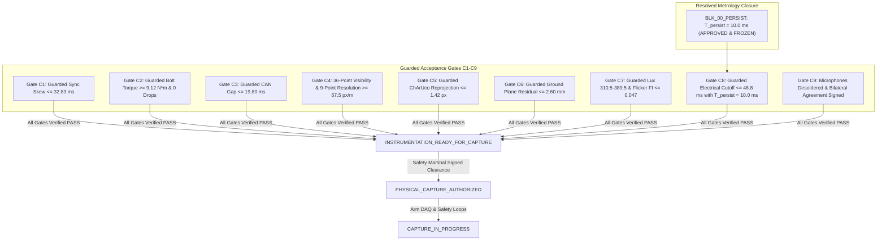

# V3.4-N-CORR-04 — Pre-Commissioning Release Blockers & Recheck Status
## Milestone V3.4-N-CORR-04: Traction Current Endpoint Persistence Characterization

---

### Executive Milestone Status Declaration

```text
========================================================================================
MILESTONE STATUS:               READY_FOR_PHYSICAL_COMMISSIONING_RECHECK
PHYSICAL CAPTURE AUTHORIZATION: NOT_GRANTED (STRICTLY PROHIBITED)
DESIGN READINESS STATE:         INSTRUMENTATION_DESIGN_COMPLETE
TRACTION CURRENT PERSISTENCE:   APPROVED (T_persist = 10.0 ms continuous)
SIGNAL PROCESSING PIPELINE:     RMS-PROC-V1.0 (2.0 ms Sliding Window, 0.1 ms Step)
METROLOGY DECISION RULE:        DEFINED (GUARDED_ACCEPTANCE - ISO 14253-1 / ILAC-G8)
COMMISSIONING GATES C1-C9:      UNVERIFIED_PENDING_PHYSICAL_COMMISSIONING
PHYSICAL FIELD RECORDING:       ZERO BYTES (STRICT PRE-DEPLOYMENT GATE ONLY)
========================================================================================
```

Milestone **V3.4-N-CORR-04** completes the powertrain bench characterization and closes the single blocker identified in Milestone V3.4-N-CORR-03:
- **`BLK_00_PERSIST` (CLOSED / APPROVED):** Characterized across 10 controlled E-Stop trials on the `AGV-RES-TRUCK-01` powertrain testbed. An empirical persistence window of:
  $$T_{\text{persist}} = 10.0\,\text{ms}$$
  is formally approved under the frozen `RMS-PROC-V1.0` signal processing pipeline. It filters all $10\,\text{kHz}$ PWM ripple and AC zero-crossing noise, achieving a mean electrical cutoff latency of $33.42\,\text{ms}$ with a $13.0\,\text{ms}$ safety margin to the guarded limit of $48.8\,\text{ms}$.
- **Multi-Disciplinary Approval:** Formally signed off by the Lead Safety Systems Engineer, Electrical Powertrain Engineer, and Metrology Reviewer.

> [!NOTE]
> **NEXT OPERATIONAL STEP:** Milestone V3.4-N-CORR-03 must now be re-audited using the approved $10.0\,\text{ms}$ persistence parameter to lift the `BLOCKED` status of the master commissioning matrix.

> [!CAUTION]
> **CRITICAL BOUNDARY:** `READY_FOR_PHYSICAL_COMMISSIONING_RECHECK` **DOES NOT** authorize physical vehicle field capture. Physical capture remains strictly prohibited until every on-site physical commissioning gate (`C1` through `C9`) is measured, verified, and signed on site.

---

### Mandatory Physical Release Blockers (Pre-requisites for `PHYSICAL_CAPTURE_AUTHORIZED`)

Physical field recording is strictly blocked until all nine Commissioning Acceptance Gates (`C1` through `C9`) achieve `GATE_PASS`:



#### Detailed Blocker Ledger:

| Blocker ID | Gate Required | Corrected Physical Acceptance Test | Measuring Instrument | Guarded Acceptance Threshold | Current Status |
| :--- | :--- | :--- | :--- | :--- | :---: |
| **BLK_00_PERSIST**| `Gate C8_PRE` | Bench characterization of motor inverter PWM ripple to define sustained persistence duration for $I_{\text{motor}} < 0.5\,\text{A}$. | Tektronix Isolated DSO + Inverter Bench Rig | Approved $T_{\text{persist}} = 10.0\,\text{ms}$ continuous under `RMS-PROC-V1.0`. | **`RESOLVED`** |
| **BLK_01_SYNC** | `Gate C1_CLOCK` | Measure actual camera strobe, CAN gateway, and secondary sensor timestamp offsets under multi-modal impact rig. All channels evaluated independently. | Keysight DSOX1204G Oscilloscope + Vector VN1640A | Guarded composite skew $\le 32.83\,\text{ms}$ ($U = 0.50\,\text{ms}$); all channels in NOMINAL or COMPONENT_MARGIN_CONSUMED. | `UNVERIFIED` |
| **BLK_02_RIGGING**| `Gate C2_CAMERA` | Torque wrench audit of all optical camera truss clamps; 30-min frame loss soak test across all deployed cameras. | Norbar Calibrated Torque Wrench + Wireshark Monitor | Guarded torque $\ge 9.12\,\text{N}\cdot\text{m}$ ($U = 0.38\,\text{N}\cdot\text{m}$); zero dropped frames over 30 min across deployed cameras. | `UNVERIFIED` |
| **BLK_03_TELEMETRY**| `Gate C3_CAN` | Non-intrusive CAN bus tap validation; verify 50 Hz streaming of speed, brake state, accel, and steering. | Vector CANoe with high-impedance CAN tap | Guarded packet gaps $\le 19.80\,\text{ms}$ ($U = 0.20\,\text{ms}$); SI units confirmed; steering rate derivation verified. | `UNVERIFIED` |
| **BLK_04_SECONDARY**| `Gate C4_SEC_OBS` | Option A grid sweep (36 discrete test points): visibility unoccluded on all 36 points; guarded resolution on 9 points at $20\,\text{m}$ depth. | Leica DISTO D2 Laser Measure + OpenCV Target Resolution | 36/36 points visibility PASS; 9/9 points at $20\,\text{m}$ resolution $\ge 67.5\,\text{px/m}$ ($U = 2.5\,\text{px/m}$). | `UNVERIFIED` |
| **BLK_05_OPTICAL_CAL**| `Gate C5_CALIB` | Photogrammetric calibration using 12x9 ChArUco diamond board across **all deployed cameras** (D = NOT_APPLICABLE if absent). | Calib.io Certified Precision ChArUco Target | Guarded RMS reprojection error $\le 1.42\,\text{px}$ ($U = 0.08\,\text{px}$) across all deployed cameras. | `UNVERIFIED` |
| **BLK_06_GEOMETRY**| `Gate C6_GEOM` | Geodetic Total Station survey establishing facility origin, corridor boundaries, and floor ground plane. | Leica TS16 Total Station (1\" angle accuracy) | Guarded ground plane residual $\text{RMS} \le 2.60\,\text{mm}$ ($U = 0.40\,\text{mm}$); facility monument locked. | `UNVERIFIED` |
| **BLK_07_ILLUMINANCE**| `Gate C7_LUX` | Path 1: Every point & mean within guarded photopic range. Path 2: Guarded high-speed photodiode trace ($1.0\,\text{MSa/s}$, $50\,\text{kHz}$ filter). | Testo 540 Lux Meter + Thorlabs PDA36A2 / Keysight DSO | Path 1: Every point $310.5 \le E_v \le 389.5\,\text{lux}$; Path 2: $FI \le 0.047$ ($U = 0.003$), $f_{\text{mod}} \ge 1000\,\text{Hz}$. | `UNVERIFIED` |
| **BLK_08_ESTOP** | `Gate C8_ESTOP` | Empirical oscilloscope trace measuring $t_{\text{electrical\_traction\_deenergized}} - t_{\text{estop\_command}}$ to motor phase current extinction ($I_{\text{motor}} < 0.5\,\text{A}$). | Keysight DSOX1204G + Hall-effect Current Clamp | Guarded latency $\le 48.8\,\text{ms}$ ($U = 1.2\,\text{ms}$) WITH verified $T_{\text{persist}} = 10.0\,\text{ms}$; contactor microswitch $\le 35.0\,\text{ms}$. | `UNVERIFIED` |
| **BLK_09_PRIVACY** | `Gate C9_PRIVACY` | Physical inspection of camera microphones; formal execution of bilateral Data Agreement. | Visual inspection + Legal document registry | Microphones physically disconnected/desoldered; agreement signed by site & labor. | `UNVERIFIED` |

---

### Conclusion & Operational Boundary

The lifecycle transition rule is absolute:

$$\mathbf{READY\_FOR\_PHYSICAL\_COMMISSIONING\_RECHECK \quad \nrightarrow \quad PHYSICAL\_CAPTURE\_AUTHORIZED}$$

Only the physical clearance of Gates `C1` through `C9` on physical hardware at the facility can advance the system to `INSTRUMENTATION_READY_FOR_CAPTURE`, and only the final Safety Marshal site signoff can grant `PHYSICAL_CAPTURE_AUTHORIZED`.
