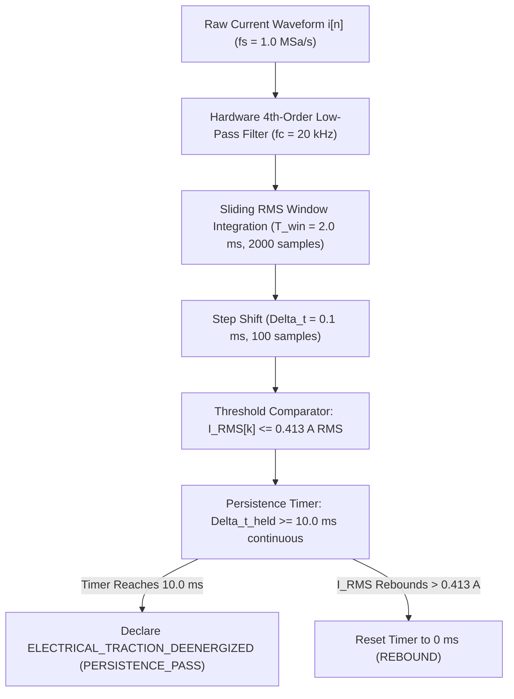

# V3.4-N-CORR-04 — Traction Current Persistence Measurement Protocol

## Milestone V3.4-N-CORR-04: Traction Current Endpoint Persistence Characterization

---

### 1. Testbed Configuration & Scope

This protocol specifies the exact physical setup, instrument configuration, calibration procedure, and signal processing pipeline to measure and verify the persistence of `ELECTRICAL_TRACTION_DEENERGIZED` on the research vehicle testbed:

```text
========================================================================================
VEHICLE PLATFORM:               AGV-RES-TRUCK-01 (48V PMSM Electric Industrial Truck)
INVERTER CONTROLLER:            Curtis 1238E-5421 / Sevcon Gen4 Size 4 (10 kHz PWM)
PRIMARY INSTRUMENT:             Keysight DSOX1204G (4 Ch, 70 MHz, 1.0 MSa/s)
CURRENT TRANSDUCER:             Tektronix TCP303 Current Probe + TCPA300 Amplifier
MEASUREMENT LOCATION:           Motor Stator Phase U Conductor
SIGNAL PROCESSING PIPELINE:     RMS-PROC-V1.0 (2.0 ms Sliding Window, 0.1 ms Step)
APPROVED PERSISTENCE WINDOW:    T_persist = 10.0 ms continuous
GUARDED THRESHOLD:              I_guarded <= 0.413 A RMS (Nominal 0.500 A, U = 0.087 A)
========================================================================================
```

---

### 2. Instrument Setup & Calibration Calibration Procedure

#### 2.1 Oscilloscope Channel Allocation
- **Channel 1 (Trigger Edge):** E-Stop Wireless Safety Receiver NC Output (24VDC to 0VDC).
  - Probe: 10:1 Passive Voltage Probe (Keysight N2862B).
  - Trigger: Falling edge at 12.0 V, single-shot trigger mode.
- **Channel 2 (Contactor Status):** Main Traction Contactor Auxiliary Microswitch (24VDC to 0VDC).
  - Probe: 10:1 Passive Voltage Probe (Keysight N2862B).
- **Channel 3 (Traction Current):** Motor Stator Phase U Conductor.
  - Probe: Tektronix TCP303 Hall-effect AC/DC current clamp coupled to TCPA300 amplifier.
  - Scale: $0.1\,\text{V/A}$ ($10\,\text{A/V}$ setting on scope).
  - Vertical Sensitivity: $100\,\text{mV/div}$ ($1.0\,\text{A/div}$).
- **Channel 4 (Brake Coil Control):** Mechanical Brake Solenoid Coil Voltage (24VDC to 0VDC).
  - Probe: 10:1 Passive Voltage Probe.

#### 2.2 Probe Degaussing and Zero-Offset Nulling
Prior to every test sequence:
1. Ensure no current flows through the Phase U conductor (inverter keyed off).
2. Lock probe clamp around Phase U conductor with jaw fully seated and latched.
3. Depress the **DEGAUSS** button on the TCPA300 amplifier front panel.
4. Adjust the **BALANCE** trim potentiometer until oscilloscope Channel 3 DC baseline measures $0.0\,\text{mV} \pm 2.0\,\text{mV}$ ($0.0\,\text{A} \pm 0.02\,\text{A}$).
5. Record residual baseline noise floor ($u_{\text{noise}} \le 25\,\text{mA}$).

---

### 3. Signal Processing Pipeline Specification (`RMS-PROC-V1.0`)

To prevent instantaneous zero-crossings or high-frequency PWM switching ripples from triggering false de-energization, raw current waveforms are processed through the frozen `RMS-PROC-V1.0` pipeline:



#### 3.1 Mathematical Definitions
- **Discrete Sampling:** Phase current is digitized at $f_s = 1.0\,\text{MSa/s}$ ($T_s = 1.0\,\mu\text{s}$).
- **Sliding RMS Formula:** Over a window of $N = 2000$ samples ($T_{\text{window}} = 2.0\,\text{ms}$):
  $$I_{\text{RMS}}[k] = \sqrt{\frac{1}{N} \sum_{m=0}^{N-1} i^2[k \cdot M - m]}$$
  where $M = 100$ samples ($0.1\,\text{ms}$ step shift), providing $95\%$ frame overlap.
- **Continuous Persistence Rule:**
  $$\mathbf{PERSISTENCE\_PASS} \iff \forall t \in \left[t_{\text{stable}} - 10.0\,\text{ms},\; t_{\text{stable}}\right],\; I_{\text{RMS}}(t) \le 0.413\,\text{A}$$
  within total latency:
  $$\Delta t_{\text{electrical}} = t_{\text{stable}} - t_{\text{estop\_command}} \le 48.8\,\text{ms}$$

---

### 4. Step-by-Step Test Procedure

1. **Pre-Test Safety Audit:**
   - Elevate vehicle drive chassis on certified mechanical jack stands so drive wheels are suspended and rotate freely without ground traction.
   - Post exclusion perimeter tape ($3.0\,\text{m}$ radius) around vehicle drive axle.
   - Verify emergency manual battery disconnect switch is within immediate reach of safety operator.
2. **Drive Arming:**
   - Key on vehicle; verify 48V main contactor closes.
   - Spin drive motor to target operating speed/torque using external diagnostic service console (e.g. $60\,\text{Hz}$ electrical frequency, $50\%$ rated torque).
3. **E-Stop Initiation:**
   - Depress wireless remote E-Stop push button.
   - DSO triggers single-shot acquisition on Channel 1 falling edge ($t = 0.0\,\text{ms}$).
4. **Data Acquisition & Analysis:**
   - Export raw 4-channel CSV waveform (duration $\ge 200\,\text{ms}$, from $-20\,\text{ms}$ pre-trigger to $+180\,\text{ms}$ post-trigger).
   - Execute `RMS-PROC-V1.0` script on recorded Phase U current trace.
   - Verify that:
     1. $I_{\text{RMS}}$ drops below $0.413\,\text{A}$.
     2. Current remains continuously $\le 0.413\,\text{A}$ for $\ge 10.0\,\text{ms}$.
     3. Total elapsed time $t_{\text{stable}} \le 48.8\,\text{ms}$.
     4. Contactor auxiliary contact opened within $\le 35.0\,\text{ms}$.
5. **Decoupled Verification:**
   - Independently confirm high-voltage DC bus discharge ($V_{\text{bus}} < 50\,\text{V}$) is measured on a separate high-voltage probe channel and NOT inferred from motor current.
   - Independently verify mechanical brake pad engagement via caliper displacement sensor.

---

### 5. Provenance & Artifact Storage

Every characterization and acceptance run generates:
- Raw oscilloscope trace: `evidence/estop/trace_run_<ID>.csv`
- Processed sliding RMS profile: `evidence/estop/rms_profile_<ID>.json`
- Oscilloscope screen capture: `evidence/estop/scope_capture_<ID>.png`
- Operator and Metrologist signed acceptance sheet: `evidence/estop/signoff_<ID>.pdf`
